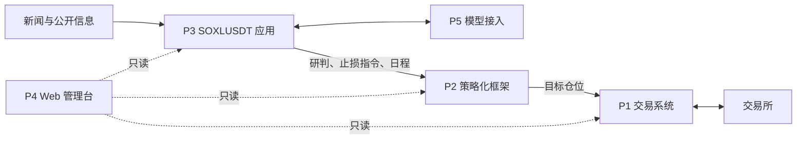

# Factorforge

Factorforge 是一个以事件和消息面为输入的量化交易系统，面向永续合约。系统读取新闻与公开信息，形成带方向和信心的判断，经过可追溯的情绪账本合成为目标仓位，再由独立的交易层负责下单、止损保护、账务与恢复。

> 本项目是研究与工程用的软件，不构成投资建议。仓库默认只运行模拟环境；任何实盘使用都需要自行评估风险、完成准入和标定。

## 架构

系统分为四层。层是抽象的依赖层级，只规定哪一层可以使用哪一层；一层可以有多个模块和多份式样书。层、模块和式样书登记在 [doc/layers.json](doc/layers.json)，`go run ./tools/check-layout` 按它检查目录和导入。

| 层 | 模块 | 作用 |
|---|---|---|
| **L1 交易层** | P1 交易系统 | 行情、订单、双层止损保护、账户风控、账务、对账与故障恢复。不依赖任何其他层，可单独使用 |
| **L2 策略层** | P2 策略化框架 | 事件准入、逐笔情绪账本与衰减、基线/研判/预排分量合成、目标仓位、风险批次、案例与参数学习 |
| **L3 应用层** | P3 SOXLUSDT 应用 | 一个交易对象的具体应用：新闻研判、止损与仓位管理、预排日程 |
| **L4 运维层** | P4 Web 管理台、P5 模型接入 | 只读的观察与追溯界面；模型账户登录与文本生成 |

下层不依赖上层。运维层读取其他层公开的只读接口；其中的服务型模块（P5）以登记的进程协议被应用层调用，代码不被导入。



几个基本原则：

- **方向来自信息，不来自历史价格**：历史 K 线只用来估计正常波动和设置止损，不用来判断方向。
- **每一笔影响都可追溯**：每个事件对仓位的影响记在情绪账本上，衰减、兑现和修订都有记录。
- **交易层是最终防线**：上层只给出目标仓位和止损指令；风险检查、保护和账务都由交易层负责，上层故障不会让持仓失去保护。
- **模拟与实盘共用一套执行规则**：模拟盘与实盘走同一条交易所执行路径，另有内部撮合用于测试与回放。

## 文档

- [文档索引](doc/README.md)：每份式样书（原理与验收）配一本设计书（实现逻辑）。
- [构建、测试与运行](doc/engineering/DEVELOPMENT.md)
- [仓库结构与模块边界](doc/engineering/REPOSITORY_LAYOUT.md)
- [交易层应急与恢复预案](doc/engineering/TRADING_RECOVERY_RUNBOOK.md)
- [贡献与版本规则](CONTRIBUTING.md)

## 快速开始

需要 Go（版本见 `go.mod`）和本地 PostgreSQL；P4 前端需要 Node.js 与 pnpm，P5 需要 Node.js 与 Bun。

```sh
go run ./tools/init-private-config   # 生成被 Git 忽略的本地配置
go run ./tools/check-layout
go test ./...
go run ./tools/build-trading         # P1
go run ./tools/build-strategy        # P2
```

各模块的配置和启动方式见 [构建、测试与运行](doc/engineering/DEVELOPMENT.md)。

## 配置

- 配置写在本地的 `config/config.toml`，提示词写在 `prompts/` 下的本地文件；两者都被 Git 忽略，仓库提供模板 `config/config.example.toml` 和 `prompts/prompts.example.json`。
- 样例文件中的数值只用来说明格式，不是推荐值。

## 版本

版本号为 `主.次.修订`，当前版本见 [VERSION](VERSION)，发布记录见 [releases.json](doc/releases.json) 和 GitHub Releases。规则见 [CONTRIBUTING](CONTRIBUTING.md)。

## 许可

代码与文档采用 [MIT](LICENSE) 许可证。引用和改编的第三方代码见 [THIRD_PARTY_NOTICES](THIRD_PARTY_NOTICES.md)。安全问题请按 [SECURITY](SECURITY.md) 报告。
