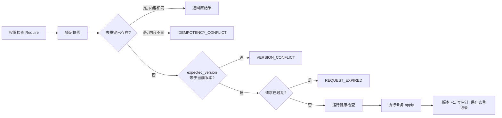

# 交易系统层设计书

版本：2.21.0

对应式样书：[01_交易系统层式样书](01_交易系统层式样书.md)。源码在 `src/factorforge/trading`，测试在 `tests/trading`。文中出现的数值都是示意值，实际取值由各运行的私有配置登记。

## 1 结构

### 1.1 包

| 包 | 职责 |
|---|---|
| `domain` | 运行聚合（`Aggregate`）及其规则：风险授权、保护、账务、盈亏、执行租约、字段约束 |
| `application` | 命令管线、目标推进、行情写入、对账与恢复、交易所事实同步 |
| `workers` | 后台循环：执行器、保护维护、交易所回报读取、行情采集 |
| `adapters/postgres` | 单行事务存储与投影表 |
| `adapters/binance` | 交易所签名请求、行情、条件单、只读账户 |
| `adapters/sim` | 内部撮合（测试与回放） |
| `adapters/health` | 磁盘、时钟、审计容量、执行队列检查 |
| `adapters/isolation` | 签名进程的受控出站通道 |
| `adapters/configuration` | 读取私有 TOML 配置 |
| `api` | HTTP 接口与 OpenAPI |
| `entrypoints/*` | 各进程入口 |

### 1.2 进程

```mermaid
flowchart TB
  subgraph 公共
    API[trading-api<br/>HTTP 接口]
    COL[market-collector<br/>行情采集]
  end
  subgraph 执行（二选一）
    VEX[execution-sim / execution-live<br/>交易所执行器]
    REP[replay-executor<br/>内部撮合]
  end
  DB[(PostgreSQL<br/>每账户一行快照 + 投影表)]
  API --> DB
  COL -->|HTTP 写行情快照| API
  VEX --> DB
  REP --> DB
  VEX <-->|签名请求| EX[交易所]
  COL -->|公开行情| EX
```

- **`trading-api`**：受理全部命令和查询。它的配置里不能有交易所密钥（`ValidateAPI` 检查到 `exchange_api_key` 或 `exchange_api_secret` 时拒绝启动，见第 10 章）。
- **`market-collector`**：按轮次读取公开行情，经 `trading-api` 写入行情快照（第 4 章）。
- **执行器**：模拟盘和实盘都由 `entrypoints/venueexec` 运行，`execution-sim` 与 `execution-live` 只是绑定的环境不同（第 8 章）。`replay-executor` 只处理内部撮合的运行（第 9 章）。

## 2 运行聚合与存储

### 2.1 聚合

一个账户的全部交易状态保存在一个 `Aggregate` 里，包括：

- 运行身份 `RunKey`（环境、账户、运行编号）、状态、版本号和时钟。
- 账户策略 `AccountPolicy`（第 5 章）和撮合模型 `SimConfig`（第 9 章）。
- 品种规则 `Specs`、行情点 `Points`、K 线、最新成交。
- 持仓、订单、保护、成交、资金流水。
- 归属（`Owners`、`OwnerEpochs`）和目标（`Targets`）。
- 执行队列 `Outbox`，以及去重记录、审计、告警和风险锁。
- 执行租约。

运行状态 `State` 的取值：

| 状态 | 含义 |
|---|---|
| `NORMAL` | 正常交易 |
| `DEGRADED` | 有持仓的保护不完整，禁止加仓 |
| `RISK_LOCKED` | 风险锁生效 |
| `RECOVERY_CHECK` | 等待对账核清 |
| `STOPPED` | 紧急停止，不会自动解除 |

`ExecutionMode` 取 `REPLAY`、`SHADOW` 或 `LIVE`：

- `REPLAY` 和 `SHADOW` 都是内部撮合的运行，`SHADOW` 只记录不撮合。
- 连接交易所账户的运行（模拟盘与实盘）都是 `LIVE`，即 `VenueBacked()` 为真。

所有金额和数量都用 28 位精度的十进制运算（`domain/decimal`），不使用浮点数。

### 2.2 事务

`Store.Transaction(key, apply)` 是唯一的写入口（`adapters/postgres/store.go`），每次事务的步骤如下：

1. 对该账户的 `trading_run` 行加 `FOR UPDATE` 锁并读入快照，同时核对审计序号连续，否则返回 `AUDIT_MUTATION_FORBIDDEN`。
2. 在内存里执行 `apply`，再对整个聚合做字段约束校验。
3. 内容没有变化就什么都不写：序列化结果与读入时逐字节相同、没有新审计、没有待写 K 线时直接返回。执行器空闲轮询、无需续期的租约检查都走这条路。
4. 有变化时，只重写变化过的投影行，新审计追加到 `audit_event`，新完成的 K 线追加到 `market_candle`，最后更新快照行。

补充说明：

- **投影表**：订单、成交、保护、持仓、去重记录等都投影成独立的表（`Relations` 列表），便于查询和审计。
- **只追加的表**：`command_dedup` 与 `market_trade` 只插入、不覆盖。
- **审计不可篡改**：`audit_event` 由数据库触发器禁止修改和删除。
- **快照外被改过时**：如果快照行在应用之外被改动过（`snapshot_text` 与 `payload` 不一致），下一次事务会整份重写投影。

SIM 与 LIVE 使用不同的数据库 schema 和角色，`Store.Environment()` 必须与执行器的环境一致，否则返回 `EXECUTOR_ENVIRONMENT_MISMATCH`。

## 3 命令管线

所有写操作都经过 `Service.Command`（`application/commands.go`）：



- **去重先于版本检查**：已确认过的重试即使状态已经前进，也能拿回原来的受理结果。
- **去重键**：`principal_id` + `idempotency_key`，内容指纹是动作、命令和载荷的哈希。
- **去重记录的保留**：保存到命令过期时刻之后 24 小时（`CommandDedupRetention`），过期后由 `retainDedup` 清理；建运行的记录永久保留。
- **权限**：使用者的权限来自配置的 `permissions`，命令所需权限见第 11 章的接口表。
- **身份**：主体身份由 `principal_id` 与 `account_id` 组成，只能操作自己账户的运行。
- **拒绝也留痕**：经 HTTP 接口认证、且能找到绑定运行的请求被拒绝时，另记一条 `REQUEST_REJECTED` 审计（`RecordRejection`）。未认证的请求和直接调用应用服务的拒绝不记录；记录失败不影响原来的拒绝结果。

建运行（`CreateRun`）只接受 SIM 环境。初始现金同时作为日初净值和峰值净值，执行世代从 1 开始。

## 4 行情

### 4.1 采集

`workers/Collector` 每轮读取以下数据：

- 标记价、买卖价等最新行情点（`LatestPoints`），以及资金费观测。
- 最近成交，最多 `trade-limit` 条。
- 指定周期的已完成 K 线，回看 `lookback-seconds`。
- 可选：用 `--reference-funding` 每 10 分钟读一次真实盘公开的资金费结算记录（第 7.3 节）。

数据组成一份行情快照，通过 `trading-api` 写入。行情快照与执行器争用同一行：

- 版本冲突时，采集器重新读取版本，最多重试 `CollectorConflictAttempts` 次。
- 快照时刻早于运行时钟（`MARKET_CLOCK_INVALID`，连接交易所的运行里执行器会推进时钟）时，取新的时刻重设快照时间，再提交一次。

内部撮合的运行同时指定 `--sim-capabilities` 和 `--sim-frames`（只允许 SIM）时，每份快照之后再提交一帧撮合（第 9 章）。

### 4.2 写入规则（`IngestSnapshot`）

- **时钟只前进**：快照时刻不能早于运行时钟。跨过风险日边界时，把当前权益记为新的日初净值，外部资金流清零（风险日由 `risk_day_zone` 时区决定）。
- **行情点**：必须匹配当前品种规则版本，且可用时间不晚于快照时刻；同一种类的行情点不能倒序。
- **K 线**：
  - 只接受已完成的。
  - 同一根 K 线内容不同时，必须带更高的修订号。
  - 例外：同一来源在收盘后 1 小时内（`CandleCorrectionWindow`）重报的修订号为 0 的 K 线，自动记为下一修订号，并列入 `revised_candles`。
  - 快照里只保留 7 天（`CandleRetention`），历史留在 `market_candle` 表。
- **最近成交**：只保留最近 1 小时、每个品种最多 1000 条（`MarketTradeLimit`）。同一成交编号内容不一致时拒绝，返回 `MARKET_TRADE_ID_CONFLICT`。
- **缺口与交叉**：
  - 相邻 K 线首尾不接时，该品种的行情点全部标为 `MISSING`，并告警 `CANDLE_GAP`。缺口只对本次快照里出现的品种和周期检查；只含行情点的快照不重新检查，新的有效行情点会覆盖原来的 `MISSING`。
  - 买价高于卖价时，两者都标为 `CONFLICT`。
- **最后检查**：快照写入后检查账户闸门（第 5.3 节）；算不出权益时，加入运行问题 `ACCOUNT_MARK_UNAVAILABLE`。

### 4.3 可用价格（`Quote`、`Mark`）

一个行情点要同时满足以下条件才可用：

- 质量为 `VALID`。
- 可用时间不晚于运行时钟。
- 规则版本与当前品种一致，币种为报价币种，种类在品种的 `price_roles` 里。
- 观测距今不超过 `max_market_age_seconds`。

否则授权失败，返回 `MARKET_DATA_UNUSABLE`；标记价不可用时返回 `ACCOUNT_MARK_UNKNOWN` 或 `ACCOUNT_MARK_STALE`。

### 4.4 品种规则

品种规则 `InstrumentSpec` 由采集器从交易所的品种信息生成并登记（`RegisterSpec`），字段如下：

- 身份：`key`、`version`、`valid_from`。
- 价格与数量：`price_tick`、`quantity_step`、`contract_multiplier`、`min_notional`。
- 币种：`quote_currency`、`settlement_currency`。
- 能力：`capabilities`，例如 `MARKET`、`LIMIT`、`REDUCE_ONLY`、`SHORT`、`CONDITIONAL_PROTECTION`。
- 价格种类：`price_roles`，即允许作为触发和估值的种类。
- 交易时段：`sessions`。值为 `null` 表示不限时段；空数组表示没有任何交易时段，始终不可交易。
- 停牌：`halted`。
- 分组：`risk_group`，用于分组名义上限。
- 保证金分档：`margin_tiers`，每档为（名义上限，维持保证金率）。

登记规则的限制：同一版本内容不同时拒绝；有持仓或未完成订单时不能改合约乘数；有未完成订单时切换规则版本，运行转为 `RECOVERY_CHECK`。

规则缺失、版本不一致或尚未生效时，任何增险都返回 `INSTRUMENT_RULES_UNVERIFIED`。报价币种与结算币种不同的品种暂不支持增险，返回 `ACCOUNTING_CAPABILITY_UNVERIFIED`。

## 5 风险授权

### 5.1 账户策略

账户策略 `AccountPolicy` 在建运行时登记：

- **版本**：`version` 是策略版本。目标请求必须带同一版本，否则返回 `TARGET_RULE_VERSION_MISMATCH`。`valid_from` 晚于运行时钟时，策略尚未生效。
- **风险日**：由 `risk_day_zone` 决定日损益的起点。
- **上限**：
  - `notional_limit`：账户名义总上限，按每个品种在最不利成交路径上的最大绝对名义求和。
  - `margin_limit`：保证金上限，与当前权益取小者。
  - `trade_loss_limit`：单笔开仓的最大可能损失。
  - `net_notional_limit`：可选，净名义上限。
  - `group_notional_limits`：可选，按品种的 `risk_group` 分组的名义上限。
  - `stress_scenarios`：可选，压力情景（第 5.2 节）。
- **三道闸门**：`daily_loss`、`drawdown`、`consecutive_loss`（第 5.3 节）。
- **触限处置**：`breach_action`，见第 5.3 节。`recovery_policy` 目前只有 `MANUAL_RECONCILE`，即恢复必须人工对账。
- **行情时效**：`max_market_age_seconds`，见第 4.3 节。
- **保险止损**：`insurance_stop_fraction`、`insurance_trigger_kind`、`insurance_quality_state`，见第 6.2 节。
- **运行健康**：`operational`，见第 10.2 节。

### 5.2 开仓授权（`AuthorizeOrder`）

所有订单都先做第 1 项检查；只减仓订单之后只做下文的数量检查，其他订单依次做全部检查。任一项失败即拒绝：

1. **品种与订单本身**：
   - 品种规则有效，报价币种等于结算币种。
   - 订单类型在品种能力内。
   - 数量符合 `quantity_step`，限价符合 `price_tick`。
   - 归属不冲突：同一品种已有其他归属者时返回 `OWNER_CONFLICT`。
2. **只算新开部分**：用 `OpeningQuantity` 拆出订单里新开的数量（反手时只算越过零的部分）。新开为零即是纯减仓，直接通过。
3. **运行状态**：
   - 没有未完成的条件单清理任务。
   - 品种在交易时段内。
   - 运行健康检查是在本时钟内完成且无问题的（第 10.2 节）。
   - 做空时品种有 `SHORT` 能力。
   - 运行处于 `NORMAL` 且没有风险锁。
   - 没有结果未知的订单。
   - 每个非零持仓都处于受保护状态（否则返回 `POSITION_UNPROTECTED` 或 `POSITION_INSURANCE_ONLY`）。
4. **保护计划**：必须带保护计划，且品种有 `CONDITIONAL_PROTECTION` 能力。按成交后的预期持仓和预期均价校验计划（第 6.3 节）；交易所条件单模式的覆盖数量不能小于新开数量。
5. **单笔风险**：
   - 敞口价 = max（成交侧报价，标记价，限价）×（1 + `slippage_bps`/10000）。
   - 费用准备 = 名义 ×（2 × `fee_rate` + 计划的 `max_slippage_bps`/10000）。
   - 止损距离：交易所条件单模式用 |入场价 − 触发价|；上层管理模式用 |入场价 − 管理价| + 余量。
   - 订单总数量 × 敞口价 × 合约乘数低于 `min_notional` 时，返回 `MIN_NOTIONAL_NOT_MET`。
   - 新开数量 × 距离 × 合约乘数 + 费用准备，超过 `trade_loss_limit` 时返回 `TRADE_RISK_LIMIT`。
6. **账户上限**：
   - 按最不利路径计算全部敞口，超过 `notional_limit` 返回 `ACCOUNT_NOTIONAL_LIMIT`。
   - 总名义 / `leverage` + 手续费，超过 min（`margin_limit`，权益）返回 `ACCOUNT_MARGIN_LIMIT`。
   - 品种有保证金分档时，敞口超出最高档返回 `MARGIN_TIER_UNVERIFIED`。
7. **组合约束（`CombinationRisk`）**：
   - 净名义：所有品种最不利路径下的净名义，不得超过 `net_notional_limit`。
   - 分组名义：每个 `risk_group` 的合计不得超过 `group_notional_limits` 中的对应值。
   - 压力情景：每个 `stress_scenarios` 情景（`scenario_id`）对每个品种施加冲击 `shocks`，再加退出成本 `exit_cost_rate`，最坏损失不得超过 `loss_limit`。情景缺少某个持仓品种的冲击值时，返回 `STRESS_SCENARIO_INCOMPLETE`。

只减仓的订单在第 1 项之后只检查一件事：数量（含同品种其他未完成的只减仓订单）不超过实际持仓，且方向相反。否则返回 `REDUCTION_NOT_PROVEN`。

“最不利路径”（`exposureEnvelope`）的算法：把每个品种的实际持仓，加上所有未终结、非只减仓订单可能成交的方向，分别累加成上下两个边界，每个品种取两者中绝对值较大的一个。这样原持仓和反手的全部成交不会被重复当作两份新敞口，也不会用净额隐藏风险。

### 5.3 账户闸门（`AssessLossGates`）

写入行情快照、内部撮合帧、资金流水，以及交易所回报同步（非恢复模式）之后执行。成交入账本身（`ApplyFill`、`MergeOrder`）不执行闸门，交易所成交要等下一次回报同步：

1. **被动超限**：当前敞口超过 `notional_limit`、保证金超限或组合约束超限时，加上 `PASSIVE_...` 风险锁并告警。
2. **更新峰值净值**：峰值净值取历史最大权益。划转入账时，划转金额同时计入当日外部资金流和峰值净值，所以提款会降低记录的峰值。
3. **计算闸门**：
   - 日亏损 = 日初净值 − 当前权益 + 当日外部资金流（不低于 0）。
   - 回撤 = 峰值净值 − 当前权益。
   - 连续亏损次数：在持仓周期完全平掉时更新，周期净值为负则 +1，否则清零（第 7.1 节）。
4. **判断触发**：闸门 `LossGate` 的阈值：日亏损和回撤可以设金额 `amount` 或比例 `fraction`（相对日初或峰值净值），不能设次数；连续亏损只能设次数 `count`。设定的阈值任一达到即触发。
   - `mode` 为 `OBSERVE`：只把闸门名记入 `WouldTrigger`。
   - `mode` 为 `ENFORCE`：加风险锁，运行转为 `RISK_LOCKED`。

有风险锁时执行触限处置（`ApplyBreachAction`），按 `breach_action`：

- `KEEP_PROTECTION`：只保留保护，不动持仓。
- `ORDERLY_REDUCE` 与 `EXIT_WHEN_TRADABLE`：目前处理相同，依次是：
  1. 所有目标标为 `BLOCKED`（理由 `ENFORCED_ACCOUNT_EXIT`）。
  2. 撤销所有增险订单。
  3. 对没有挂单的持仓下一笔只减仓市价单（记入 `EmergencyOrders`）。不在交易时段的品种先告警 `EXIT_WAIT_TRADABLE`，等可交易后再下。

## 6 目标、订单与保护

### 6.1 目标持仓（`SetTarget`、`AdvanceTargets`）

目标请求带以下信息：归属者、品种、目标版本、目标数量、归属世代 `owner_epoch`、策略和规则版本、过期时刻、来源决策编号，以及可选的保护计划。

受理时检查：

- 规则版本和策略版本与当前一致。
- 归属世代未变。外部改仓或强平会使世代 +1，旧目标自动作废。
- 目标版本必须递增，否则返回 `TARGET_VERSION_CONFLICT`。

受理时的处理：

- 目标数量按数量步长向零取整。
- 没给保护计划时，沿用旧目标的计划；旧目标也没有时，沿用同方向持仓当前的计划。

目标数量与旧目标相同时：

- 不产生任何订单。
- 只有计划变了：交易所条件单模式替换上层止损，上层管理模式校验并记录声明（理由分别是 `PROTECTION_ONLY_UPDATED`、`MANAGED_DECLARATION_RECORDED`）。
- 计划也没变：理由为 `TARGET_INTENT_UNCHANGED`，未完成订单改挂到新目标版本，不撤换。

目标数量不同时，调用 `AdvanceTargets`。执行器每轮也会调用它（第 8.2 节）：

1. **作废条件**：归属世代变化、目标过期、规则版本不符时，目标标为 `BLOCKED`。
2. **旧版本订单**：先撤销所有属于旧版本的未完成订单，等撤单确认（理由 `WAIT_PREVIOUS_CANCEL_CONFIRMATION`）。
3. **有挂单就等**：本版本还有未完成订单时，等它完成。
4. **被拒就停**：本版本有订单被拒时，目标 `BLOCKED`（`TARGET_ORDER_REJECTED`）。
5. **计算差额**：差额 = 目标 − 实际，按步长取整。
   - 差额与实际持仓异号、且绝对值不超过持仓时，是只减仓订单。
   - 方向相反时，是一笔反手（理由 `REVERSAL_SINGLE_ORDER`）。
6. **下单**：用市价单、GTC，按第 5.2 节授权。授权失败时：受理目标时的首次推进直接返回错误，整笔目标请求回滚；执行器每轮的推进则把目标标为 `BLOCKED` 并记下拒绝码。通过后生成订单，放入执行队列。订单记下授权时的实际持仓和归属世代，供执行器派发前复核（第 8.2 节）。

### 6.2 保险止损

保险价由 `InsurancePrice` 计算：

- 多头：均价 ×（1 − `insurance_stop_fraction`），按 `price_tick` 向下取整。
- 空头：均价 ×（1 + 比例），向上取整。

触发种类为 `insurance_trigger_kind`，只能是 `MARK` 或 `LAST`。

`insurance_quality_state` 表示这个比例的可信程度：

- SIM 接受 `EXPERIMENT_ONLY` 或 `VALIDATED`。
- LIVE 只接受 `VALIDATED`。测试用的例外：策略版本与保险质量同为 `EXPERIMENT_ONLY` 时，这一步也放行；正式的实盘准入（第 8.1 节）仍要求 `VALIDATED`。
- 比例缺失、不在 (0, 1) 内，或保险价已被当前价穿越时，拒绝开仓。

持仓每次因成交而变化，P1 都按新的数量和均价自行重算并替换保险止损（`ProtectActualPosition`），上层无法修改。

### 6.3 上层保护计划

保护计划 `ProtectionPlan` 的字段：

- 模式：`strategy_protection_mode`，取 `VENUE` 或 `UPPER_MANAGED`。目标请求省略模式时，沿用旧目标计划的模式；没有旧计划时为 `VENUE`。
- 两种模式都要的触发价格类型：`trigger_kind`，取 `MARK` 或 `LAST`，用来取当前价判断是否已被穿越。
- 交易所条件单模式：`trigger_price`、`covered_quantity`、`exit_order_type`（只能是 `MARKET`）。
- 上层管理模式：`managed_stop_price` 与 `overshoot_allowance`。此时 `trigger_price`、`covered_quantity`、`exit_order_type` 必须为空。
- 两种模式都有：`max_slippage_bps`（计入费用准备）、`spec_version`（必须等于当前品种规则版本）。

`CheckStrategyPlan` 按以下顺序校验：

1. 字段组合合法。
2. 先算出保险价。
3. 计划的触发价（上层管理模式取管理价）尚未被当前价穿越。
4. 交易所条件单模式：触发价符合价格步长，严格比保险价紧。维护实际持仓的保护时，覆盖数量必须等于实际持仓；开仓授权和同数量目标更新时不做这项检查，开仓另要求覆盖数量不少于新开数量（第 5.2 节）。
5. 上层管理模式：管理价减去（多头）或加上（空头）余量后，仍严格比保险价紧。

### 6.4 按实际持仓维护保护（`ProtectActualPosition`）

每次成交都会调用它：

- **持仓归零**：发起条件单清理（第 6.6 节），清空计划与声明，状态 `CLOSED`。
- **持仓非零**：
  1. 本轮持仓开出时分配周期编号 `position_cycle_id`。
  2. 不属于当前方向和周期的旧保护全部标为待撤。
  3. 选择模板计划：与持仓同方向的当前目标计划优先；其次是同方向开仓订单自带的计划；都没有时保留持仓已有的计划；仍为空时取本周期最新的有效上层止损。
  4. 按新数量和均价重挂保险止损。
  5. 用模板（覆盖数量改为实际持仓）校验并挂上层止损。校验不通过时，持仓标为 `MANAGED_DECLARATION_REVIEW_REQUIRED`，并告警 `PROTECTION_PLAN_REVIEW_REQUIRED`，此后禁止增险。之后任一次维护重新校验通过（包括同一计划因行情变化重新合法），标记即清除。

保护的生成（`queueProtection`）：

- 本周期同一角色有未请求撤销的 `DISPATCHING` 或 `UNKNOWN` 保护时，不论计划是否相同，直接沿用它；同一计划已在途或有效时，也不重复生成。
- 编号由品种、周期、角色、世代号和时钟决定，保证稳定可重放。
- 客户端条件单标识 `ff-i-`（保险）或 `ff-s-`（上层），后接本运行的哈希前缀，用来在交易所侧识别本运行的条件单。
- 内部撮合的运行：保护立即生效。
- 连接交易所的运行：保护先为 `PENDING`，由保护维护进程挂单并确认后，才变成 `ACTIVE_VERIFIED`。

### 6.5 保护状态（`RefreshProtectionState`）

| 有效的保险止损 | 有效的上层止损（比保险紧） | 生效模式 | 持仓状态 |
|---|---|---|---|
| 有 | 有 | 任意 | `ACTIVE_VERIFIED` |
| 有 | 无 | `UPPER_MANAGED` | `ACTIVE_VERIFIED` |
| 有 | 无 | `VENUE` | `INSURANCE_ONLY` |
| 无 | — | — | `UNPROTECTED` |

“有效”的保护必须同时满足：`ACTIVE_VERIFIED`、未请求撤销、属于当前方向和周期、覆盖数量等于实际持仓。

- **降级**：任何非零持仓不是 `ACTIVE_VERIFIED` 时，运行从 `NORMAL` 转为 `DEGRADED`。
- **恢复**：只有因保护不完整而降级（`ProtectionDegraded` 为真且状态为 `DEGRADED`）时才自动恢复：所有持仓恢复受保护、没有风险锁、运行问题和结果未知的订单之后，回到 `NORMAL`。其他原因进入的降级不会自动恢复。

### 6.6 模式切换与平仓清理

- **模式切换（`ReconcileStrategyMode`）**：只有交易所里已经确认了所需的条件单时，新模式才生效。
  - 切到交易所条件单模式：要求新的上层止损已确认有效。
  - 切到上层管理模式：要求所有上层条件单都已撤销。
  - 切到上层管理模式生效时，记下管理声明 `StrategyProtectionDeclaration`，包括管理价、余量、方向、周期、来源决策、目标版本和声明哈希。切回交易所条件单模式时不创建新声明。
  - 归属世代在切换途中变化时，切换状态标为 `UNKNOWN`（`STRATEGY_MODE_SWITCH_POSITION_CHANGED`）。
- **平仓清理（`RequestConditionalCleanup`）**：
  - 生成该品种的清理任务，状态 `PENDING`，所有保护标为待撤。
  - 保护维护进程按本运行的客户端标识逐个撤单，再重新列出交易所的未完成条件单，直到为空，任务才变成 `CONFIRMED`。
  - 列表中不属于本运行的条件单使任务变为 `FOREIGN`，只告警 `UNRECOGNIZED_CONDITIONAL`。
  - 清理任务未确认前，该品种拒绝增险（`CONDITION_CLEANUP_PENDING`）。

## 7 账务

### 7.1 成交入账（`ApplyFill`）

成交的唯一键是“品种 + 交易所成交编号”：

- 重复送达且内容相同时忽略，内容不同返回 `FILL_ID_CONFLICT`。
- 已被外部事实（第 8.4 节）计入的成交不能再记一次。

成交要与订单的品种、方向、交易所订单编号一致，数量不超过剩余量，时间不晚于运行时钟。

入账的内容：

1. **手续费**：从现金扣除。
2. **平掉的部分**：已实现损益 = 平仓数量 × 合约乘数 ×（成交价 − 均价）× 方向，计入现金和周期净值。
3. **开出的部分**：
   - 新周期：以成交价为均价，分配新的周期编号。
   - 加仓：按数量加权更新均价。
4. **持仓完全平掉时**：周期净值为负则连续亏损 +1，否则清零；均价、计划和声明随之清空。
5. **订单本身**：更新已成交量、成交均价和状态。剩余的保证金占用按剩余新开量的比例缩小。
6. **最后**：调用 `ProtectActualPosition`。

### 7.2 资金流水与权益

- **资金流水（`ApplyIncome`）**：按外部编号去重。资金费、特殊资金费、结算和划转分别记录。公司行动目前不支持入账，返回 `ACCOUNTING_CAPABILITY_UNVERIFIED`。内部撮合的运行不接受划转（`SIM_CAPITAL_IS_FIXED`）。
- **权益（`Equity`）**：现金加各持仓的浮动盈亏（数量 × 合约乘数 ×（标记价 − 均价））。
- **初始保证金**：名义 / `leverage`。
- **维持保证金（`MaintenanceMargin`）**：名义 × 维持率。维持率取品种分档，没有分档时用 `maintenance_margin_rate`。
- **多币种**：用登记的汇率换算到账户币种；汇率过期时拒绝（`FX_RATE_UNVERIFIED`），汇率变动另记重估差额。

### 7.3 盈亏视图与参考资金费（`PnLView`）

- **连接交易所账户的运行**：盈亏视图中的保证金余额、钱包余额和各持仓的浮动盈亏都取上次同步时交易所的返回值（`VenueAccount`）。还没观测到时，这些字段为空，不用计算值代替。账户视图顶层的现金、权益和浮动盈亏仍由本地账务和标记价计算。
- **内部撮合的运行**：由系统计算并标明来源。
- **参考资金费**：对真实盘公开的每条结算记录（`FundingSettlement`），用结算时刻之前的持仓计算 −数量 × 合约乘数 × 结算标记价 × 费率，按“累计”和“当前持仓”两个范围求和。历史持仓由成交重建；重建结果与当前持仓不一致，或没有结算记录时，参考资金费为空，并给出缺失原因。
- **结算记录的写入**：同一记录重复送达时跳过；费率、标记价或来源冲突时保留先到的记录并告警 `FUNDING_SETTLEMENT_CONFLICT`，不拒绝整份快照。
- **实盘核对**：实盘且参考历史完整时，比较累计参考资金费与账面资金费，容差为 0.00000001 × 结算记录数，结果为 `MATCH` 或 `DIFFERENT`。
- **参考费率**：品种信息里另给出最近一次结算记录作为参考费率，结算间隔按相邻两次记录计算（只有一次时按 8 小时）。下一次结算逾期 30 分钟仍未取得时不再给出。

## 8 交易所执行

### 8.1 进程启动（`entrypoints/venueexec`）

1. **绑定环境（`Bind`）**：
   - 配置的 `environment` 必须等于执行器的环境，`adapter` 必须是 `binance`。
   - SIM 只接受官方模拟盘地址（相似域名也拒绝），且 `allow_live` 必须为假。
   - LIVE 只接受 `https://` 地址，且不能是模拟盘地址。
2. **连接**：执行器用 `execution_database_url` 连接执行角色专用的数据库连接，用 `exchange_api_url`、`exchange_api_key`、`exchange_api_secret` 签名请求（这些凭据只出现在执行器的配置里）。
3. **签名传输层（`signed_transport`）**：
   - 请求预算：在 `budget_window_seconds` 窗口内总权重不超过 `request_budget`，其中 `priority_request_reserve` 留给撤单和保护等优先请求。各接口的权重由 `request_weights` 给出：这张表为空时每个请求权重为 1；表不为空时，没有列出的“方法 + 路径”权重为 0，请求被拒绝（`VENUE_REQUEST_WEIGHT_UNVERIFIED`）。
   - 时间参数：`recv_window_ms` 是签名的接收窗口，`timeout_seconds` 是单次请求超时，`poll_seconds` 是主循环和保护维护的轮询间隔。
4. **建立运行**：普通启动要求运行已经存在；建立运行必须显式使用 `--initialize-run`，并要求账户里没有持仓、普通挂单和条件挂单。建立时读取交易所账户，从 `account_currency` 的钱包余额取起始资金；SIM 忽略并列出其他资产，LIVE 有其他资产时拒绝。用配置的 `account_policy` 和 `cost_model` 建立 `ExecutionMode` 为 `LIVE` 的运行，初始状态为 `RECOVERY_CHECK`，必须先对账才能交易。
5. **LIVE 准入**：LIVE 还要读 `live_readiness`，即准入记录 `Readiness`。它记录下列外部证据：
   - 账户和地址：`account_id`、`approved_endpoint`，有效期 `valid_until`，策略版本 `policy_version`。
   - 验证记录：账户探测、普通单、保护单、出站隔离、官方预案演练、风险标定，即 `account_probe_ref`、`ordinary_probe_ref`、`protection_probe_ref`、`egress_isolation_ref`、`official_runbook_exercise_ref`、`risk_calibration_ref`。
   - 人员：操作者 `operator_id` 与复核者 `reviewer_id`，两人不能相同。
   - 品种：已批准的品种规则版本 `approved_instrument_versions`。
   - 交易所能力：能否重叠挂保护 `overlapping_protections`，能否原子修改保护 `atomic_protection_modify`。

   `Readiness.Require` 还要求：
   - 保险比例为 `VALIDATED`。
   - 三道闸门都是 `ENFORCE`。
   - 杠杆为 1。
   - 配置了运行健康策略。

   任一项不满足就返回 `LIVE_ADMISSION_NOT_VERIFIED`。SIM 配了准入记录时，只记录未满足的项目。
6. **出站隔离**：签名进程可以放在没有网络的命名空间里，只通过 `adapters/isolation` 提供的可吊销 Unix 套接字通道连到交易所。

### 8.2 执行器循环（`workers/Executor`）

**执行租约**：同一持有者在剩余时间不到一半时，把租约延长 `lease_seconds`。旧持有者的租约过期后，新持有者不能直接接管：必须先有该世代的隔离记录（`POST /executors/fence`）和非空证据，否则返回 `PREVIOUS_EXECUTOR_NOT_ISOLATED`；接管时世代 +1，未完成执行项的世代随之改写。

每一轮：

1. **续租**：按上述规则续租。
2. **一次事务内完成以下处理**：
   1. 核对执行世代和租约。
   2. 运行健康检查。
   3. 执行触限处置。
   4. 推进目标（第 6.1 节）。
   5. 从执行队列里取一项未完成的，优先级为：撤单 > 只减仓 > 开仓。
   6. 开仓单派发前复核：命令是否过期、运行是否 `NORMAL`、有没有风险锁；由目标生成的订单，还要核对实际持仓和归属世代是否仍等于授权时的值（不等则撤销，理由 `REVERSAL_SNAPSHOT_CHANGED`）；最后在去掉本单的快照上重新授权一次。
   7. 通过后，这一项标为 `DISPATCHING`，保存。
3. **在事务之外**调用交易所：提交或撤单；上次状态是 `DISPATCHING` 或 `UNKNOWN` 时，先按客户端订单编号查询。
4. **回写结果**：在新事务里合并订单状态和成交（`MergeOrder`）。网络错误、超时、或查无此单时，该项标为 `UNKNOWN`，订单也为 `UNKNOWN`，下轮先查询，绝不盲目重发。
5. **轮询间隔**：
   - 内部撮合执行器（`replay-executor`）：有工作时 250 毫秒一轮，空闲时逐步退避到 2 秒，且不超过租约的四分之一，因此租约不会在两次轮询之间失效。它的空闲轮询不产生写入（第 2.2 节）。
   - 交易所执行器：每轮固定等待 `poll_seconds`，没有按租约截断，所以 `poll_seconds` 必须由配置保证小于租约的一半。它每轮都会做一次交易所回报同步，同步成功就推进版本并追加审计，即使执行队列为空也有写入。

### 8.3 保护维护与交易所回报

- **保护维护（`workers/Protection`）**：
  - 把 `PENDING` 的保护挂到交易所，确认后标为 `ACTIVE_VERIFIED`，再撤掉被替换的旧世代。
  - 替换保护只看能否多张保护共存（`overlapping_protections`）：可以就先挂新的再撤旧的；不可以就返回 `ATOMIC_PROTECTION_CAPABILITY_UNVERIFIED`。原子修改（`atomic_protection_modify`）目前没有实现，声明为真也不会使用。
  - 没有待处理的保护、且存在未确认的清理任务或未完成的上层管理模式切换时，进入扫描：重新列出交易所的未完成条件单，先保存发现的外部编号再撤单，所以重启后也能接着清理。
  - 新方向的保护优先于撤旧方向的保护。
- **回报读取（`workers/Feedback` → `Synchronize`）**：
  1. 在锁外读取交易所的订单、条件单、成交、资金流水、持仓和账户。
  2. 只对读取时的快照版本应用；版本已经变化时放弃，下轮重来。
  3. 逐张查询本地保护：查询返回不存在时整个同步失败（见第 7 步）；查询成功但在交易所的未完成条件单列表里找不到时，标为 `UNKNOWN`。已请求撤销的保护不会因为查询结果恢复为有效；保护维护进程尚未确认的 `UNKNOWN` 或 `DISPATCHING` 世代，也不会由同步直接升级为 `ACTIVE_VERIFIED`。
  4. 首次发现交易所保护的退出订单时，建立只减仓的退出订单记录、请求撤销该品种的增险订单、归属世代 +1，相关目标标为 `BLOCKED`（`PROTECTION_EXIT_REVIEW_REQUIRED`）。
  5. 持仓数量不一致时，加入运行问题 `EXTERNAL_POSITION_DIFFERENCE`，相关目标 `BLOCKED`。
  6. 钱包余额或权益差额超过 `reconciliation_tolerance` 时，记 `EXTERNAL_ACCOUNT_DIFFERENCE`。权益比较时，交易所持仓按本运行的标记价重估，避免两边标记价差几个价格步长造成误报。
  7. 记下交易所的账户数字，供盈亏视图使用（第 7.3 节）。
  8. 读取失败时，运行转为 `RECOVERY_CHECK`，并告警 `VENUE_FEEDBACK_UNAVAILABLE`。

### 8.4 对账、恢复与外部事实

- **对账（`run:reconcile`）**：运行转为 `RECOVERY_CHECK`，列出所有问题：未知订单、未受保护的持仓、未确认的清理任务、算不出权益、外部差异等。
- **恢复（`run:resume`）**：必须已处于 `RECOVERY_CHECK`（否则返回 `RECONCILE_REQUIRED`），且恢复问题全部清零、没有风险锁、没有未知订单、持仓全部受保护，才回到 `NORMAL`。连接交易所的运行还要求最近一次交易所对账的版本等于当前版本。运行健康问题本身不阻止恢复，但会继续阻止开仓。
- **外部事实（`ImportExternal`）**：人工改仓、强平、自动减仓、结算、品种变更作为外部事实导入：归属世代 +1，旧目标随之作废；撤销该品种全部未终结订单；运行转为 `RECOVERY_CHECK`，清空交易所对账版本，并加入必须解决的 `EXTERNAL_OWNERSHIP:<品种>` 问题。
- **外部归属（`ResolveExternal`）**：外部持仓的归属由使用者在 `RECOVERY_CHECK` 状态下指定，前提是没有未完成订单，且持仓受保护。
- **停止（`run:stop`）**：运行转为 `STOPPED`，撤销所有增险订单，保护保留。

## 9 内部撮合

内部撮合只服务 `REPLAY` 运行，由 `replay-executor` 和回放帧接口（`AdvanceReplay`）使用。撮合模型由 `SimConfig` 登记：

- `seed`：参与生成资源编号的哈希，保证同一输入重放得到同一编号。
- `fee_rate`：手续费率。
- `slippage_bps`：市价单和止损成交的滑点。
- `participation_rate`：每帧可用的成交量占比。帧给出的流动性 × 参与率，按数量步长取整，作为本帧的成交上限。
- `latency_seconds`：订单创建后至少过这么久才可能成交。
- `queue_ahead_quantity`：限价单前面排队的数量，先消耗它再轮到本单。
- `ohlc_rule`：用 K 线判定触发时的处理。`CONSERVATIVE` 按 K 线最不利的价格成交；`REJECT_AMBIGUOUS` 只要某张在开盘前已生效的保护被这根 K 线触发，就拒绝整帧（不再细分是否真有顺序歧义）。
- `leverage`、`maintenance_margin_rate`、`liquidation_fee_rate`：杠杆大于 1 时启用强平模拟。权益不高于维持保证金（按 K 线最不利价估算）时强平，扣除强平费，记为外部事实 `LIQUIDATION`，加风险锁 `SIM_LIQUIDATION`；之后即使权益恢复，也继续按每帧流动性退出残仓。杠杆大于 1 时必须登记强平费率。

每一帧（`matchFrame`）的处理顺序：

0. 撮合之前，回放帧接口已经写入行情并执行一次账户闸门，所以本帧撮合开始前就可能出现风险锁。
1. 判断强平。
2. 找第一张被触发的保护：已部分退出（`EXIT_PARTIAL`）的保护始终优先，并且后续帧不再满足穿价也继续退出残仓；其余按多头触发价最高、空头最低的顺序。K 线的最低价或最高价越过触发价也算触发，前提是保护在该 K 线开盘前就已生效。被触发的保护按帧上限成交，其余保护作废；实际退出数量不为零时，才撤销增险订单、把相关目标标为 `BLOCKED`（`PROTECTION_TRIGGERED_REVIEW_REQUIRED`）。
3. 撮合普通订单。市价单按对手价加滑点成交；限价单要价格穿越并排完前面的队列。非只减仓订单成交前，在去掉本单的快照上重新授权一次，不通过就拒绝；只减仓订单按实际方向和残仓截断数量，方向不符或已平仓时撤单。`POST_ONLY` 限价单提交时若可立即成交就拒单；`IOC` 订单撮合后未成交的余量立即撤销。
4. 最后再执行一次账户闸门。

`SHADOW` 运行只记录，不撮合。

## 10 配置与运行健康

### 10.1 私有配置

每个进程读取一份私有 TOML 配置（`adapters/configuration`）：

- `runtime` 节：`environment` 取 `SIM` 或 `LIVE`。
- `services` 节：`database_url` 给 API 和采集器用，`execution_database_url` 给执行器用，`exchange_api_url` 是交易所地址，`trading_api_url` 是采集器调用的 API 地址。
- `credentials` 节：`trading_api_token` 是 API 的访问令牌；`exchange_api_key` 和 `exchange_api_secret` 只允许出现在执行器的配置里。
- `trading` 节：
  - 适配器与实盘开关：`adapter` 取 `binance` 或 `mock`，`allow_live`。
  - 账户与主体：`account_id`、`principal_id`、`permissions`。
  - 健康检查路径：`storage_path` 是执行器的磁盘检查路径。
  - 执行器首次建运行用：`account_currency`、`account_policy`、`cost_model`。
  - 对账容差：`reconciliation_tolerance`。
  - 实盘准入：`live_readiness`。
- `trading` 下的 `runtime_health` 节：API 进程的健康检查，包括 `storage_path`、`clock_probe_url`、`timeout_seconds`。
- `trading` 下的 `signed_transport` 节：见第 8.1 节。

SIM 打开 `allow_live` 时拒绝启动；LIVE 缺少准入记录时拒绝启动。交易所执行器的 `--probe-only`、`--initialize-run`、`--recover-only` 三种模式在这两项检查之前就返回，不受其约束。

### 10.2 运行健康（`adapters/health`）

健康策略为 `operational`。检查由健康探针执行：API 进程只在 `runtime_health` 的 `storage_path` 不为空时装上探针；执行器总装探针。装了探针时，每个命令（去重命中的重试除外）和每轮执行都做以下检查；`operational` 为空时探针不报任何问题：

| 检查 | 不满足时的运行问题 |
|---|---|
| 存储路径剩余空间不少于 `min_disk_bytes` | `DISK_CAPACITY` |
| 与交易所时钟的偏差不超过 `max_clock_skew_seconds` | `CLOCK_UNVERIFIED_OR_DRIFTED`（探测失败为 `HOST_HEALTH_UNAVAILABLE`） |
| 审计条数小于 `max_audit_records` | `AUDIT_RETENTION_CAPACITY` |
| 未完成的执行项少于 `max_pending_commands` | `EXECUTION_QUEUE_CAPACITY` |
| 未完成执行项所属订单的创建时间距今不超过 `max_command_age_seconds`（按订单而不是执行项入队的时间，所以给老订单新建撤单项也可能触发） | `EXECUTION_QUEUE_AGE` |

有任何运行问题时，开仓授权返回 `OPERATIONAL_HEALTH_NOT_VERIFIED`。执行租约的时长由 `lease_seconds` 决定（第 8.2 节）。

## 11 接口

前缀 `/api/v2/trading`。除建运行外，写请求都带命令元数据：`schema_version`、`request_id`、`idempotency_key`、`run_key`、`expected_version`、`reason`、`expires_at_utc`。建运行的请求没有 `expected_version`，带上会被严格解码拒绝。

| 方法与路径 | 作用 | 权限 |
|---|---|---|
| `POST /runs` | 建运行（仅 SIM） | `run:create` |
| `POST /runs/{id}/stop`、`/resume`、`/reconcile` | 运行动作 | `run:stop` 等 |
| `PUT /owners/{owner}/targets/{instrument}` | 设定目标持仓 | `target:write` |
| `POST /orders`、`POST /orders/{id}/cancel` | 直接下单、撤单 | `order:write` |
| `POST /instruments` | 登记品种规则 | 见 `RegisterSpec` |
| `POST /protections`、`/protections/{id}/replace`、`/cancel` | 维护上层止损 | 保护写权限 |
| `POST /market/snapshots` | 写行情快照 | `market:write` |
| `POST /simulation/frames` | 内部撮合帧 | `sim:write` |
| `POST /income`、`/external-facts`、`/external-facts/resolve`、`/fx` | 资金流水、外部事实、汇率 | 各自的写权限 |
| `POST /executors/fence` | 记录旧执行器已隔离 | `executor:fence` |
| `GET /runs/{id}`、`/orders`、`/positions`、`/protections`、`/fills`、`/income`、`/targets`、`/alerts`、`/audit`、`/account`、`/market/points`、`/market/candles`、`/market/trades`、`/operational-health` | 查询 | `read` |

查询在一致快照上执行。列表查询返回 `snapshot_version`；运行详情返回 `aggregate_version`；单个订单、单个保护、账户和运行健康的查询不带版本字段。契约由 `api/openapi.go` 导出到 `contracts/`。

## 12 验证

| 验收 | 主要测试（`tests/trading`） |
|---|---|
| T1-01、T1-04、T1-11 | 内部撮合与命令管线：幂等、版本冲突、部分成交、撤单竞态、同根 K 线歧义 |
| T1-02、T1-20 | 环境隔离：模拟盘地址锁定、执行器与内部撮合互拒、起始资金取法 |
| T1-03 | 行情写入：过期、缺口、K 线修订、交叉报价 |
| T1-05、T1-14、T1-16、T1-17、T1-19 | 保护：双层、保险价取整、替换、平仓清理、模式切换、外来条件单 |
| T1-06、T1-13 | 最不利路径、组合约束、一笔反手 |
| T1-07、T1-08 | 账户闸门的观察与执行、跨风险日 |
| T1-09、T1-10 | 结果未知不重发、对账与恢复、外部事实 |
| T1-12 | 权限与审计不可篡改、实盘准入 |
| T1-15 | 同数量只更新计划不下单 |
| T1-18 | 测试网验收进程 `entrypoints/testnet-acceptance` 的场景（需要另行授权的真实测试网账户） |
| T1-21 | 盈亏视图与参考资金费 |
| 存储 | 真实 PostgreSQL 测试：投影只写变化行、空事务不写任何行、审计防篡改 |
