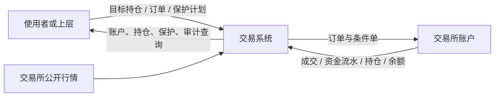

# 交易系统式样书

版本：3.0.0

对应设计书：[01_交易系统设计书](01_交易系统设计书.md)。需求编号 S1，验收编号 T1。

## 1 定位

交易系统（P1）是与策略无关的交易服务。使用者给出交易对象、订单或希望达到的目标持仓及其保护条件，P1 负责检查交易能力、控制账户风险、执行、记录事实，并在故障后恢复到一致状态。

P1 不判断行情，不评价消息，不选择模型，也不学习参数。止损的位置可以由使用者直接给出，也可以由上层计算；P1 负责把它变成交易所里真实存在、被核验过的保护，并保证任何请求都不能越过账户风险上限。

P1 可以单独运行，不依赖策略框架（P2）或应用实例（P3）。

## 2 运行方式

### S1-001 独立运行

只启动 P1 时，使用者就能创建运行、读取行情、设定目标或提交订单、设置止损、撤单、查询订单与账户、重启后恢复。

- 接入新的交易对象或交易渠道时，业务能力保持一致。
- 某项能力不受支持时明确返回原因，不得假装支持。
- 交易对象用“渠道 + 产品 + 代码”三段标识，避免同名代码混淆。

### S1-002 模拟盘与实盘隔离

运行环境只有两种：

- **模拟盘（SIM）**：交易所提供的模拟账户，订单真实发往交易所的模拟环境，没有真实资金。
- **实盘（LIVE）**：真实资金。

两种环境的账户、资金、订单、持仓、保护和审计完全隔离，模拟盘的请求不能到达实盘执行路径。开启实盘必须显式绑定账户、具备有效规则并完成准入（S1-023）；没有准备好实盘时，模拟盘照常可用。

### S1-023 两种环境共用一套执行规则

- **执行规则相同**：模拟盘与实盘使用同一个交易所执行器，下单、成交读取、对账、保护单、恢复与执行租约的规则完全相同。账务按交易所回报的成交、费用、资金费和余额记账，起始资金取账户的实际余额。
- **模拟盘执行器**：只能连接交易所固定的模拟盘地址。配置成其他地址或打开实盘开关时，拒绝启动；连接层在发出请求前再检查一次。
- **实盘执行器**：不接受模拟盘地址。
- **两者的唯一差别**：实盘必须通过准入检查，模拟盘不要求。模拟盘若配置了准入条件，只逐项检查并记录未满足项，不阻止运行。
- **账户资产**：模拟账户中预置的非结算币种资产不计入资金，并留下记录；实盘要求账户里只有结算币种。
- **交易对能力**：条件止损、只减仓、做空能力在模拟盘按实测结果声明；实盘需另行准入。

### S1-014 内部撮合只用于测试与回放

系统内置的撮合器只用于自动化测试、历史回放和策略框架的反事实计算，不是一种运行环境。它与交易所执行器互不处理对方的运行。

- **语义相同**：内部撮合与真实执行使用相同的订单、风险和状态语义。
- **按规则成交**：成交遵守数据可用时间、手续费、延迟、流动性参与率和资金规则。
- **同一根 K 线内的顺序**：顺序不明的触发采用登记的保守路径，或直接拒绝歧义。
- **不当作执行证据**：撮合规则带版本号，理想成交不得当作真实执行的证据。

## 3 行情与交易规则

### S1-003 行情与 K 线

P1 采集最新成交、买卖报价、标记价、已完成的 K 线以及资金费观测。

- **数据可追溯**：每份数据都能查到来源、观测时间、可用时间和质量。
- **未完成 K 线不算历史**：不能当作已完成的历史数据使用。
- **异常要标出来**：断流、过期、缺口、买卖价交叉都要标记出来，受影响的品种禁止新增风险。
- **K 线修订有限制**：已完成的 K 线只能在修订窗口内按修订号更正，更正要留下记录。

### S1-004 交易规则与经济核算

按生效的品种规则处理价格步长、数量步长、最小名义、合约乘数、交易时段、做空能力、保证金分档和费用。

- 金额、数量、价格和币种不混用，按真实产品计算双向损益。
- 品种规则缺失或不明时，禁止新增风险。
- 规则变化和公司行动不得静默改写历史账务。

## 4 订单、目标与持仓

### S1-005 订单与撤单

支持品种能力范围内的市价单、限价单、撤单和订单查询。

- **订单状态**：区分待处理、已受理、部分成交、全部成交、已撤销、已拒绝和结果未知。提交成功不能显示为已成交。
- **撤单未确认前**：发出撤单请求后、交易所确认前，这笔订单仍按可能成交计入风险。

### S1-006 目标持仓与归属

使用者可以提交带归属标识的目标持仓，由 P1 计算还需要交易的差额；也可以直接提交订单。两种入口经过同一套账户检查。

- **分别显示**：实际持仓、目标持仓和未完成订单分别显示。
- **共享账户**：多个使用者共享一个账户时，不能重复占用同一份资金，也不能用净额相抵来隐藏风险。
- **外部改仓**：外部改动过的持仓不会被自动补回。

### S1-016 一笔反手

目标持仓与实际持仓方向相反时，只下一笔订单。

- **数量**：|目标 − 实际|，按数量步长向零取整。
- **风险按新开部分算**：单笔风险、开仓名义和保证金只按新方向开出的部分计算，订单必须附带保护计划。
- **原持仓照样计入**：原持仓和未终结的订单仍计入账户的最不利风险。

反手未成交或失败时，原方向的保护保持有效。每次成交后，以实际持仓的方向决定保护：

| 成交后的实际持仓 | 保护处理 |
|---|---|
| 仍是原方向 | 按实际数量重设原方向的保护 |
| 归零 | 撤销全部保护（S1-019） |
| 已是新方向 | 撤销全部旧方向保护，按新方向声明的模式建立保护 |

## 5 保护

### S1-007 保护必须真实存在

P1 为真实已成交的持仓建立、查询、更新和撤销保护。普通订单与条件保护单分别管理。

- **覆盖数量**：保护必须覆盖实际数量和残仓。
- **保护出问题时**：建立失败、触发后没有完全退出、或状态不明时，禁止继续增加风险，并持续告警。
- **替换不留空档**：替换保护失败时，不能出现没有记录的保护空档。
- **不保证成交价**：止损不保证按触发价成交。

### S1-017 双层保护

每个非零持仓有两层保护。

- **保险止损（INSURANCE）**：由 P1 自己持有和维护，持仓非零时必须存在。
  - 价格：多头触发价 = 平均开仓价 × (1 − 保险比例)，空头触发价 = 平均开仓价 × (1 + 保险比例)。按价格步长向远离持仓的方向取整（多头向下，空头向上）。
  - 保险比例：属于账户风控策略，满足 0 < 比例 < 1。上层不能修改。
- **上层止损（STRATEGY）**：来自目标请求的保护计划，允许收紧，也允许放宽。它必须同时满足：
  - 严格比保险止损更紧：多头的上层价高于保险价，空头低于保险价。
  - 尚未被当前价格穿越。
  - 覆盖数量等于实际持仓的绝对值。
- **替换顺序**：先挂新的条件单并确认生效，再撤旧的；替换期间保险止损始终有效。
- **持仓的保护状态**：

| 状态 | 条件 | 后果 |
|---|---|---|
| 受保护 | 两层都有效（或 S1-022 的上层管理模式下，保险止损有效） | 正常 |
| 仅保险保护 | 只有保险止损有效 | 运行降级，禁止加仓，允许减仓和维护保护 |
| 未受保护 | 保险止损也缺失 | 运行降级 |

### S1-022 上层自行管理止损

目标的保护计划可以声明两种模式：

| 模式 | 上层止损放在哪里 | 交易所里挂什么 |
|---|---|---|
| 交易所条件单（VENUE） | 交易所里的条件单 | 两张条件单：保险止损 + 上层止损 |
| 上层管理（UPPER_MANAGED） | 由上层自己判断触发，再用目标变更去减仓或平仓 | 只有 P1 的保险止损 |

上层管理模式的规则：

- **受保护的条件**：保险止损有效，持仓即为受保护，运行不因缺少上层条件单而降级。
- **管理声明**：必须给出管理止损价 M（正数）和收盘触发的超出余量 O（非负数）。M 和 M 加上不利余量后的价格，都必须严格比保险价 I 更紧：多头 M > I 且 M − O > I，空头 M < I 且 M + O < I。
- **开仓风险**：按“管理止损距离 + 余量 + 费用与滑点准备”计算。
- **只改管理价或余量**：数量不变时，P1 只校验并记录声明，不下任何单。P1 不会按管理价自己触发退出。
- **切换模式**：
  - 从交易所条件单切到上层管理：撤销并核实全部上层条件单，保险止损保留。
  - 从上层管理切到交易所条件单：先挂好上层条件单并确认生效，再切换。
  - 切换失败或结果未知：保留原模式和待办，不得报告完成。

### S1-018 持仓期间只更新保护

目标数量不变、只有保护计划变化且目标版本递增时：

- 交易所条件单模式只替换上层止损；上层管理模式只校验并记录声明。两种情况都不产生普通交易订单。
- 数量和计划都没变的重复提交，不得撤换仍然有效的执行订单。
- 不带保护计划的目标，不解释为撤销现有保护。

### S1-019 平仓后清理

实际持仓归零后，P1 主动撤销本运行在该品种上建立的全部条件单，包括两种角色和替换遗留的单，不能指望交易所自动撤销。

- **识别本运行的条件单**：按本运行特有的客户端条件单标识。
- **不属于本运行的条件单**：不自动撤销，只告警，并禁止该品种增加风险，等待人工处置。
- **逐单确认**：逐单确认终态，再重新查询，直到为空。撤销失败或结果未知时，保留清理任务并禁止该品种重新增加风险。

### S1-020 内部撮合同样执行双层保护

内部撮合同样支持一笔反手、双层保护、持仓期间更新保护和归零清理。

- **触发顺序**：两层保护中先触发的那张成交，另一张随即撤销。
- **部分退出**：按实际残仓维护保护，同一帧的流动性不重复消耗，也不会因为两层保护而反向开仓。

### S1-021 交易所适配

在已核验的单向持仓能力范围内：

- 交易所条件单模式用两张只减仓的止损市价条件单实现两种角色。
- 上层管理模式只保留保险止损条件单。
- 客户端条件单标识区分角色和所属运行。对账要能识别角色、方向、覆盖数量、替换遗留和归零遗留；没有核清之前，不得宣称双层保护有效。

## 6 账户风险

### S1-008 最终风险检查

名义敞口、保证金、单笔风险、账户损失和组合约束，优先于任何交易请求。

- **检查范围**：实际持仓，加上所有未终结订单可能成交的最不利结果。
- **超限时**：拒绝增加风险；保护维护和可证明的减仓继续可用。
- **数据不可靠时**：缺少可靠价格、净值、规则或退出风险估计时，不允许新增风险。
- **被动超限**（行情变化导致超限）：立即锁定、禁止继续增加风险，并按登记的政策处理。

### S1-009 账户保护的观察与执行

账户级的日亏损、回撤和连续亏损三道闸门，可以分别设成“只观察”或“执行”。

- **只观察**：照常计算并记录“本会触发”，不锁定运行，也不通过风险预算间接让目标归零。订单真实性、保证金、名义上限和单笔保护照常生效。
- **执行**：触发后锁定运行，按登记的处置政策处理现有持仓。
- **实盘**：三道闸门都必须设为执行。

### S1-010 资金、费用与风险日

- **分项记录**：成交损益、浮动损益、手续费、资金费（常规和特殊）以及外部资金流，分别记录。
- **日损益起点**：从固定风险日的起始净值算起，不能因为转账、平仓或重启而重置。
- **未知不填零**：未知的损失不能填零。
- **资金不足**：按规则拒单或清算，不能自动补造资金。

### S1-024 盈亏来源与参考资金费

- **连接交易所账户的运行**：账面数字只取交易所，包括保证金余额、钱包余额、各持仓浮动盈亏，以及按回报记账的已实现盈亏、手续费和资金费。系统不另行计算；某个数字尚未取得时标为“未取得”，不用计算值代替。
- **内部撮合的运行**：账面数字由系统计算并标明来源。内部撮合不结算资金费。
- **参考资金费**：每个运行另算一份，用交易所真实盘公开的结算记录：

  参考资金费 = −结算前持仓数量 × 合约乘数 × 结算标记价 × 费率

  参考值不入账，不影响权益、风控、交易和对账。结算记录取不到时，不阻断行情采集，之后补取；重复送达的记录不重复计入；数值冲突时保留先到的记录并告警。
- **输出两个范围**：累计（自运行首笔成交起）和当前持仓（本轮持仓开出起，每个品种各一份）。每个范围给出：交易盈亏（不含资金费）、账面资金费、参考资金费、账面合计、参考合计，以及数据来源、观测时刻、参考记录截至时刻和是否过期。
- **实盘核对**：实盘的参考资金费与账面资金费应该一致，差额超过舍入容差时标为不一致。
- **品种信息里的参考费率**：品种信息另给出最近一次结算记录作为参考费率，包括费率、结算间隔、下次结算时刻。下一次记录逾期 30 分钟仍未取得时，不再给出。

## 7 可靠性

### S1-011 重复请求与结果未知

- **重试**：同一业务请求重试，不能重复增加风险。
- **超时或断线**：订单先核实实际状态，核清之前不得再发。
- **重复或乱序的成交回报**：不能重复记账。
- **以交易所为准**：不能只凭本地请求状态认定交易所里的事实。

### S1-012 对账、重启与外部变更

- **重启后**：先恢复实际的订单、成交、持仓、保护、资金和风险锁，再允许新交易。
- **外部事实**：人工改仓、强平、自动减仓、特殊结算都作为外部事实记录，并通知使用者重新核验目标。不能因为目标还没变，就自动恢复旧的风险。

### S1-013 异常与紧急处置

提供以下能力：紧急停止、停止增加风险、撤销增加风险的订单、按登记政策减仓。

- **紧急停止**：不会自动解除。
- **P1 不可用而实盘有残仓时**：使用事先准备的官方交易渠道人工处置。恢复后导入人工事实并对账，不能直接继续增加风险。

### S1-015 权限、记录与运行质量

- **可追溯**：每个请求、拒绝、成交、风险动作和恢复，都能追溯到使用者、环境、配置和原因。更正只能追加记录。
- **凭据隔离**：交易凭据只有执行组件能用，观察者和策略使用者读不到。
- **运行异常**：磁盘、时钟、审计容量或执行队列异常影响可靠性时，禁止新增风险。

## 8 验收

| 编号 | 条件 | 应达到的效果 |
|---|---|---|
| T1-01 | 上两层都未安装 | 完成行情、挂撤单、止损和重启对账 |
| T1-02 | 模拟盘与实盘账户交叉使用 | 请求被拒绝，实盘没有模拟订单 |
| T1-03 | 过期价格、未完成 K 线、规则变化 | 数据状态标记正确，受影响的增险被拒绝 |
| T1-04 | 重试、超时、部分成交、撤单竞态 | 无重复订单或记账，未核实的风险仍计入 |
| T1-05 | 成交后保护失败或有残仓 | 持仓事实可见，禁止增险，持续告警 |
| T1-06 | 多个使用者同时占用预算 | 合并风险不突破限额，外部改仓不被补回 |
| T1-07 | 同一亏损路径下切换闸门模式 | 观察模式继续运行；执行模式锁定并按政策处置 |
| T1-08 | 转账、特殊资金费、重启跨风险日 | 账务分项一致，锁定与日亏损不被重置 |
| T1-09 | 断网、执行崩溃、数据库或主机失效 | 无盲目重发；外部保护和人工预案可核验 |
| T1-10 | 人工改仓、强平、恢复导入 | 去重对账，保留恢复核验，授权后才恢复增险 |
| T1-11 | 同一根 K 线同时满足多种触发 | 使用登记的保守路径或拒绝歧义 |
| T1-12 | 越权、审计失败、未就绪的实盘设置 | 拒绝并留痕，普通权限不能绕过保护 |
| T1-13 | 一笔反手（多空对称；失败、未成交、原向残仓、恰好归零、跨零、全部成交） | 只对新开部分计预算，旧方向计划不混用 |
| T1-14 | 双层保护 | 保险价取整方向正确；拒绝未标定参数、越权改保险、相等或更宽或已穿越的上层价、覆盖不足；允许合规放宽；替换失败保留保险；正确区分仅保险与未受保护 |
| T1-15 | 目标数量不变、只更新计划 | 无新增或撤换交易订单；重复请求幂等；不带计划不撤保护 |
| T1-16 | 平仓、止损、反手经过零、外部归零 | 清理本运行的全部条件单；外来条件单只告警并阻断增险；失败或未知可续接，确认为空前不恢复增险 |
| T1-17 | 内部撮合的双层保护 | 先触发者成交、另一张撤销；部分退出与同帧歧义无重复账务或反向开仓 |
| T1-18 | 交易所双层保护场景 | 双层保护、放宽上层止损、反手后旧止损被撤、平仓后条件单全撤，各场景保存前后持仓、条件单与成交证据 |
| T1-19 | 上层管理模式 | 管理价与余量边界正确；仅保险有效时为受保护；同数量更新管理价不下单；两向切换含失败、未知、重启时保险不中断 |
| T1-20 | 两种环境共用执行规则 | 模拟盘保护要等交易所确认才生效；模拟盘只接受固定地址（相似域名、实盘开关、实盘配置均拒绝）；实盘拒绝模拟盘地址；执行器与内部撮合互不处理对方的运行；模拟盘起始资金只取结算币种 |
| T1-21 | 盈亏来源与参考资金费 | 参考资金费按结算记录计算且不影响权益和交易；结算前平仓、结算后开仓不计；账面数字取交易所，未观测时为空；重复记录不重复计入；冲突保留原值并告警；实盘不一致时标出；参考费率逾期 30 分钟后不再给出 |
