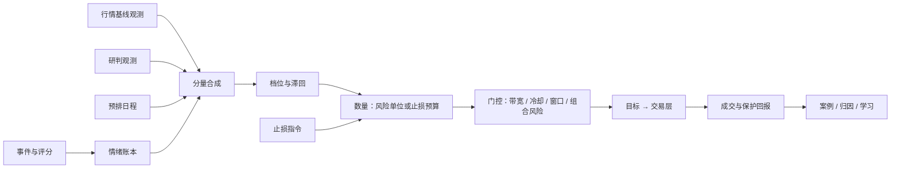

# 策略化框架式样书

版本：3.2.0

对应设计书：[02_策略化框架设计书](02_策略化框架设计书.md)。需求编号 S2，验收编号 T2。

## 1 定位

策略化框架（P2）把外部提供的输入变成交易层的目标持仓。输入包括事件评分、行情基线观测、研判观测、预排日程和止损指令。

- **核心方法**：每条事件对每个观测对象的贡献单独记账，随时间衰减，随价格兑现而消耗。剩余情绪与行情基线、研判一起合成方向和档位，再按风险预算算出数量。
- **执行**：经交易层（P1）执行。实际成交、止损和费用反过来形成案例，供归因和受限学习使用。

P2 不联网搜索，不调用模型，不内置任何交易对象或实例数值。观测哪个对象、捕捉什么消息、由谁评分、用什么基线，都由使用者或上层应用决定。没有上层应用时，手工输入或固定测试数据就能驱动完整流程。评分服务暂时没有新输入时，旧贡献的衰减、持仓管理和风险处理照常进行。

## 2 对象与输入

### S2-001 观测对象与隔离

- 可以创建、查询、暂停和归档多个观测对象，每个对象绑定交易对象、环境（模拟或实盘）、策略和参数版本。
- 每个对象的情绪账本、决策、案例和参数分别保存。
- 同一交易对象上的多个策略运行，必须有明确的持仓归属。
- 对象暂停后，仍然处理已有的持仓、案例和保护，不能静默删除状态。

### S2-002 事件

- **事件内容**：事件记录事实、证据、来源时间、类型和修订关系，可关联一个或多个对象。
- **只登记不交易**：登记事件只表示事实已登记，不会自动形成情绪或订单。
- **事件类型**：可以扩展，每种类型有自己的评分量表和生命周期。

### S2-003 评分

使用者可以对事件就某个对象提交评分。

- **最少内容**：方向和影响程度。
- **可交易评分的完整内容**：可信度、相关度、新颖度、预期覆盖、提前计价比例、预计半衰期、质量，以及证据、评分量表版本和标定版本。
- **方向与影响**：方向为正、负或中性；影响程度不小于 0。
- **不完整或有问题的评分**：缺失、未知、超界或矛盾的评分保留原因并隔离，不当作中性或零风险。

### S2-004 去重与事实修订

- **转载**：同一经济事实的转载、翻译和多媒体报道只补充来源，不重复注入情绪。
- **分别记录**：新事实、官方确认、数额修订和撤销分别记录。
- **纯评分修订**：只改变当前剩余影响，不能重置事件年龄，也不能再次消费已经兑现的价格。
- **可查**：所有差额和拒收量都可以查。

### S2-005 新颖度与提前计价

- **新颖度**：按新事实的比例降低重复信息的影响。
- **提前计价**：结合事前预期和评分可用之前的价格反应，估计尚未被市场计入的部分。同一证据不能重复扣减。
- **无法可靠估计时**：缺乏可靠的预期或价格时，以可信下界限制新增风险；连下界都无法建立时，不凭该事件增仓。

### S2-039 判断型事件

事件类型可以登记为判断型：评分来自上层对一组新闻的整体研判，而不是对单一事实的逐项评估。

- **提前计价**：登记为“不评估”时，提前计价比例固定为 0 并留痕。上层输入不含价格，因此不能声称已经扣除提前计价。
- **半衰期**：取评分向量里的预计半衰期，必须落在登记界限内，越界则拒绝。
- **标定**：信心到影响量的换算是登记的映射，以标定版本登记。标为实验用途的标定版本只能用于模拟。未被研判评估的字段按登记的固定值填写，并注明来源。
- **每次注入新建事件**：证据只列本次新出现的证据，新颖度为 1。方向改变时新建事件，原方向的贡献由上层按失效清除。

## 3 情绪账本

### S2-006 贡献账本

每个事件对每个对象的贡献单独保存，汇总正向、负向和净情绪。

- **注入量**：基础影响经可信度、相关度、新颖度、预期覆盖、提前计价和来源权重修正后注入，并遵守事件、事件族和对象三级上限。
- **反向消息**：用负向贡献抵消净值，不删除原来的正向贡献。
- **来源权重为负**：表示反向来源，方向随之反转。

### S2-007 时间衰减

- **按真实时间衰减**：剩余影响按登记的半衰期随真实经过时间减小，包括没有交易和停机的时间。
- **不能变年轻**：重启、重复评分或更换参数，都不能让旧消息恢复年轻状态。
- **不翻转方向**：衰减不会把正面贡献翻成负面。

### S2-008 价格兑现

- **只消耗一次**：价格向预测方向运动时，消耗尚未兑现的影响；回撤后再回到旧高位，不重复消耗；反向运动也不会补回。
- **共享预算**：多个同向贡献共享一次兑现预算，不能每条消息都把同一段涨幅完整归为自己。
- **与持仓无关**：空仓时也计算兑现。实际持仓的盈亏不作为兑现量。
- **可关闭**：事件类型可以登记为关闭价格兑现。

### S2-009 失效、缺数与守恒

- **清除原因**：被证伪、撤销、超过寿命、低于清理阈值，或低于登记的“初始量的比例”时，按原因清除。止损本身不让事件失效。
- **守恒**：每次变化都可以解释为注入、修订、衰减、兑现、失效或转基线之一。账差超过登记容差时，冻结受影响的增险。
- **价格缺失**：继续时间衰减，暂停兑现和依赖该价格的新风险；恢复后不回写历史决策。

### S2-038 贡献转入行情基线

有信号资格的上层可以提交“转基线”命令，在同一事务内完成两件事：

- 清除指定贡献的剩余影响，原因记为“转基线”。
- 写入一条基线因子观测。

约束：

- 命令前后合成方向必须相同，合成值变化不超过登记容差，否则整体拒绝，不会部分写入。
- 转基线不改变风险批次的数量和已生效的保护。
- 基线观测可以带“再确认”标记（供 S2-035 使用）和理由代码；仍受有效期与缺失政策约束。

## 4 应持仓位

### S2-010 时基决策

- **按周期计算**：评分可以提前处理，但不会一到达就直接增险。
- **每周期的顺序**：先接收实际成交和保护结果，再处理旧贡献和新评分，最后形成目标。
- **漏掉的周期**：停机漏掉的周期只记录，不追补过期订单。
- **不等周期的事**：止损和执行异常及时处理，不等主周期。

### S2-011 行情基线与研判

- **行情基线**：由使用者登记的基线因子构成。每个因子按周期提交取值在 −1 到 1 之间的观测，框架按登记权重合成。
- **研判**：周期性的综合判断，给出方向和大小，可以声明“强制减险”。
- **三种状态**：每个因子和研判各处于启用、只记录或停用。只记录的照常计算并保存结果，但不影响仓位。从只记录升为启用，必须引用样本外或前向检验证据。
- **有效期**：观测超过有效期即视为缺失，按登记的缺失政策处理（默认取零），不沿用过期值。
- **基线做空**：需要单独开启；未开启时，负的基线按零处理。
- **不从价格推断**：框架不从历史价格或 K 线推断市场状态，也不以状态修正仓位。

### S2-012 分量合成

应持仓位由四个分量合成：

| 分量 | 来源 |
|---|---|
| 基线 | 行情基线因子（S2-011） |
| 研判 | 研判观测（S2-011） |
| 预排 | 预排事件窗口（S2-025） |
| 调整 | 剩余净情绪（第 3 章） |

- **核心**：基线、研判、预排三者之和，裁剪到满仓范围内。
- **调整**：净情绪经登记的尺度映射，乘以证据质量和冲突程度，不超过登记的调整上限。
- **合成规则**：
  - 调整与核心同向时相加，以满仓为限。
  - 调整与核心反向时，最多把仓位压到空仓，不因事件反向开仓。
  - 核心为零时，事件单独开仓不超过登记的“单独开仓上限”（可以为零）。
- **反向**：只有核心本身转向，仓位才反向，而且新方向要持续登记的确认期（S2-028）。
- **档位**：合成值量化为有限档位，进入某档的阈值高于退出该档的阈值。
- **只受这些约束**：合成仓位只受流动性、组合风险和止损风险预算约束，不受波动或状态乘数修正。
- **决策记录**：每个决策保存各分量、核心、合成值、档位和最终暴露；只记录分量的假设值一并保存。

### S2-025 预排事件

使用者可以登记已排定日程的事件：类型、对象、预计时刻、确定程度（已确认或预估）和来源。

- 日程变化以新修订登记，取消也要登记。
- 日程修订只影响尚未开始的窗口，已执行的决策不追溯；窗口内取消时，剩余窗口作废。

### S2-042 预排事件不从价格标定

预排事件的模板调整量不从历史价格反应在线估计，模板只能固定为 0 或只记录。预排事件仍然用于日程登记、修订、取消和事件前降险（S2-037）。离线证据形成的模板须由使用者提出并以新因子登记。

### S2-026 成本感知调仓

- **无交易带**：目标与当前暴露之差小于无交易带时不调仓。无交易带由往返手续费、滑点和预期持有期内的资金费构成，并且不小于登记的最小变动。
- **调整的节奏**：调整分量只在使档位变化时才执行，两次由调整引起的调仓之间不短于登记的间隔。
- **不受限制的操作**：减仓到零、强制减险、止损和保护更新，不受无交易带、节奏和冷却限制。

### S2-040 相对无交易带

风险单位模式下，无交易带还可以登记为“批次数量 Q 的比例”：目标与实际之差小于“比例 × Q”时不调仓，同时仍不小于 S2-026 的成本带。

- 减仓到零、收盘止损退出、强制减险、方向改变和保护更新不受此带限制。
- 调仓间隔允许登记为 0。

### S2-043 资金费估计来源

实例可以登记资金费估计的来源：

- **运行费率**（默认）：运行所连交易所的当前费率。
- **参考费率**：交易层按 S1-024 提供的真实盘最近结算记录。参考费率缺失时，使用登记的备用年化费率。

来源只影响框架内部的资金费估计（无交易带、分层账本），账务资金费以交易层入账为准。决策输入记录所用来源。

## 5 执行、止损与风险批次

### S2-013 目标与执行闭环

- **目标带信息**：向交易层提交带版本、期限和原因的目标，查询实际持仓和未完成量后再作下一个决策。
- **理论不等于成交**：理论目标不记为成交。卖空、最小订单或资金能力不足时，说明实际为何与理论不同。
- **调整与减险**：普通调整有最小变动与冷却，强制减险优先。
- **不绕过交易层**：交易层的最终风险拒绝不能被框架绕过。

### S2-014 噪声止损

用已完成的 K 线估计正常噪声，在噪声之外计算保护距离，并按单笔风险预算降低数量或不交易。

- 这个计算与情绪强弱无关。
- 存量风险批次不因亏损或学习而扩大止损；新参数只用于以后的新批次。
- 历史 K 线只用于这项估计，不用于判断方向。

### S2-015 时段政策

使用者可以为时段登记“新增风险次数”和“净亏损案例次数”两个上限。

- 两者独立计数，任一达到即禁止该窗口增险。
- 重试、拆单、部分成交不重复占额；结果未知的继续占额。
- 止损、减仓和保护不受次数限制。

### S2-028 确认后直接反向

- **一笔反手**：方向持续满足确认期后，直接下发反向目标和新方向的止损，由交易层一笔反手。
- **确认期**：可以为 0，负数非法。
- **等待期间**：保持原执行意图和保护，独立的强制减险仍可减仓。
- **重新计时**：候选方向变化或消失时，确认期重新计算。
- **门控照旧**：即使反向目标的绝对值更小，反手仍含新开风险，必须通过全部门控。

### S2-029 止损指令

框架提供公开的止损指令通道，供上层提交两类指令：

| 种类 | 用途 |
|---|---|
| 持仓止损 | 持仓期间的绝对止损价 |
| 初始距离 | 开仓或反向新开时，用给定距离（加超出余量）倒推可开数量，取代噪声止损 |

规则：

- **校验**：写入方有该对象、环境、种类的写权限，方向与当前实际持仓一致（初始距离指令表达拟开方向），尚未被当前价穿越，且在有效期内。
- **持仓期间更新**：每周期读取有效的持仓止损。与当前已生效的止损不同时，下发“数量不变、只更新保护计划”的新版本目标，不受无交易带和冷却阻断。
- **指令过期**：不撤止损，保持最后生效的止损。
- **没有有效初始距离指令时**：沿用噪声止损。

### S2-030 未成交重发保留计划

- 未成交或部分成交期间，重发相同目标必须带上适合新开方向的止损计划。
- 结果未知时先查回执。
- 价格已穿越或计划失效时阻断增险并说明原因，不发出无保护的新开目标。

### S2-032 上层管理模式与余量

- **模式**：止损指令可以声明交易所条件单模式或上层管理模式，以及超出余量。框架原样传给交易层（S1-022）。
- **开仓数量**：按“初始距离 + 余量”与亏损预算倒推。
- **持仓期变化**：模式、管理价或余量变化，都形成数量不变的新版本目标声明。
- **收盘触发**：由上层负责判断，触发后通过收盘止损退出请求（S2-034）减仓或平仓。

### S2-031 契约

止损指令、退出请求、转基线等接口的字段、状态和错误码都进入公开契约。公开接口的权限不授予内部信号资格。

### S2-033 风险单位仓位

策略可以声明风险单位模式。新风险批次开仓时，按以下公式计算该批次的风险单位数量 Q：

- 亏损预算 = 权益 × 上层在初始距离指令中提出的风险比例，不超过登记的最大风险比例和对象亏损预算。
- 每单位亏损 = 合约乘数 ×（初始距离 + 超出余量 + 价格 ×（手续费 + 滑点 + 跳空准备））。
- Q = 亏损预算 ÷ 每单位亏损。

规则：

- Q 在批次内冻结。目标数量 = 方向 × Q × 档位比例。判断变弱只按比例减少数量，不重新放大止损。
- 档位上升带来的加仓仍以 Q 为上限。
- 缺少有效的初始距离指令或风险比例时，不开新批次。
- 名义上限、组合风险和交易层风控仍然最终约束。

### S2-034 收盘止损退出

- **收盘止损价**：交易所条件单模式的止损指令可以附带收盘止损价，它必须比交易所触发价更紧。框架只记录它，不下发交易所。上层管理模式以管理价作为收盘止损价。
- **退出请求**：上层可以提交收盘止损退出请求，内容包括对象、方向、所依据的指令版本、K 线周期、该根 K 线的收盘时刻和收盘价、来源。
- **核验**：写权限；方向与实际持仓一致；该 K 线已完成且已可用；收盘价与交易层记录一致；收盘价越过当前生效的收盘止损价。
- **通过后**：立即下发归零目标，不受无交易带、调仓间隔和冷却限制，批次记为“收盘止损”结束。重复请求幂等。核验失败则拒绝并留痕，不当作止损已发生。
- **被拒或过期**：归零目标被交易层拒绝或过期时，请求回到“已受理”，下一周期再次下发。请求自该 K 线收盘起 30 分钟内有效，到期仍未执行（同一批次仍按原方向持仓）就记为“已过期”，不再归零。
- **交易所保护成交**：交易所保护单成交结束的批次，同样记为止损结束。止损结束不令事件失效。

### S2-035 止损后再入场门

批次以止损结束后，同方向的新风险要同时满足两条才放行：

- 距止损已过登记的冷却时间。
- 止损之后出现了新的合格输入：止损后新注入的同向贡献，或止损后提交、带“再确认”标记的同向基线观测。

再入场门只看输入，不看价格。反方向不受限制。门的状态持久保存。

### S2-036 判断链亏损上限

- **判断链**：自上次合成方向改变以来，同方向的连续风险批次构成一条判断链。
- **按 R 累计**：每个已结束批次的盈亏折算为 R（实现盈亏 ÷ 批次亏损预算）。
- **停止增险**：链累计亏损达到登记上限后，该方向停止新增风险，直到方向改变。
- **持久**：记录持久保存，重启和参数变更不重置。盈利批次默认不抵扣。

### S2-037 事件前降险

使用者可以为预排事件类型登记降险窗口（事件前后的时长）、缩减比例和所需的确定程度。

- 窗口内不开新风险。
- 止损尚未达到保本价（入场价加往返成本）的批次，按缩减比例减仓一次；已在保本以上的不动。
- 减仓视为强制减险。

## 6 案例、归因与学习

### S2-016 案例与观察期

- **建立案例**：以实际方向的持仓周期建立案例，关联风险批次、事件、评分、目标、成交、成本、止损和退出原因。
- **观察期**：持仓归零后进入观察期，观察期规则在入场时冻结。
- **不补零**：缺数、未结束或仍在持续影响的案例标为未成熟或删失，不用零结果补齐。

### S2-017 分层归因

- **顺序**：先检查数据和执行，再检查外部异常、去重和提前计价，之后评价方向、强度、生命周期、兑现、时机和止损。
- **允许不确定**：允许多原因和无法确定。
- **外部解释只是候选**：必须经客观证据和稳定性核验，模型自述的置信度和单笔盈亏不能直接决定参数修正。

### S2-018 多事件与反事实

- **样本组**：共同驱动或重叠的事件合并为独立样本组。
- **单因素反事实**：支持不用策略止损、延迟入场、调整退出、同预算更宽止损等。
- **分列**：反事实与实际账务分列，不能用事后最佳点制造盈利。

### S2-019 受限参数学习

- **可学习的参数**：只有登记白名单内的参数可以提出学习候选，包括来源权重、半衰期、兑现参数和止损倍数。
- **门控**：成熟且质量合格的独立证据，经置信度、遗忘、重复误差、有效样本量和稳定状态门控后，才可以按该参数的固定步长小幅调整。
- **不可学习的内容**：硬风险、权限、数据真实性和实例额度。

### S2-020 防错误学习

- **不能误导学习的样本**：单次极端行情、无法归因、执行污染、重复案例，以及盈利但判断错误的案例。
- **证据和参数的限制**：同一证据不能独自重复推动更新；相关参数不能同时无条件修改。
- **调整的限制**：参数有上下限、漂移预算、冷却、新证据门槛和反向门槛。证据不足时保持现值。

### S2-021 自动生效、监测与回滚

- **生效**：合格候选通过独立验证和风险门后，在周期边界自动生效。
- **回滚**：失败则拒绝或回滚，并冻结。回滚只影响未来，不改历史。

### S2-022 研究验证

提供按真实可用时间的重放、严格时间顺序的样本外验证、事件组隔离、未来信息检查，以及冻结与自适应的对照。核心假设不支持时停止升级。

### S2-027 分层归因与权重学习

- **分摊**：按持仓区间把收益和成本分摊给各分量。收益按分量在合成值中的有向份额分摊，调仓成本归入触发调仓的分量，资金费按份额分摊。
- **只记录分量**：按假设暴露计算假设收益，与实际账务分列。
- **权重学习**：各分量和因子的权重在登记界限内按 S2-019 至 S2-021 学习。成本后长期为负的分量降权，可以降为零并自动转为只记录；证据满足门槛的只记录分量可以自动启用。
- **来源权重跨零**：来源权重从正跨到负（或反之）的证据门槛，是同向调整的两倍。

### S2-041 学习冻结

策略可以登记“学习冻结”。

- **冻结期间**：学习候选、分量权重、自动降级和自动启用照常计算，作为“冻结期候选”记录，但不生效，不改变参数快照或分量状态。
- **不受影响的**：冻结不影响硬风险、判断链上限、再入场门和保险止损。
- **解除冻结时**：不追溯应用冻结期候选，须重新经过门控。

## 7 资格、恢复与查询

### S2-023 资格、恢复与可解释性

- **两种评分分开**：研究评分与可交易评分的资格分开，公开接口的使用者不能自行获得信号资格。
- **隔离**：不同实例、模拟与实盘相互隔离。
- **恢复**：恢复后先与交易层核验；框架重启不能解除交易层的锁定。
- **可重放**：每次交易、不交易、更新、不更新，都能按当时输入重放原因。

### S2-024 只读追溯

- **可查内容**：有查询权限的公开身份可以查询对象目录、事件及事实版本、评分及准入结果、贡献账本、案例与归因、参数激活与审计。
- **只读**：查询不创建任何业务记录，不推进时钟，不授予信号资格。
- **分页**：长列表采用有界查询和稳定分页，游标与读取快照绑定。
- **不公开的内容**：原文、提示词、凭据和内部命令载荷不进入公开查询。

## 8 验收

| 编号 | 条件 | 应达到的效果 |
|---|---|---|
| T2-01 | 不安装应用层，手工创建两个对象及评分 | 完成独立情绪、目标、模拟执行与案例闭环 |
| T2-02 | 新事件未评分，或已有事件收到评分 | 前者不注入；后者校验后在下一有效周期处理 |
| T2-03 | 转载、纯确认、新事实、撤销、重复请求 | 不重复注入，修订不重置年龄，差额可查 |
| T2-04 | 提前计价未知或同一证据重复使用 | 采用可靠下界或拒绝相关增险 |
| T2-05 | 衰减、兑现、反向和失效叠加 | 组成可查、守恒、非负，重复价格不再消耗 |
| T2-06 | 停机、断价、补消息、相同输入重放 | 实时衰减，无过期补单或历史回写，结果一致 |
| T2-07 | 边界情绪、冲突、反向、能力不足 | 正确滞回和降险，目标与实际分开 |
| T2-08 | 止损、学习与新风险批次 | 旧保护不放宽，止损不清空事件，不立即学习 |
| T2-09 | 时段内重试、未知订单、迟到亏损案例 | 两个计数独立且持久，减险继续 |
| T2-10 | 未成熟、删失、重叠、执行污染的案例 | 不提前学习，保存未知或簇级结论 |
| T2-11 | 反事实：更宽止损、修改退出 | 同预算、只用当时信息，真实损益不混入 |
| T2-12 | 固定步长、证据消费、漂移、相关参数 | 门控失败不更新，合格时只改变可识别参数 |
| T2-13 | 候选合格或回滚 | 在周期边界自动生效，拒绝与回滚可查，历史不改 |
| T2-14 | 泄漏样本、失败试验、误差不可识别 | 正确隔离，记录全部尝试，不宣称通过 |
| T2-15 | 公开调用伪造信号资格、跨实例、异常恢复 | 拒绝并留痕，不解除交易层锁 |
| T2-16 | 公开查询身份查询追溯数据 | 修改或跨范围请求被拒；查询前后状态、时钟、发件箱不变；游标失效可检测；缺记录不伪造 |
| T2-17 | 未声明合成规则与声明合成规则的策略 | 前者冻结回放结果不变；后者决策含各分量、核心、合成、档位、暴露，只记录分量不改变目标 |
| T2-18 | 核心与事件反向、核心为零、核心转向 | 反向只压到零；单独开仓上限为零时不开仓；转向经确认期；负基线未开启做空时按零；过期观测按缺失政策 |
| T2-19 | 预排事件日程修订与取消 | 窗口按预计时刻计算，修订只影响未开始窗口，取消使剩余窗口作废 |
| T2-20 | 差额小于无交易带或调整间隔未到 | 不调仓；减仓到零、强制减险、止损不受限；带宽随费用、滑点、资金费变化 |
| T2-21 | 分层归因 | 加总守恒；只记录分量的假设账务分列；来源权重跨零需双倍门槛；权重降为零自动转只记录 |
| T2-22 | 合成路径 | 无波动和状态乘数；缺少波动估计不阻止有价格和流动性的合成暴露；空基线且其余分量只记录时目标为零 |
| T2-23 | 确认期为 0 或正数、候选改变、等大或更小的反向 | 不先发零目标，新开风险经过全部门控 |
| T2-24 | 止损指令 | 拒绝越权、跨对象、错方向、已穿越、过期；同数量有效指令只更新保护；过期保留最后生效；初始距离同预算缩量；无指令回退噪声止损 |
| T2-25 | 未成交和部分成交的重发 | 保留正确方向计划，幂等，结果未知先查；计划失效不无保护增险 |
| T2-26 | 契约 | 契约导出并验证身份、字段、错误码，框架到交易层闭环可用测试数据独立验收 |
| T2-27 | 上层管理模式 | 模式与余量完整透传；同数量更新声明不下单；仅保险有效时不被误判为缺保护；指令过期保持最后模式 |
| T2-28 | 风险单位 | Q 按比例、距离、余量、成本倒推并按上限截断；档位下降按比例缩量，上升不超过 Q；缺指令不开新批次 |
| T2-29 | 收盘止损退出 | 收盘止损价不比交易所触发价紧的指令被拒；未完成 K 线、未来可用、方向不符、未越过、越权被拒；合格请求立即归零且幂等；交易所保护成交同样记止损；贡献不被清除 |
| T2-30 | 再入场门 | 冷却未到、只有止损前贡献、只有价格回到原方向时不放行；止损后新同向贡献或再确认基线且冷却已到时放行；反方向不受限；重启后状态保持 |
| T2-31 | 判断链 | 按批次 R 累计，达到上限后同向新风险被拒，方向改变后解除；重启与参数变更不重置；盈利默认不抵扣 |
| T2-32 | 事件前降险 | 窗口内不开新风险；未到保本的批次按比例减仓一次，保本以上不动；改期只影响未开始窗口 |
| T2-33 | 转基线 | 贡献剩余为零、原因为转基线、基线观测写入、守恒关联可查；方向改变或超容差被拒且无部分写入；数量与保护不变；关闭兑现的类型不消耗兑现预算 |
| T2-34 | 判断型事件 | 无价格证据时不被隔离且提前计价为 0；半衰期取向量值、越界拒绝；未登记标定隔离，实验标定在实盘拒绝；每次新建事件、新颖度为 1；非判断型类型的校验不变 |
| T2-35 | 相对无交易带 | 差异小于比例 × Q 不调仓，大于时调仓；归零、收盘退出、强制减险、方向改变绕过；间隔 0 合法 |
| T2-36 | 学习冻结 | 产生候选记录，但参数快照与分量状态不变；硬风险照常；解除冻结后候选不自动生效 |
| T2-37 | 预排模板 | 窗口结束不更新模板取值；日程修订、取消与降险窗口照常 |
| T2-38 | 资金费估计来源 | 默认取运行费率；登记参考费率时取参考费率并在决策输入注明；参考缺失时用备用年化费率 |
| T2-39 | 收盘退出的重发与过期 | 归零被拒后回到已受理、下一周期重发；有效期过后未执行的记为已过期且不再归零；其他批次已执行的请求不变 |
