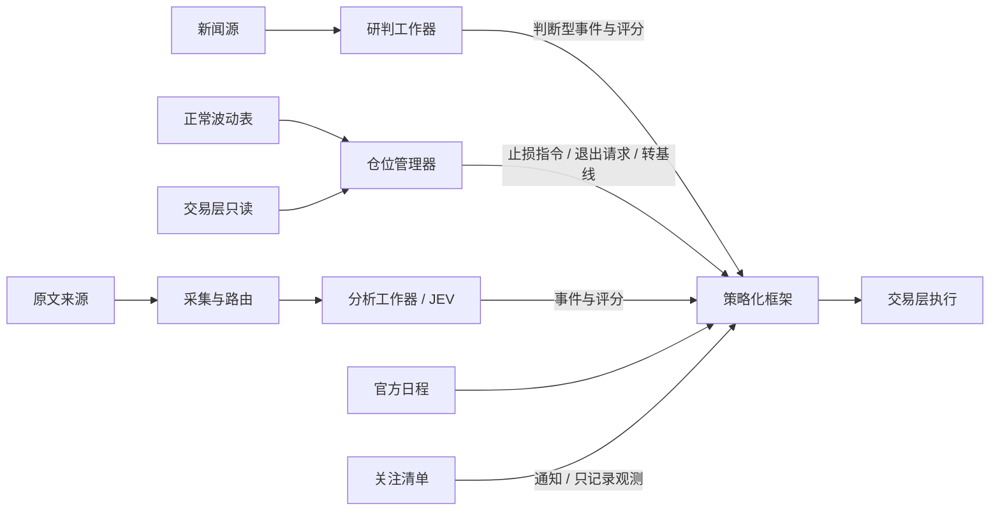

# SOXLUSDT 应用实例式样书

版本：2.21.0

对应设计书：[03_SOXLUSDT应用实例设计书](03_SOXLUSDT应用实例设计书.md)。需求编号 S3，验收编号 T3。

## 1 定位

应用实例（P3）为一个永续合约交易对象（本实例为 SOXLUSDT）提供输入：

- 它采集新闻与公开信息，形成判断，交给策略化框架（P2）记账、合成仓位。
- 它为每批风险计算止损，并在持仓期间移动止损。
- P2 决定应持仓位，交易层（P1）负责下单、止损执行与账户保护。

P3 只通过 P2 和 P1 的公开接口工作，不直写下层状态，也不持有交易所签名凭据。

P3 有两条输入路径，可以分别启用：

| 路径 | 输入 | 交给 P2 的内容 |
|---|---|---|
| 研判路径 | 登记的新闻源 + 模型研判 | 判断型事件与评分、止损指令、收盘止损退出、转基线 |
| 事件路径 | 原文采集、事实抽取、事件分析服务（JEV） | 经核验的事件与矢量评分 |

另有两类辅助输入：

- **预排日程**：宏观与财报的日程，作为 P2 的预排事件。
- **关注清单**：定时检索关注对象的新闻，生成通知和只记录的研判观测。

## 2 实例与运行

### S3-001 实例与对象

- **一个实例绑定**：交易渠道、准确的产品身份（渠道、产品、代码）、环境（模拟或实盘）和 P2 的观测对象。
- **不混淆产品**：名称相同的 ETF、合约或其他产品不得混为一个交易对象。
- **上线前**：验证目标账户能否交易该产品，以及能否双向交易。

### S3-010 产品与价格

- **分别使用不同价格**：合约的可成交价、标记价、指数价和参考资产价格，分别使用。
- **休市或陈旧的参考价**：不当作独立信息。
- **特殊账务**：分红、拆并股、特殊资金费、只减仓、强平和自动减仓，都要核验和记录。
- **杠杆产品**：参考 ETF 的每日倍数目标，不得再次乘入合约损益。

### S3-011 全天运行与时段

- **全天运行**：实例全天运行，覆盖常规、盘前盘后、隔夜、周末和节假日，不因美股收盘自动平仓。
- **按日历区分时段**：区分常规和非常规时段，支持夏令时和提前收市。
- **非常规时段的增险上限**：可以登记“新增风险次数”和“净亏损案例次数”两个上限（P2 S2-015）。

### S3-012 额度与账户保护

- **名义上限**：每个实例登记名义上限，包括最不利情况下可能成交的增险量，不与本金或保证金混淆。
- **两种环境的账户保护**：
  - 模拟环境：账户保护（日亏损、回撤、连续亏损）可以只观察。
  - 实盘：账户保护必须执行，额度不能靠学习或盈利自动扩大。

### S3-013 未决政策阻止实盘

风险默认值、触限后的持仓处置和恢复政策没有登记齐全之前，实盘准入不通过。离线工作和模拟运行不受影响。

### S3-008 资格与资源隔离

- **研究与交易分开**：研究请求只能产生研究记录。只有登记了来源、许可、对象映射、事件类型、时效和证据质量都满足政策的任务，才能进入交易评分。
- **不能自封资格**：应用不能自行授予“可交易”资格。
- **队列与预算分开**：研究与交易任务分别持久化、领取和限额，模拟负载不能耗尽实盘的保留预算。
- **研判路径的身份**：研判路径使用独立的模拟信号身份，模型调用预算与事件路径分开。

### S3-009 故障与降级

- **不伪造**：新闻源、搜索、模型或分析服务中断时，停止不可靠的新判断并告警。不伪造事件，也不反复询问直到得到有利的方向。
- **其余照常**：框架里已有的贡献照常衰减，交易层保护照常工作。
- **恢复后**：旧消息遵守时效和真实可用时间，过期任务不进入交易。

### S3-016 本地部署与私有资产

- **部署方式**：实例运行在使用者的本地服务器上。
- **私有内容**：真实提示词、凭据、账户资料、受限原文和模型缓存保存在私有位置，公开仓库只放空模板和示意数据。
- **数据外发**：调用外部模型或分析服务会发送筛选后的内容，数据许可、保留期和隐私边界须事先核实。

### S3-017 运维

- **可查询**：启停、健康、积压和降级状态可以查询。
- **重启**：重启后与下两层核验通过，才恢复增险。
- **本地中断**：有告警和官方交易渠道的人工处置预案。

## 3 研判路径

### S3-023 新闻采集

- **定时采集**：按登记的来源定时采集新闻，来源可以是官方公告、公开财经 RSS 或快讯接口。
- **每条新闻保存**：来源、标题、摘要、发布时间、接收时间和稳定编号。
- **剔除行情复述**：只复述行情涨跌的条目（只有涨跌词加数字，没有新信息）直接剔除，所以模型看不到任何价格信息。
- **来源许可**：来源登记许可范围，只允许模拟使用的来源在实盘配置下被拒绝。

### S3-024 模型研判

- **研判时刻**：按登记的时刻定时研判。
- **输入**：近期新闻的标题与摘要，较早新闻只给标题，不提供任何价格或涨跌信息。提示词由本实例私有保管，经模型接入模块（P5）发送。
- **输出**：
  - 方向：多、空或观望。
  - 信心：1～5。
  - 预计影响时长：小时。
  - 理由。
  - 所依据的新闻编号。
  - 最强的反面消息。
  - 失效条件：出现什么就说明判断错了。
  - 上一判断的失效条件是否已经出现：出现时要附上依据的新闻编号。
- **输出校验**：输出缺项、越界，或引用了不在输入里的新闻编号时，本次输出无效。
- **调用顺序**：按登记的通道顺序调用，前一个失败就换下一个；全部失败时本轮没有研判并告警。
- **新鲜度门**：最近一次成功采集距今超过登记时长，或有来源中断且近期没有新闻时，本轮不研判并告警。
- **留存**：输入、输出、通道、模型版本和用量全部留存。

### S3-025 研判进入情绪账本

研判作为判断型事件贡献（P2 S2-039）进入框架的情绪账本，按半衰期衰减，不是每轮覆盖。

- **何时注入新贡献**：只在以下三种情况。其余研判只记录，不重置衰减。
  - 首次出现方向。
  - 方向改变且连续两次一致。
  - 引用了此前从未出现过的新闻编号，且信心不低于当前。是否“新”由程序比对，不采信模型自报。
- **信心下降**：下降 2 分或以上时，当前贡献按新信心缩小。
- **观望或没有研判**：不注入，已有贡献照常衰减，不当作反向。
- **清除**：方向反转（连续两次一致），或模型确认上一判断的失效条件已出现时，原贡献按失效清除。
- **半衰期**：取模型给出的影响时长，限定在登记的上下界内。
- **影响程度**：信心 1～5 按登记的映射换算为影响程度。

### S3-034 研判跟随

实例可以登记为另一实例研判的跟随者：

- **不自己研判**：不采集新闻、不调用模型，而是经被跟随实例的只读查询（S3-032）逐条读取研判及其引用新闻，记入自己的记录，再按 S3-025 处理。
- **只读起始时刻之后**：只读取登记起始时刻之后的研判，不补历史。新闻过期的轮次只记录。
- **读不到时**：被跟随实例暂时读不到时，不产生研判并告警；恢复后按顺序补上，同一条研判不处理两次。
- **不能跟随自己**。

## 4 止损与仓位

### S3-026 正常波动表

- **数据**：每天用该合约最近一段时间的 1 分钟 K 线，排除登记的宏观事件公布前后的时段。
- **分组**：按时段（美股盘中、盘前盘后、隔夜、周末）× 持有时长（1、4、24、72 小时）× 方向统计。
- **统计项**：持有期间的最大不利偏移（触碰口径、5 分钟和 15 分钟收盘口径）、从最有利价格的回撤、5 分钟影线、收盘触发的超出量，各取 50/80/90/95/99 分位。
- **只用于止损**：这张表只描述正常波动，只用于计算止损，不产生方向信号。
- **版本**：表带版本和生成时刻。

### S3-027 风险比例与三层止损

- **风险比例** = 基础比例 × 信心系数 × 回撤系数，最高为权益的 2%。
  - **基础比例**：最初 30 笔固定为 1%，之后按最近最多 60 笔的胜率和盈亏比取 ¼ 凯利；结果不大于 0 时停止开仓。
  - **信心系数**：取与持仓方向相同的最近一次研判的信心（在最近 12 次研判内），1～5 分对应 0.25/0.5/0.75/1/1；没有同向研判时取 0.25。
  - **回撤系数**：1 − 回撤 ÷ 10%，最低 0.25。
- **三层止损**：

| 层 | 位置 | 由谁执行 |
|---|---|---|
| 收盘止损 | 入场价 ∓ R | 本实例在 5 或 15 分钟 K 线收盘时检查，越过即提交收盘止损退出请求（P2 S2-034） |
| 硬止损 | 收盘止损外侧再加一个缓冲 | 交易所条件单，指令里附带收盘止损价 |
| 保险止损 | 交易层按保险比例设定 | 交易层（P1 S1-017） |

- **R**：收盘口径不利偏移的登记分位数，持有档取不小于预计时长的最近一档；R 取“入场时段”和“美股盘中”两格中较大的一个，入场后不因时段变化而放宽。
- **缓冲**：登记倍数 × 持有窗口内最差时段 5 分钟影线的登记分位数。
- **超出保险止损时**：硬止损若超出保险止损（扣除登记余量），先改用更短的持有档重算；仍超出则本次不开仓并告警。
- **开仓数量**：由框架按风险单位倒推（P2 S2-033）。
- **退出请求等待期间**：收盘止损退出提交后，等待执行期间不移动止损；自该 K 线收盘起 30 分钟仍在同一持仓周期时，记录“退出未执行”并告警，恢复移动止损。

### S3-028 移动止损

- **启动前**：浮盈不足 1R 时止损不动。
- **达到 +1R**：止损移到保本价加往返成本。
- **之后**：止损跟随开仓以来最有利的 5 分钟收盘价，距离取回撤表的登记分位数，只向有利方向移动。
- **下发**：每次移动同时更新收盘止损价和硬止损价，经止损指令通道下发。

### S3-033 阶梯止损

实例可以登记阶梯步长 L（0 表示不启用）。

- **级数**：以开仓价为基准，开仓以来最有利的已完成 5 分钟收盘价每多出一个 L，收盘止损上移一级。第 1 级到保本价加往返成本，第 k 级锁住 (k − 1) × L 的浮盈。
- **与移动止损的关系**：阶梯与移动止损同时计算，取对持仓更有利的一个；只向有利方向移动；硬止损照旧位于收盘止损外侧。
- **不改变转基线的条件**：阶梯不改变 S3-029 的转基线条件。

### S3-029 兑现转基线与基线状态

本实例维护一个行情基线状态（方向、来源、开始时刻、是否暂停），与仓位分开。

- **转基线**：浮盈达到 +1R、已核验的止损已在保本以上，且持仓名义不超过登记的权益比例时，把同向贡献整笔转入基线（P2 S2-038）。仓位数量与止损不变。研判类事件登记为关闭价格兑现。
- **止损只平仓**：止损触发后，基线保留但暂停（向框架报基线为 0）。
- **重新开仓**：暂停期间，模型连续两次判断与基线同向，且距止损已过登记的等待时间时，提交带“再确认”标记的基线观测，框架按正常风险比例重新开仓。
- **基线归零**：只在模型反向且连续两次一致，或出现原判断写明的失效条件时；不按时间衰减。基线观测在有效期内续报。

### S3-030 判断链与事件前降险

- **判断链**：使用框架的判断链上限（P2 S2-036），链累计亏损达到登记的上限后，该方向停止开仓，直到方向改变。
- **事件前降险**：登记的已知事件（宏观发布和关注公司的已确认财报）公布前的登记时段内不新开仓。止损尚未到保本的仓位按登记比例减仓，已在保本以上的不动（P2 S2-037）。只看已确认的日程。

## 5 事件路径

### S3-002 监控与信息获取

- **全天监控**：按登记的主题全天监控，包括半导体行业、成分公司、宏观政策、监管和突发事件。
- **可查**：订阅和联网搜索都有可查的任务、更新时间、失败和积压记录。

### S3-003 原文与证据

- **找原始材料**：对初步消息联网寻找原始公告、可信报道、事前预期、修订或反向证据。
- **可追踪**：每条事实都能追踪到来源、引用位置、发布时间、接收时间和许可。搜索摘要不能代替原始事实。
- **核验不足**：放在研究或隔离区，不生成可交易评分。

### S3-004 事件识别

- **形成事件**：把新闻整理为有版本的经济事实，识别主体、事项、时间和已有事件关系，通过框架接口创建新事件或关联已有事件。
- **事件关系**：转载只补充证据；官方确认、数额修订和撤销要显式表达关系。

### S3-005 事件分析服务

- **分析内容**：事件分析服务判断事件类型、相关程度、方向、影响程度、预期覆盖和影响期限。
- **量表与弃权**：评分量表按证据标定；低置信、缺项、矛盾和无法判断时允许弃权。
- **不当作已验证**：分析服务的输出不当作已验证的事实或已校准的置信度。

### S3-006 事实抽取与模型职责

- **独立组件**：联网、原文归档、事实抽取、数字和日期核验由独立组件或人工标注完成，不假定分析服务能联网或写出完整的事实解释。
- **不交给模型**：策略运算、风险批准和下单都不交给模型。

### S3-007 提交矢量评分

- **提交内容**：针对观测对象提交方向、影响程度，以及框架需要的质量、相关度、新颖度、预期、期限、证据引用和版本。
- **重复与晚到**：重复提交不重复注入；晚到的评分按真实完成时间生效，不回填过去的交易。

## 6 日程与关注清单

### S3-019 行情基线

- **不内置基线因子**：本实例不内置任何基线因子，不用历史 K 线判断或预测行情。
- **基线来源**：基线思路由使用者提出，验证后以新因子登记。
- **转基线**：研判路径的转基线（S3-029）是基线观测的来源之一。

### S3-020 预排日程

- **登记哪些日程**：宏观发布（议息会议、物价、就业、国债拍卖等）和关注公司的财报日程，只取官方来源。
- **预估与确认**：公司尚未公布日期时，可以登记为“预估”，公布后改为“已确认”。改期和取消都登记修订。
- **模板**：模板先验不得来自历史行情统计（P2 S2-042）。

### S3-021 关注清单与通知

- **登记**：使用者登记关注清单和关注主题。
- **定时检索与去重**：系统定时检索并分析新闻，区分官方确认与媒体报道，对同一事件去重。
- **何时通知**：只在出现重大的新增信息或异常行情时通知使用者。异常行情只用短期日线波动作为正常幅度标尺，不判断方向。
- **不影响交易**：通知不触发下单。每次分析同时形成一条只记录的研判观测，不影响仓位。

## 7 查询与反馈

### S3-018 实例运行事实的只读查询

- **可查内容**：实例健康、登记来源与许可、分析任务、受限证据、研究与交易预算、周期报告和审计。
- **只读**：只读身份不能创建或升级任务，不接触提示词、供应商密钥、工作凭据或私有地址。
- **原文**：来源许可和调用者权限都允许时才提供原文，否则只给元数据和限制原因。
- **无副作用**：查询不触发搜索、模型或交易。

### S3-032 研判、止损与基线状态的只读查询

- **当前状态**：
  - 当前批次：方向、入场价、开仓时间、止损档位与时段、R、缓冲、移动距离、风险预算、最有利收盘、收盘止损价及其来源（初始止损、移动止损或阶梯止损）、是否已移动、是否已转基线。
  - 阶梯：登记了阶梯时，给出当前级数、锁定价和下一级。
  - 退出：尚待执行的收盘止损退出及其截止时刻。
  - 下一次开仓的初始计划。
  - 基线状态、判断链、波动表版本、各新闻源的健康。
- **研判记录**：时间、成败、通道与模型、方向、信心、时长、理由、反面因素、失效条件、引用新闻的来源、标题和发布时间。提示词、原始输出、用量和新闻正文不公开。
- **动作记录**：注入、失效、修订、开仓、移动止损、退出、转基线、批次结束、基线暂停、重开与归零。初始止损指令的下发不列出（下一次开仓的初始计划在状态中给出）。
- **分页与身份**：按时间范围和游标分页，新的在前。查询身份只能读本实例、本环境。实盘绑定下，只允许模拟使用的来源不返回标题。

### S3-014 反馈与展示

- **读取框架记录**：应用读取框架的情绪组成、目标与实际、交易理由、案例归因、参数发布与回滚记录。
- **自动生效**：合格参数按框架规则自动生效（学习冻结时只记录，P2 S2-041）。
- **不进入普通学习**：额度、权限、代码、提示词和模型更换。

### S3-015 评测与准入

- **分别验证**：捕获覆盖、事实抽取、去重、评分质量、标定、弃权、成本、延迟和版本漂移。
- **前瞻对照**：模型的历史知识污染无法排除时，不能仅凭历史回测准入，须有前瞻对照。
- **逐级扩展**：按研究、影子、模拟、有限实盘的顺序逐级扩展，不因单次盈利升级。

## 8 验收

| 编号 | 条件 | 应达到的效果 |
|---|---|---|
| T3-01 | 从空实例配置启动 | 验证产品，创建框架对象并保持环境绑定 |
| T3-02 | 监控线索与联网补证 | 保留原文来源、跨度、许可和各可用时间 |
| T3-03 | 转载、修订、已有事件、重复提交 | 正确调用创建、关联、评分，情绪不重复 |
| T3-04 | 分析服务未知、低质量、跨项矛盾 | 弃权或隔离，完整评分才进入框架 |
| T3-05 | 研究洪泛与交易分析同时运行 | 独立队列和预算有效，不能伪造信号资格 |
| T3-06 | 搜索、抽取或分析服务不可用及恢复 | 无伪评分或过期补交易，旧贡献与保护继续 |
| T3-07 | 特殊账务与失效参考价 | 正确代理与核账，无倍数重复、无历史伪数据 |
| T3-08 | 周末、节假日、夏令时与双次数触限 | 窗口连续持久，禁增险而允许减险 |
| T3-09 | 模拟与实盘、价格跳变 | 名义上限与保护模式正确，不自动扩额 |
| T3-10 | 风险阈值证据不足或处置政策未定 | 阻止实盘准入，离线工作继续 |
| T3-11 | 周期报告与参数发布 | 合格参数自动生效，拒绝与回滚可追踪 |
| T3-12 | 评分评测、知识污染、核心假设不支持 | 分项报告或证据不足，不跳过准入 |
| T3-13 | 私有提示词缺失、许可或发布扫描失败 | 明确停用，阻止生产启用或公开发布 |
| T3-14 | 主机失效、残仓与恢复 | 人工预案与事实导入可核验，不自动补仓 |
| T3-15 | 运行事实的只读查询 | 研究与交易分区不混淆；越权或许可缺失不泄漏原文、提示词或密钥；读取前后队列、预算与框架提交不变 |
| T3-16 | 行情基线 | 不内置基线因子；无启用的方向分量时目标为零 |
| T3-17 | 预排日程 | 来自官方来源，预估与确认区分，改期与取消形成修订；只记录的模板不改变目标 |
| T3-18 | 关注清单 | 只有重大新增信息或异常行情才通知；重复报道去重；通知不下单；研判观测为只记录 |
| T3-19 | 新闻采集 | 来源条目带稳定编号与各时间；行情复述被剔除；只许模拟的来源在实盘配置下被拒 |
| T3-20 | 模型研判 | 新闻过期或来源中断时不研判并告警；输入无价格；输出缺项、越界或引用未知编号被拒；前一通道失败换下一个，全部失败无研判且告警；留存完整 |
| T3-21 | 研判进入账本 | 维持不变的研判不注入、不重置衰减；新编号、方向两次一致、信心变化按规则；观望不当反向；半衰期界限与清除生效 |
| T3-22 | 正常波动表 | 与离线重算一致；事件时段被排除；不输出方向；版本可追溯 |
| T3-23 | 风险比例与三层止损 | 比例公式与上限、信心系数、凯利不大于零时停开；R 取两格较大者且不随时段放宽；硬止损超出保险时降档、仍超出不开仓并告警；单笔亏损不超预算 |
| T3-24 | 移动止损 | +1R 到保本；之后按回撤表跟随且只向有利方向；收盘越过才提交退出请求 |
| T3-25 | 转基线与基线状态 | 转基线后仓位与止损不变；止损后基线暂停不归零；两次确认且满等待时间才重开；反向两次或失效条件才归零；名义比例上限生效 |
| T3-26 | 判断链与事件前降险 | 链达上限停同向、方向改变解除；事件前不新开，未到保本的仓位按比例减仓 |
| T3-28 | 研判与止损的只读查询 | 写入被拒；跨实例、跨环境被拒；不含提示词、原始输出与用量；初始止损指令的下发不列入；实盘下只许模拟的来源标题被隐藏；无记录返回“未记录”；篡改游标被拒 |
| T3-29 | 阶梯止损 | 步长为 0 时与移动止损逐位相同；不足一个步长不动；第 1 级为保本加成本、第 k 级锁住 (k − 1) × L；多空对称；只向有利方向；阶梯更有利时以阶梯理由下发 |
| T3-30 | 研判跟随 | 跟随者不采集、不调用模型；起始时刻前不读；过期轮次只记录；不重复处理；读不到时告警；不能跟随自己 |
| T3-31 | 收盘止损退出未执行 | 有效期内不移动止损；过期后仍在同一周期时记录“退出未执行”、告警一次并恢复移动止损 |
| T3-32 | 阶梯的只读显示 | 步长、级数、锁定价与下一级与 S3-033 一致；未登记阶梯时为空；收盘止损来源按最后被受理的指令理由给出 |
