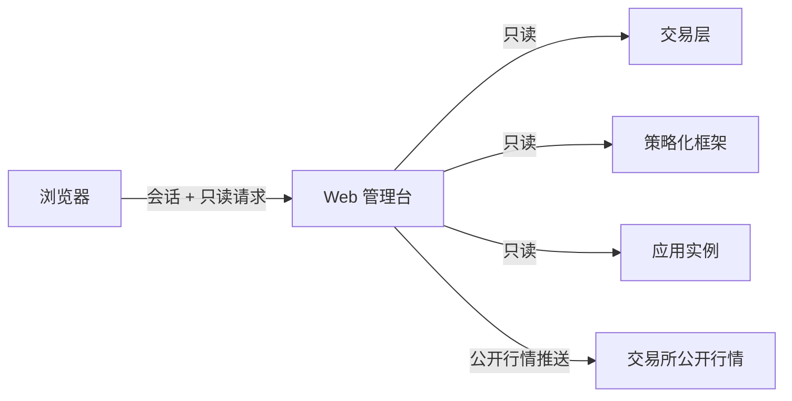

# Web 管理台式样书

版本：3.0.0

对应设计书：[04_Web管理台设计书](04_Web管理台设计书.md)。需求编号 S4，验收编号 T4。

## 1 定位

Web 管理台（P4）是一个只读的观察与追溯界面，用来回答四个问题：

- 系统现在在观察什么；
- 为什么得到当前的目标仓位；
- 目标是否被实际执行；
- 案例和参数是怎样演变的。

管理台属于运维层，只读取交易层（P1）、策略层（P2）和应用层（P3）公开的只读接口。它不持有交易所凭据，不直连数据库，也不写入任何下层状态。关闭管理台不影响交易保护、框架周期和实例运行；管理台也不是故障时的交易所应急通道。

管理台页面不提供以下操作：下单、撤单、修改止损、手工评分、启动实盘、授予信号资格、编辑提示词、手工批准学习、改变业务政策。

三类信息各自保留来源和状态：交易层的事实、框架的判断、应用的分析。页面显示成功，不等于评分已准入、订单已成交、参数已生效或实盘可用。

## 2 访问与范围

### S4-001 登录、范围与环境识别

- **先登录**：除登录页和静态资源外，所有页面和数据都要求管理台本地用户的有效会话。
- **范围由服务端限定**：每个用户只能看到登记给他的“查看范围”。一个查看范围对应一组固定的绑定：部署、环境、实例、交易账户运行、交易对象和观测对象。修改地址或参数不能越过范围。
- **环境醒目**：页面固定显示当前范围的 SIM/LIVE、实例和运行绑定。
- **切换只换查看对象**：切换环境或范围只改变正在看的对象，不改变任何服务的部署环境或账户配置。
- **范围失效**：当前范围失效时要求重新选择，不自动换到另一个实盘范围。
- **能力**：用户能力只有“查看”和“导出”两种，导出需要单独授予。

### S4-015 部署与秘密

- **部署位置**：管理台在本机、授权局域网，或按 S4-018 经认证隧道部署。
- **浏览器不保存秘密**：浏览器中没有下层访问令牌、交易所或模型密钥、提示词或数据库连接。只有显示偏好可以保存在浏览器本地。
- **服务端再次检查**：每次读取都由服务端重新检查会话、范围与环境。
- **公开示例只含虚构数据**：仓库里的示例和夹具只用虚构记录，不含真实账户、原文、地址或提示词。
- **缺配置不连实盘**：缺少本地配置时以明确的夹具或不可用状态运行，不能连接实盘。夹具模式只允许本机地址和 SIM 环境。

### S4-018 经认证隧道的远程访问

用户可以通过登记的公网域名远程查看管理台，条件如下：

- 域名入口先由隧道边缘认证，未认证的请求到不了管理台。
- 管理台只接受本机和登记隧道主机的连接。来自隧道主机的请求，其主机名必须是登记的公开地址；改变状态的请求，其来源（Origin）必须是登记的公开地址。
- 进入后仍要管理台本地登录，会话和权限规则不变。
- 远程访问只开放只读页面，不增加写操作。
- 隧道停止或失效时，本地访问和下层运行不受影响。
- 隧道令牌和边缘配置属于部署环境的凭据，不进入仓库。

## 3 页面

页面以通用的对象、实例、交易运行和产品标识组织，导航和通用表格中不写死某个交易对象。

| 页面 | 内容 |
|---|---|
| 总览 | 账户、持仓、保护、运行、策略对象、情绪池、最近决策 |
| 研判与止损 | 见 S4-017 |
| 行情 | K 线、价格点、产品规则 |
| 事件与评分 | 事件列表、事件详情与各版本评分 |
| 情绪组成 | 情绪池与逐笔贡献账本 |
| 决策与目标 | 周期决策、框架目标、交易层目标、持仓 |
| 执行与账务 | 持仓、订单、成交、保护、收入、归属、外部事实 |
| 案例与归因 | 案例列表、案例详情、归因与反事实 |
| 参数学习 | 参数、学习决策、参数生效、验证记录 |
| 运维 | 交易层运行质量、告警、策略对象状态 |
| 审计追溯 | 交易层与策略层各自的审计记录 |

### S4-002 总览与独立运行状态

- **内容**：实际权益与保证金、持仓、保护、风险状态、执行恢复状态、策略对象状态、情绪净值与最近决策。
- **按来源独立**：每一块按事实的可用程度标注（S4-013）。某个上层服务离线时，已经可用的下层信息仍然显示。
- **原样显示未就绪状态**：`UNKNOWN`、未登记、只供实验或未验证的实盘能力必须原样显示并说明，不能被页面上其他正常的区块“带成”已就绪。

### S4-003 行情与时间语义

- **价格分用途**：目标产品的 K 线、可成交价、标记价和指数价分别标明用途。参考资产价格另行标明，不能混成合约行情。
- **只用当时已有的记录**：历史视图只含当时已可用的记录。没有目标产品的数据时显示缺失，不能拿参考资产的历史代替。
- **区分最终 K 线**：最终 K 线与正在形成的 K 线必须分开（正在形成的 K 线只来自 S4-019 的参考层）。
- **时间分开显示**：事件的公开时间、接收时间、可用时间和评分完成时间分别显示。交易影响按实际生效时间标注，不把后来完成的评分放回新闻公开的时刻。
- **显示时区**：可以选择显示时区（UTC、东京、上海），图表坐标轴和十字线也跟随。查询和记录始终使用 UTC 绝对时间，夏令时不改变事件顺序。

### S4-004 事件与修订

- **事件列表**：显示事件类型、主体、事项、来源摘要、版本，以及转载、确认、修订、撤销的关系，可以按时间检索。
- **证据引用**：详情显示事实所引用的证据标识、哈希和引用位置，不提供原文。
- **版本可对照**：最新版本与历史版本可以对照。转载不表现为新的交易贡献；确认、实质修订和撤销分别标注。历史决策仍引用其当时的版本。

### S4-005 矢量评分与准入结果

- **评分内容**：方向、影响程度、生命周期、置信或质量，以及模型、量表、校准和提示词的版本标识。提示词正文不进入页面。
- **生产与准入分开**：评分的生产结果和框架的准入结果分区显示。弃权、仅研究、隔离、待价格、待生效、已应用和已被替代，不能混成“评分成功”。
- **浏览器不注入**：修订可以比较前后差异，但浏览器不把差异注入情绪池。

### S4-006 情绪组成与衰减追溯

- **内容**：正向池、负向池、净值和逐事件贡献。
- **贡献详情**：初始量、剩余量、时间消耗、价格兑现、修订差额、失效清除，以及所用的冻结参数版本。
- **不由页面推演**：图表只表示框架已经记录的结果。没有历史样本时显示当前快照，不能由页面重算出一条看似真实的衰减历史。

### S4-007 决策与目标/实际仓位

- **决策内容**：周期、输入截止时间、参数版本、前后等级、投影后的目标、实际与未成交仓位、保护计划和确定性的理由。
- **四种状态分开**：目标送达、交易层受理、订单状态和成交事实分别显示。受理不等于成交；送达结果未知时不显示为已成交，也不自动重发。
- **不同观测时点**：各层的数据分别显示自己的观测时间和版本，不合成同一时点。
- **历史引用保留**：保留旧的归属代次、目标版本和历史引用，失效的目标不当作当前要求。暂停、风险拒绝、过期和恢复锁都显示原因。

### S4-008 持仓、订单、保护与账务

- **内容**：实际持仓、订单、成交、保护覆盖与核验时间，以及手续费、资金费、其他收入和外部资金流。
- **账务以交易层为准**：不用订单报价、目标数量或页面价格估算真实收益。
- **单位与模式**：不同币种保留各自单位。账户保护的观察模式与执行模式分别显示，“本应触发”与实际风险锁分别显示。
- **保护状态不混用**：“保护已发出”和“保护已核验”不能用同一个状态表示。

### S4-009 案例、归因与反事实

- **状态与标签分开**：案例状态（进行中、观察中、成熟、删失）与标签（未成熟、未知、中性、正确、错误）分开显示。
- **案例内容**：实际成交、风险批次、成本组成、退出和观察结束时间。
- **不提前定论**：未成熟的案例不产生确定的正确率。
- **三类收益分开**：归因候选与已验证归因分开；真实收益、研究反事实和冻结对照分开；未知和执行污染有明确标识。

### S4-010 参数学习与自动生效

- **内容**：学习理由、证据、样本或有效样本量、固定步长、前后参数版本、发布/拒绝/冻结/回滚状态和生效时点。
- **无记录即“未记录”**：现有记录证明不了的结果显示“未记录”，不能只凭参数值不同就推断已经发布。
- **不加批准门**：门控合格后的自动生效不等待用户查看页面。管理台没有逐笔批准门，也不把模型或提示词的更换归入普通参数学习。

### S4-011 运维

- **内容**：交易层的运行质量与恢复状态、告警、策略对象状态。
- **不补造结果**：没有提供的能力显示“未配置”或“不适用”，不补造结果。

### S4-012 告警、审计与导出

- **告警**：显示来源、首次和最近时间、当前状态。浏览过不等于故障已解决。
- **审计**：可以按关联标识追溯交易层与策略层各自的审计记录；隐私内容与提示词不能导出。
- **导出**：有导出能力的用户可以把当前范围内的一页数据导出为 JSON 或 CSV。导出内容与页面显示的脱敏数据相同，标注范围、绑定版本和生成时间，也不生成暗含未展示内容的附件。

## 4 刷新与使用

### S4-013 刷新、缺数和恢复

- **读已提交状态**：首次访问、手动刷新和周期刷新都只读下层已提交的状态。
- **每块独立的状态**：每个数据块独立显示以下状态之一，并说明原因：

  | 状态 | 含义 |
  |---|---|
  | 可用 | 读到并通过校验 |
  | 空 | 读到，结果为空 |
  | 陈旧 | 本次读取失败，显示上一次成功的结果并标明其时间 |
  | 不可用 | 读取失败或校验不通过 |
  | 缺失 | 下层没有这条记录 |
  | 禁止 | 下层拒绝了访问范围 |
  | 未配置 | 这个范围没有登记该服务 |
  | 不适用 | 该绑定没有这项内容（例如没有观测对象） |

  空数组、空值、零金额和请求失败是不同的状态。
- **旧值标明年龄**：出错时保留上一次成功的结果并标明其时间，不能继续当作当前值。
- **绑定不一致即中止**：下层返回的环境、实例、运行或对象与范围的绑定不一致时，整页拒绝显示，而不是显示为空。
- **恢复**：页面重新可见后重新核验会话并刷新；会话失效时读不到任何数据。过期的响应或其他范围的响应不能覆盖当前页面。
- **页面不可见时不刷新**：页面在后台时停止周期刷新和实时推送。
- **退出即清空**：退出或撤权后清除页面数据和会话，切换范围不能带着前一范围的缓存。

### S4-014 检索与使用体验

- **语言**：默认中文；状态码同时保留原值和解释。
- **长列表**：支持筛选、排序、分页、列选择和详情定位，检索范围可复现。分页游标与范围、用户和筛选条件绑定，换了条件就失效。
- **布局**：宽屏适合行情与表格并排查看，窄屏可以滚动阅读全部字段。
- **可访问性**：主要流程可以用键盘操作；状态含文字，不只依赖颜色。
- **只用授权数据**：复制标识或导出只使用已获授权的数据。

### S4-016 可扩展性

- **新增实例不改算法**：新增实例只登记新的查看范围和绑定，不修改交易或量化算法。
- **实例专有页面**：实例专有的来源和模型信息由独立页面适配。
- **能力状态**：每个页面可以标为可用或不适用；没有观测对象的绑定，事件、情绪、案例和学习相关页面为不适用。

## 5 研判与止损页

### S4-017 研判、止损与基线

这一页用来观察应用实例的新闻研判与止损管理。全部内容只读，每一块标注来源、记录时间和状态。

| 区块 | 来源 | 内容 |
|---|---|---|
| 仓位与账户 | P1 | 方向、数量、均价、权益、浮动与已实现盈亏、手续费、风险状态 |
| 持仓盈亏 | P1 | 见 S4-020 |
| 三层止损与价格 | P3 + P1 | 收盘止损、交易所策略止损、保险止损（见下） |
| 行情图 | P1 + P3 | 目标合约的最终 K 线，叠加入场价、三条止损线和研判标记 |
| 研判时间线 | P3 | 每次研判及其是否生效 |
| 动作时间线 | P3 | 注入、失效、开仓、移动止损、收盘退出、转基线、批次结束、基线的暂停/重开/归零 |
| 判断链与行情基线 | P3 | 当前判断链的方向、信心、起点和研判数；基线的阶段、方向和数值 |
| 框架状态 | P2 | 风险单位、再入场门、判断链亏损等框架已公开的字段，原样显示 |
| 新闻来源与开仓计划 | P3 | 各来源最近成功时间与是否中断；下次开仓的初始止损计划及所用波动表版本 |

**三层止损与价格**：

- **收盘止损**：由应用实例记录，按完成的 K 线收盘价判断，不挂单。注明它来自初始止损、移动止损还是阶梯止损。
- **交易所策略止损**和**保险止损**：来自交易层的保护，显示角色、触发价、触发口径和核验状态。只画仍在保护当前持仓的那一代保护。
- **每条线**：显示相对最新收盘价（以及参考标记价）的距离，以及移动止损启动价、是否已启动移动止损、是否已转入基线和本批风险预算。
- **阶梯止损**：登记了阶梯的实例，另列阶梯步长、当前级数和锁定价，并给出下一级的触发收盘价和到达后的收盘止损（图上画成虚线）。没有登记阶梯的实例不显示这些内容。
- **待执行的退出**：有尚待执行的收盘止损退出时，标出它的有效截止时刻。

**行情图**：

- 默认只在改变了仓位依据的研判时刻标出方向与信心，并写明动作（注入、作废原链、修订）。
- 只记录、没有改变仓位的研判默认不画；选中“显示未生效的研判”后以灰点显示。
- 另外标出时间范围内各批次开仓与平仓的时刻和价格。
- 价格轴默认按 K 线范围缩放；选中后才把止损线纳入范围。超出 K 线范围的止损线列在图下，不会悄悄落在屏幕外。
- 图只画已记录的数据，不画预测线。

**研判时间线**：每次研判的时间、方向、信心、影响时长、理由、反面因素、失效条件、引用的新闻标题与来源。失败的研判显示原因。每条研判注明是否生效（“注入 / 作废原链 / 修订”及原因，或“仅记录，未改变仓位”），依据与动作时间线相同的动作记录。

**规则**：

- 距离、R 倍数等只是显示换算，标明所用的价格与时间，不是账务事实。账务以交易层为准。
- 三个来源的观测时间不同时，并列各自时间，不合成同一时点。
- 尚无批次、尚无研判、应用实例未配置时，分别显示“无持仓”“未记录”“未配置”。
- 页面不提供平仓、改止损、触发研判或修改参数的操作。

### S4-019 实时参考行情

研判与止损页上有一层实时参考：管理台服务端订阅交易所的公开行情推送（标记价和正在形成的 K 线），再通过同一会话推给浏览器。

| 内容 | 说明 |
|---|---|
| 参考标记价 | 最新收到的标记价和交易所给出的时间 |
| 参考浮动盈亏 | 交易层当前仓位数量 ×（参考标记价 − 交易层持仓均价），并按本批风险预算换算成 R；与交易层的浮动盈亏并排显示，标明“参考” |
| 止损梯 | 增加“参考标记价”一行，各价位增加“相对参考标记价”的距离 |
| K 线图 | 在最后一根最终 K 线之后画出正在形成的那一根（半透明）；它收盘后，以交易层记录的最终 K 线为准 |

规则：

- **只用公开行情**：参考值只来自交易所的公开行情，不需要账户凭据。
- **不进入任何账务或决策**：参考值不写入任何存储，不参与交易层账务、框架决策或应用实例的止损判断。账本上的数字仍按刷新周期读取。
- **四种状态**：

  | 状态 | 页面表现 |
  |---|---|
  | 连接中 | 等待第一条推送 |
  | 实时 | 正常更新 |
  | 过期 | 超过登记的秒数没有收到推送；数字变灰，显示最后收到的时间 |
  | 不可用 | 连接失败，或该绑定不适用 |

- **不影响其他区块**：参考层不可用时，页面其余部分照常显示。
- **只对登记的来源启用**：只有登记了公开行情来源的交易所和产品才启用参考层，其他绑定显示“不适用”。
- **随会话结束**：会话失效、退出或撤权后，推送最迟在一个登记的心跳周期内停止。
- **共享连接**：同一产品的多个浏览器共享一条上游连接，最后一个离开后在登记的空闲时间后关闭。总推送数有上限。

### S4-020 持仓盈亏与真实资金费

研判与止损页的“持仓盈亏”区块，数字全部来自交易层（P1 S1-024），管理台只做展示，不自行计算账务。

- **两行**：“当前持仓”（本轮持仓开出以来，没有持仓时不显示）和“累计”（运行以来）。
- **标明来源**：每个数字旁标明“交易所”或“系统计算”。
- **三种运行方式**：

  | 运行方式 | 显示 |
  |---|---|
  | 系统内部模拟撮合 | “按真实资金费”的合计，拆成交易盈亏与真实资金费两项，均标“系统计算” |
  | 模拟盘 | 并排显示“模拟盘实际”（交易盈亏 + 模拟盘资金费，标“交易所”）与“按真实资金费”（交易盈亏 + 真实资金费，资金费标“系统计算”），并列出两者的资金费差额 |
  | 实盘 | 实际盈亏（交易所）；参考资金费只用来核对，一致时不单独显示，不一致时显示告警与差额 |

- **时刻**：同时显示交易所数字的观测时刻，以及真实资金费结算记录截至的时刻；模拟撮合与模拟盘的记录过期时显示“资金费待更新”。
- **缺项不替代**：交易所数字未取得、交易层没有提供该区块时，对应位置显示“未取得”或“未提供”，不用其他数字代替。

## 6 用户操作流程

1. 登录，选择允许查看的范围，确认运行绑定。
2. 先看总览的事实状态，再进入行情、事件或决策的详情。
3. 由事件版本定位评分和贡献，由贡献定位周期决策，再关联目标、订单和实际成交。关联缺失时明确停止追溯并提示缺项。
4. 由实际案例进入观察、归因和学习记录，对照证据和生效版本。
5. 退出或撤权后清除页面数据和会话。

## 7 与其他层的关系

- 交易事实与最终风控以 P1 为准，确定性计算与学习以 P2 为准，研判、止损与日程以 P3 为准。本书不改变这些业务规则。
- 管理台读取的接口：P1 的只读查询（含 S1-024 的盈亏）、P2 的只读追溯（S2-024）、P3 的研判、止损和基线状态查询（S3-032）。

## 8 验收

| 编号 | 场景 | 应达到的效果 | 覆盖 |
|---|---|---|---|
| T4-01 | 未登录、越权和跨范围访问 | 服务端拒绝；不泄漏秘密或其他范围的数据 | S4-001、S4-015 |
| T4-02 | 应用实例或前端停止 | P1/P2 运行不受影响；已有的下层事实仍可查看 | S4-002、S4-016 |
| T4-03 | 产品无历史、正在形成的 K 线、参考价陈旧 | 产品、时间和质量清楚，不造合约历史 | S4-003 |
| T4-04 | 转载、修订、撤销 | 历史版本可追溯；不提供原文 | S4-004、S4-005 |
| T4-05 | 衰减、兑现、修订及缺历史 | 显示已记录的账本与版本，不由页面推演业务值 | S4-006 |
| T4-06 | 目标已受理、未知、拒绝、部分成交 | 送达、受理和实际事实分开，不重复提交 | S4-007、S4-008 |
| T4-07 | 收益含手续费、资金费和外部资金流 | 金额、单位、来源正确，观察与执行不混淆 | S4-008 |
| T4-08 | 未成熟、删失、未知及反事实案例 | 不提前定标签，不混入真实收益 | S4-009 |
| T4-09 | 用户离线时自动发布或回滚 | 下层按既有门控执行，页面只展示历史，不增加批准门 | S4-010 |
| T4-10 | 服务失败、能力未配置 | 显示真实状态；未配置不显示虚构成功 | S4-011 |
| T4-11 | 导出与审计 | 范围内记录可复现；无秘密、原文或隐藏数据 | S4-012、S4-015 |
| T4-12 | 断网、迟到响应、切换范围、401/403、绑定不一致 | 旧值标陈旧；旧响应不覆盖新范围；撤权后清空；绑定不一致整页拒绝 | S4-013 |
| T4-13 | 键盘与窄屏阅读 | 导航、表格与详情可用；文字说明完整 | S4-014 |
| T4-14 | 新增虚构实例、不提供应用实例或缺本地配置 | 通用页面不改算法；缺项与夹具状态明确；夹具模式只允许本机与 SIM | S4-002、S4-015、S4-016 |
| T4-15 | 研判与止损页：有/无持仓、研判失败、应用实例未配置、三源时间不一致、生效与仅记录的研判 | 三层止损与来源、时间正确；缺项分别标注；换算不当作账务；图上默认只标生效研判与开平仓，选中后才显示未生效研判；时间线的生效标注与动作记录一致；无写操作 | S4-017 |
| T4-16 | 未经边缘认证、非登记主机直连、错误的主机名或来源、隧道停止 | 请求被拒且不泄漏数据；登录与会话规则不变；本地访问照常 | S4-015、S4-018 |
| T4-17 | 推送正常、中断或过期、无持仓、会话过期、不适用的绑定 | 参考值按秒更新并标明“参考”；中断或过期时数字变灰或显示不可用，账本区块不受影响；会话失效后一个心跳周期内推送停止；无写操作 | S4-019 |
| T4-18 | 内部撮合、模拟盘、实盘一致与不一致、交易所数字未取得、结算记录过期、交易层未提供该区块 | 来源标签与数字对应交易层输出；模拟盘的两种合计与资金费差额正确；缺项显示未取得或未提供，不以其他数字代替；过期显示待更新；无写操作 | S4-020 |
| T4-19 | 有阶梯与无阶梯的实例、未到第 1 级、收盘止损的三种来源、待执行的收盘止损退出 | 阶梯步长、级数、锁定价与下一级按应用实例的数字显示，图上有下一级虚线；无阶梯的实例不显示阶梯；来源与待执行标记正确；无写操作 | S4-017 |
