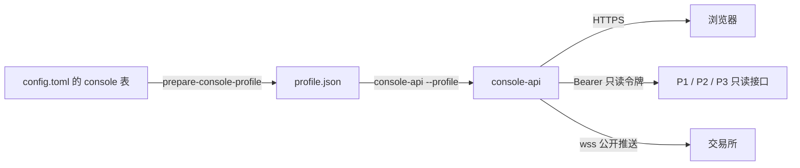

# Web 管理台设计书

版本：2.21.0

对应式样书：[04_Web管理台式样书](04_Web管理台式样书.md)。本书说明 `src/factorforge/applications/console` 的实现。

## 1 结构

### 1.1 包

| 包 | 职责 |
|---|---|
| `domain` | 查看范围（`Selection`）、用户、策略（`Policy`）、错误码、严格 JSON 解码、下层只读路由表（`Routes`）、响应投影（`Project`） |
| `application` | 会话（`SessionService`）、范围登记（`SelectionRegistry`）与绑定核验（`Validate`）、页面读取（`ReadQuery`）、实时参考（`LiveHub`） |
| `adapters` | 下层只读 HTTP 客户端（`HTTPRead`）、交易所公开行情推送（`MarketStream`） |
| `ports` | `ReadClient` 接口 |
| `api` | HTTP 处理、OpenAPI 文档 |
| `config` | 私有配置的读取、校验与派生 |
| `entrypoints/console-api` | 服务进程 |
| `web` | 浏览器前端（React + TypeScript，Vite 构建） |

`adapters` 只发固定范围的 GET 请求，不引入签名器、工作负载服务、数据库或其他应用的内部包。

### 1.2 进程与配置文件



1. 运维在私有配置 `config/config.toml` 的 `[console]` 表中登记管理台。
2. `tools/prepare-console-profile` 读取它（`-config`），校验后写出派生文件（`-out`，默认 `runtime/console/profile.json`）。
3. `console-api --profile <派生文件>` 启动服务。

**私有文件读取（`privateRead`）**：两个文件都必须是普通文件（不跟随符号链接）、不允许组和其他用户的任何权限、不超过 16 MiB，否则返回 `PRIVATE_PROFILE_REQUIRED`。

**派生（`config.Prepare`）**：把 TOML 解码为 `Profile` 并调用 `Validate`。写出的 JSON 分为两部分：`settings`（不含用户的 `Profile`）和 `users`（用户凭据单独一组）。目标文件以独占方式新建，权限 0600；已存在时返回 `PROFILE_ALREADY_EXISTS_OR_UNWRITABLE`，不覆盖。

**载入（`config.Load`）**：用严格解码（`domain.Decode`）读取派生 JSON，任何一层出现重复键或未知字段都拒绝；`settings` 中带用户时也拒绝。然后把 `users` 合入 `Profile` 并再次 `Validate`。

用户凭据分开存放，是为了让 `domain.User` 的 JSON 形式不含秘密：`username`、`password_hash`、`selection_ids` 和 `authorization_version` 在 `User` 上标为不输出 JSON，只能从 TOML 和派生文件的 `users` 组读入。

### 1.3 启动（`console-api`）

1. `config.Load` 读入并校验配置。
2. 由每个 `bindings` 条目建立查看范围（`Binding.Selection`），以及“范围 → 下层服务”的对照。
3. 建立 `SelectionRegistry`、`SessionService` 和 `HTTPRead`；`HTTPRead` 的超时取 `timeout_seconds`，单次响应上限取 `max_bytes`。
4. `live_market` 启用时建立 `LiveHub`，见第 7 章。
5. 建立 HTTP 服务：监听 `host`:`port`；请求头、读、写的超时都取 `timeout_seconds`；空闲连接超时取 `session_seconds`；请求头上限取 `max_bytes`。
6. 夹具模式（`fixture_only`）且未登记证书时用明文 HTTP，其余情况用 `tls_cert_file` 和 `tls_key_file` 提供 HTTPS。
7. 收到 SIGINT 或 SIGTERM 后在 `timeout_seconds` 内关闭。

任何一步失败，进程只输出 `CONSOLE_START_FAILED` 并退出，不打印配置内容。

## 2 配置

### 2.1 服务设置（`config.Profile`）

`schema_version` 必须为 1。

**监听与静态文件**：

- `origin`：管理台对外的地址（协议 + 主机 + 端口，无路径）。用于来源检查（第 3 章）和对交易所推送连接的 Origin 头。必须是 `https`；只有夹具模式且主机为本机地址时允许 `http`。
- `host`、`port`：监听地址。
- `tls_cert_file`、`tls_key_file`：证书与私钥。非夹具模式必填。
- `static_dir`：前端构建产物目录，必填。
- `fixture_only`：夹具模式。开启时 `host` 必须是本机地址，所有 `bindings` 的环境必须是 `SIM`，且不能登记 `trusted_peers` 或启用 `live_market`。

**会话与限流**（单位秒的字段必须在 1 和 Go 时长上限之间）：

- `session_seconds`：会话有效期。
- `challenge_seconds`：登录挑战有效期。
- `rate_window_seconds`、`max_attempts`：在一个窗口内全局最多尝试登录的次数。
- `max_sessions`：同时存在的会话数上限。
- `max_challenges`：同时存在的挑战数上限。
- `max_hash_iterations`：密码哈希迭代次数的上限，防止配置写入过大的值拖慢登录。

**读取预算**：

- `timeout_seconds`：单次下层请求和浏览器请求的超时。
- `max_bytes`：单个下层响应、请求体、导出文件的字节上限。
- `max_records`：单个下层响应可含的行数上限。
- `default_limit`、`max_limit`：一页的默认行数和上限。
- `max_pages`：核验观测对象时，最多翻读的对象目录页数。
- `cursor_seconds`：分页游标有效期。
- `cursor_key`：游标签名密钥，至少 32 字节。

`Policy.Valid` 还要求：`max_limit ≥ default_limit`，`max_records ≥ max_limit`，所有上限为正。

**前端刷新**：

- `refresh_seconds`：周期刷新间隔，至少 1。
- `max_retries`：前端失败重试次数，不小于 0。

两者通过 `/capabilities` 交给前端。

**远程访问与实时参考**：`trusted_peers` 见第 3 章，`live_market` 见第 7 章。

**用户与范围**：`users` 见 2.3，`bindings` 见 2.2。`bindings` 至少一条，`selection_id` 不能重复；每个用户的 `selection_ids` 必须都在 `bindings` 中。

示例（中性值）：

```toml
[console]
schema_version = 1
origin = "https://console.example.invalid"
host = "127.0.0.1"
port = 8443
static_dir = "runtime/web-build"
session_seconds = 7200
challenge_seconds = 120
rate_window_seconds = 600
max_attempts = 5
timeout_seconds = 12
max_bytes = 2097152
max_records = 2000
default_limit = 40
max_limit = 400
max_pages = 16
refresh_seconds = 20
max_retries = 3
```

### 2.2 查看范围与下层服务（`config.Binding`）

一个 `bindings` 条目登记一个查看范围：

- `selection_id`：范围标识。
- `deployment_id`、`environment`（`SIM` 或 `LIVE`）、`instance_id`：部署、环境和实例。
- `account_id`、`run_id`：交易层的运行键，与 `environment` 一起组成 `TradingRunKey`。
- `venue`、`product`、`instrument_id`：交易对象。`product` 必须是 `LINEAR_PERPETUAL`。
- `object_id`：策略框架的观测对象，可以为空。为空时，策略框架的读取返回“不适用”，周期报告的读取被拒绝（`OBJECT_SCOPE_REQUIRED`）；`/capabilities` 把依赖观测对象的页面都标为 `NOT_APPLICABLE`。
- `owner_id`：交易层的归属标识。
- `binding_version`：绑定版本，由运维在绑定变化时更换，前端用它判断响应是否属于当前绑定。

所有标识都必须满足 `^[A-Za-z0-9_.-]{1,128}$`（`domain.ID`）。

`services` 登记这个范围读取的三个下层服务（`adapters.Services`）：`trading`（P1）、`strategy`（P2）、`instance`（P3）。每个服务（`adapters.Service`）有：

- `url`：服务根地址，不含用户信息、路径、查询或片段。必须是 `https`；只有服务的 `fixture_only` 开启、主机为本机地址且范围环境为 `SIM` 时允许 `http`。
- `token`：该服务的只读 Bearer 令牌，只在服务端使用。
- `fixture_only`：该服务为夹具。开启时范围环境必须是 `SIM`。

`url` 或 `token` 为空时，该服务的读取返回 `READ_NOT_CONFIGURED`，页面对应区块显示“未配置”。

### 2.3 用户（`domain.User`）

- `user_id`、`display_name`：标识和显示名。
- `username`：登录名，不能与其他用户重复。
- `password_hash`：`$pbkdf2-sha256$<迭代次数>$<盐>$<摘要>`，盐至少 16 字节，摘要 32 字节，迭代次数为 1 到 `max_hash_iterations`。`application.HashPassword` 用 32 字节随机盐生成这个格式，迭代次数由运维给出。
- `selection_ids`：允许查看的范围，至少一个。
- `capabilities`：必须含 `view`，可以再加 `export`，不允许其他值。
- `authorization_version`：授权版本。修改用户的范围或能力时更换，已有会话随即失效（4.3）。

## 3 HTTP 入口

所有请求先经过一层总处理（`api.New` 返回的处理器），依次：

1. **来源主机**：登记了 `trusted_peers`（IP 或 CIDR，单个地址视为单主机前缀）时，只接受本机地址和这些地址的连接，否则返回 `PEER_FORBIDDEN`。来自非本机地址的请求，`Host` 的主机名必须等于 `origin` 的主机名，否则返回 `HOST_FORBIDDEN`。没有登记 `trusted_peers` 时不检查来源主机，由监听地址限制访问。
2. **固定响应头**：`Cache-Control: no-store`、`X-Content-Type-Options: nosniff`、`Referrer-Policy: no-referrer`，以及 `Content-Security-Policy`：脚本和连接只允许同源，样式另允许内联，图片另允许 `data:`，禁止被嵌入页面。
3. **跨站请求**：`Sec-Fetch-Site: cross-site` 的请求一律拒绝（`CSRF_REJECTED`），唯一例外是对非 `/api/` 路径的顶层 GET/HEAD 页面导航（静态页面和 `/openapi.json`），这些路径不读取会话、没有副作用。
4. **只读**：`/api/v2/console/` 下除登录（`POST /session`）和退出（`DELETE /session`）外，只允许 GET，否则返回 `READ_ONLY`。
5. 其他 `/api/` 路径返回 `RESOURCE_NOT_FOUND`。

错误响应统一为 `{code, message, retryable}`，`retryable` 在状态码 503 时为真。限流错误带 `Retry-After`（秒，向上取整）。

**静态文件（`serveStatic`）**：只服务前端路由（`/`、`/login` 和各页面路径，都返回 `index.html`）、`/assets/` 下的文件（拒绝 `..` 和 `.map`）和两份第三方许可文本。解析符号链接后，文件必须仍在 `static_dir` 之内并且是普通文件。`static_dir` 不存在时返回 `WEB_NOT_BUILT`。

`GET /openapi.json` 返回管理台自身接口的 OpenAPI 文档（`api.OpenAPI`）。

## 4 会话（`SessionService`）

### 4.1 挑战

`GET /api/v2/console/session/challenge`（不允许查询参数，拒绝跨站）：

- 先清理过期的挑战和会话。挑战数已达 `max_challenges` 时返回 `AUTH_RATE_LIMITED`。
- 生成随机挑战标识和 CSRF 值（各 32 字节），记下对端地址，有效期 `challenge_seconds`。
- 挑战标识放进 `__Host-factorforge-challenge` Cookie（`HttpOnly`、`Secure`、`SameSite=Strict`），CSRF 值和到期时间放在响应体。

### 4.2 登录

`POST /api/v2/console/session`，请求体 `{username, password, csrf}`，`Origin` 必须等于 `origin` 且不是跨站请求，请求体不超过 `max_bytes`：

1. 取出并作废挑战。挑战不存在、对端地址不同或 CSRF 不符时返回 `CSRF_REJECTED`。一个挑战只能用一次。
2. 限流：窗口（`rate_window_seconds`）到期就清零计数；计数已达 `max_attempts` 时返回 `AUTH_RATE_LIMITED`，并给出到窗口结束的等待时间。否则计数加一。
3. 按 `username` 找用户。找不到时，取任意一个已登记用户的哈希参数照样算一次，使不存在的用户名也要付出一次哈希计算。
4. 用 PBKDF2-SHA256 计算摘要并做常数时间比较。不符或用户不存在时返回 `AUTHENTICATION_FAILED`。
5. 会话数已达 `max_sessions` 时返回 `AUTH_RATE_LIMITED`。
6. 建立会话：随机会话标识和新的 CSRF 令牌，记下用户和 `authorization_version`，有效期 `session_seconds`。

成功后清掉挑战 Cookie，作废请求中原有的会话，把会话标识放进 `__Host-factorforge-session` Cookie，响应体返回 `{user_id, display_name, capabilities, expires_at, csrf}`。

### 4.3 当前会话与退出

- **当前会话（`Current`）**：会话不存在、已过期、用户已不存在，或用户的 `authorization_version` 与会话记录的不同时，删除会话并返回 `AUTHENTICATION_REQUIRED`（401）。`GET /session` 返回会话视图。每个需要登录的接口都先调用它，失败时清除会话 Cookie。
- **退出**：`DELETE /session` 要求同源，并在 `X-CSRF-Token` 头中带登录时返回的 CSRF 令牌，常数时间比较后删除会话。

会话和挑战只保存在进程内存中，服务重启即全部失效。

## 5 查看范围与绑定核验

### 5.1 范围登记（`SelectionRegistry`）

- `List(user, environment)`：按用户的 `selection_ids` 返回范围，可按环境筛选。对应 `GET /selections?environment=`，环境只能是 `SIM` 或 `LIVE`。
- `Get(user, id)`：范围不存在或不在用户的 `selection_ids` 中时返回 `SELECTION_FORBIDDEN`。
- `Revoke(id)`：撤下一个范围，之后对它的所有读取都被拒绝。

### 5.2 绑定核验（`Validate`）

每次页面读取前，对本次涉及的每个下层服务分别核验绑定（并行）：

| 服务 | 核验 |
|---|---|
| 交易层 | 健康接口的 `schema_version` 为 `trading-2.0`、环境与范围一致、`upper_layers_required` 为假；运行的 `run_key` 等于范围的运行键；产品列表中有范围的交易对象 |
| 策略框架 | 观测对象为空时“不适用”；健康接口为 `strategy-2.0`、环境一致、监听者为 `PUBLIC_RESEARCH`；在对象目录中（最多翻 `max_pages` 页，游标不前进即视为响应无效）找到观测对象；对象详情的对象、实例、环境、归属、运行键和交易对象都与范围一致 |
| 应用实例 | 健康接口（或研判状态接口）为 `instance-2.0`，环境和实例与范围一致 |

不一致返回 `BINDING_MISMATCH`（409）。这是硬错误：整次读取失败，前端整页拒绝显示，而不是显示为空。其他核验失败只让该服务的区块不可用，不影响其他服务。

`GET /capabilities?selection_id=` 返回每个页面的状态（`AVAILABLE` 或 `NOT_APPLICABLE`）以及 `refresh_seconds` 和 `max_retries`。带范围时先核验三个服务，绑定不一致即拒绝；观测对象为空时，事件、事件详情、情绪、案例、案例详情和学习页为 `NOT_APPLICABLE`。

## 6 页面读取

### 6.1 视图与下层路由

页面接口是 `GET /api/v2/console/<视图>?selection_id=…`。每个视图读取一组下层资源（`application.Views`），每个资源对应一个下层只读路由（`domain.Routes`）：

| 视图 | 资源 |
|---|---|
| `overview` | `account` `positions` `protections` `run` `object` `pool` `decisions` `instance.health` |
| `dynamic` | `dynamic.status` `dynamic.judgments` `dynamic.actions` `account` `positions` `protections` `object` `candles` |
| `market` | `candles` `points` `instruments` |
| `events` / `events/{event_id}` | `events` / `event` `scores` |
| `evidence/{evidence_id}` | `evidence` |
| `sentiment` | `pool` `ledger` |
| `decisions` | `decisions` `strategy.targets` `trading.targets` `positions` |
| `execution` | `positions` `orders` `fills` `protections` `income` `owners` `external-facts` |
| `cases` / `cases/{case_id}` | `cases` / `cases` `attributions` `counterfactuals` |
| `learning` | `parameters` `learning` `activations` `validation` |
| `operations` | `trading.operations` `alerts` `object` `instance.health` `sources` `jobs` `budgets` |
| `reports` | `reports` |
| `audit` | `trading.audit` `strategy.audit` `instance.audit` |

每个路由登记了所属服务、路径模板和允许的下层查询参数。路由表是固定的，浏览器不能指定任意下层路径。

### 6.2 浏览器查询参数（`api.filter`）

所有视图都接受 `selection_id`（必填）、`source`、`cursor`、`limit`，另外按视图接受：

| 视图 | 额外参数 |
|---|---|
| `market` | `interval` `start` `end`（必填） |
| `dynamic` | `interval` `start` `end`（必填）、`from` `to` |
| `events` `reports` `audit` `learning` | `from` `to` |
| `event` | `revision` |
| `sentiment` | `contribution_id` |
| `operations` | `queue_kind` `state` |

- 未列出的参数、重复的参数、空值都返回 `QUERY_PARAMETER_INVALID`。
- 时间必须是以 `Z` 结尾的 RFC 3339 UTC 时间，起点必须早于终点。
- `limit` 和 `revision` 是正整数。`limit` 默认 `default_limit`，不超过 `max_limit`。
- `source` 必须是视图的资源之一，只读这一个资源；带 `cursor` 时必须同时带 `source`。

### 6.3 下层请求（`HTTPRead.Get`）

1. 按资源找到路由和服务，取范围登记的服务地址与令牌（第 2.2 节的规则）。
2. 浏览器参数只传路由允许的那几个。服务端再强制加上范围参数：交易层资源（健康接口除外）加 `environment`、`account_id`、`run_id`，K 线另加 `venue`、`instrument_id`；需要对象范围的策略框架资源加 `object_id`。
3. 路径模板中的运行、实例、对象标识取自范围，事件、案例、任务、证据标识取自页面路径；替换后仍有未填的占位符则拒绝。
4. 发 GET，带 `Authorization: Bearer <token>`；不走代理，不跟随重定向，超时 `timeout_seconds`。
5. 下层的错误状态映射为：401/403 → `LOWER_SCOPE_REVOKED`，404 → `LOWER_NOT_FOUND`，409 → `LOWER_SNAPSHOT_CHANGED`，422 → `LOWER_FILTER_INVALID`，429 → `LOWER_RATE_LIMITED`（保留下层的 `Retry-After`），其他 → `LOWER_UNAVAILABLE`。
6. 响应超过 `max_bytes` 返回 `LOWER_RESPONSE_BUDGET`；不是 JSON 返回 `LOWER_RESPONSE_INVALID`。

### 6.4 响应投影（`domain.ProjectBound`）

下层响应不直接交给浏览器，而是先按冻结的公开契约投影：

- **契约来源**：`domain/projections.json` 由 `tools/generate-console-projections` 从 `contracts/v2/{trading,strategy,instances}/openapi.json` 的 200 响应生成，嵌入二进制。`--check` 校验它与契约一致。
- **完整校验**：响应先严格解码（拒绝重复键），再按该路由的 JSON Schema（2020-12，离线加载，正则匹配限时）校验。不通过返回 `LOWER_RESPONSE_INVALID`。
- **逐字段投影**：只复制契约中声明的字段。时间字段必须是以 `Z` 结尾的 UTC 时间。金额保留原 JSON 字符串，不转成浮点。
- **禁止字段**：`input_snapshot`、`command_payload`、`detail`、`prompt`、`prompt_text`、`instructions`、`provider_output`、`provider_input`、`principal_id`、`url`、`raw_text` 一律不输出。唯一例外是证据详情视图（`evidence`）可以输出 `raw_text`，前提是下层已经按许可返回了它；导出永远不输出原文。
- **开放字典**：契约中允许任意键的字典，只有登记的几种（如 `cash_balances`、`values`、`bounds`、`pnl_components`）按其值的模式逐项投影，键必须是合法标识；其他开放字典不输出。
- **有限形状**：策略框架的 `risk_lots`、`entry_snapshot`、`manifest`、`result` 在下层契约中是开放结构，管理台用固定的有限形状（`publicMask`）投影并再次校验。
- **对象范围**：策略框架资源必须有观测对象。参数、学习决策和验证记录这三个实例级列表，只保留属于观测对象（或作用域为 `*`）的行。实例的周期报告剔除明细属于其他对象的行（没有明细的报告保留）。

### 6.5 区块、分页与状态（`ReadQuery.Read`）

每个资源形成一个区块（`Panel`），各自并行读取：

- **元数据**：`source`、`state`、`code`、`fetched_at`，以及从响应中取出的 `observed_at`、`source_version`、`snapshot_version`。
- **范围再核对**：响应对象顶层的 `environment` 或 `instance_id` 与范围不同时，返回 `BINDING_MISMATCH`。运行键和观测对象的一致性由读取前的绑定核验（5.2）保证。
- **行数**：列表超过 `max_records` 返回 `QUERY_RECORD_BUDGET`。
- **分页**：管理台对浏览器使用自己的游标。
  - 游标内容为 {绑定摘要, 资源, 响应摘要, 偏移, 签发时间}，或下层游标；用 `cursor_key` 做 HMAC-SHA256 签名。
  - 绑定摘要由范围、用户、`authorization_version`、视图、详情标识和除游标与 `source` 外的全部筛选条件算出，所以换用户、换授权、换条件后游标都失效。游标自己记着资源，所以首页（读取全部区块）给出的游标，可以带着该区块的 `source` 读下一页，但不能用于其他区块。
  - 游标超过 `cursor_seconds`、签名不符、资源不符时返回 `QUERY_CURSOR_INVALID`。
  - 同一下层响应内按偏移翻页；响应摘要变了返回 `QUERY_SNAPSHOT_CHANGED`。读完这一份后，若下层给了游标，就签发一个包着下层游标的新游标。
  - 研判与止损页的 K 线一页最多 `max_limit` 根（其他区块按 `limit`），以便一次画出默认的时间范围。
- **案例详情**：只从观测对象的案例列表中取出指定的案例，找不到或不唯一时返回 `CASE_SCOPE_FORBIDDEN`。
- **状态**：

  | 情况 | `state` |
  |---|---|
  | 读到并投影成功 | `AVAILABLE`；列表为空时 `EMPTY` |
  | 服务未登记 | `NOT_CONFIGURED` |
  | 没有观测对象 | `NOT_APPLICABLE` |
  | 下层 401/403 | `FORBIDDEN` |
  | 下层 404 | `MISSING` |
  | 其他失败 | `UNAVAILABLE`，限流时带 `retry_at` |

  失败的区块数据为空，`code` 给出错误码。
- **409 是硬错误**：读取区块时的游标无效、快照变化、绑定不一致都让整次读取失败。读取前的绑定核验中，只有 `BINDING_MISMATCH` 中止整次读取；核验遇到的其他失败（包括下层的 404、409）只让该服务的区块为 `UNAVAILABLE`。
- **读完再核对**：所有区块完成后，再检查一次用户对范围的权限；HTTP 层在返回前再检查一次会话。读取期间撤权的结果不会返回。

响应为 `{schema_version: "console-2.0", selection, generated_at, panels}`。

### 6.6 导出

`GET /api/v2/console/export?view=…&format=json|csv&selection_id=…`：

- 用户必须有 `export` 能力，否则返回 `EXPORT_FORBIDDEN`。
- 可导出的视图是全部列表视图（不含事件、案例和证据详情），参数规则与页面相同，内容就是页面读到的那一页。原文永不导出。
- JSON 与页面响应相同。
- CSV 每个标量值一行，列为 `selection_id, binding_version, generated_at, source, state, field, value`。字段路径按键排序展开。以 `=`、`+`、`-`、`@`、制表符或回车开头的值前加单引号，防止被表格软件当作公式。
- CSV 超过 `max_bytes` 返回 `EXPORT_BUDGET`；JSON 的大小由页面读取的预算限制。
- 研判与止损页的导出使用与页面相同的默认时间范围（8.4）。

## 7 实时参考行情

### 7.1 配置（`config.LiveMarket`）

`live_market` 表：

- `enabled`：关闭时整块不检查，`/live` 一律返回 `LIVE_NOT_APPLICABLE`。
- `url`：交易所公开推送的 `wss` 根地址，不含路径、查询、片段或用户信息。
- `interval`：参考 K 线周期，取 `1m`、`3m`、`5m`、`15m`、`30m`、`1h` 之一。
- `stale_seconds`：多久没有收到推送就转为过期。
- `heartbeat_seconds`：向浏览器发送状态心跳并复查会话的周期。
- `idle_seconds`：最后一个浏览器离开后，保持上游连接的时间。
- `max_streams`：同时存在的浏览器推送数上限（1 到 1024）。

三个秒数都在 1 到 3600 之间。当前只为 `BINANCE` 的 `LINEAR_PERPETUAL` 交易对象启用。

### 7.2 上游连接（`adapters.MarketStream`）

- 对一个交易对象订阅组合流 `<symbol>@markPrice@1s` 和 `<symbol>@kline_<interval>`，不需要账户凭据。
- 每次读取的超时为 30 秒；一条连接最多保持 23 小时就主动重连（交易所在 24 小时断开）。
- **逐帧解析（`Parse`）**：只接受事件类型、交易对象和事件时间都正确的帧。标记价和 K 线的开高低收必须是正的十进制字符串，K 线收盘时刻必须晚于开盘时刻。字段按原样的键读取：交易所会同时发送只有大小写不同的键（如 `p` 与 `P`），不能用不区分大小写的结构解码。不合格的帧计数后丢弃。

### 7.3 共享与状态（`application.LiveHub`）

- **一个交易对象一条上游**：第一个订阅者建立上游连接，后来者共享同一份最新值（`LiveSnapshot`）。总订阅数达 `max_streams` 时返回 `LIVE_STREAM_BUDGET`（429）。
- **最新值**：收到一帧就更新标记价或 K 线、递增其序号、记下接收时间，状态置为 `LIVE`，然后通知所有订阅者。每个订阅者只有一个待处理通知位，读得慢的浏览器只会跳过中间值，不会阻塞上游。
- **断线**：连接结束时状态置为 `UNAVAILABLE`（`LIVE_UPSTREAM_UNAVAILABLE`），按 1、2、4、8、16、30 秒退避重连；收到过数据的连接断开后，退避从头开始。
- **过期**：每 `stale_seconds` / 4 检查一次，`LIVE` 状态下超过 `stale_seconds` 没有新帧就转为 `STALE`。
- **空闲关闭**：最后一个订阅者离开后，再等 `idle_seconds` 仍无人订阅就断开上游。

`LiveHub` 不存储任何值，也不把值交给下层或用于任何决策。

### 7.4 浏览器推送（`GET /live`）

- 要求有效会话和 `selection_id`；范围的交易所和产品与 `LiveHub` 不符，或参考层未启用时，返回 `LIVE_NOT_APPLICABLE`（404）。
- 以 Server-Sent Events 输出，事件有四种：`state`（`{state, at, code}`）、`mark`（`{at, price}`）、`kline`（`{open_at, close_at, open, high, low, close, final}`）、`end`（`{code: "SESSION_ENDED"}`）。
- 状态变化时发 `state`；序号变化时发 `mark` 或 `kline`。
- 每 `heartbeat_seconds` 复查一次会话和范围权限：失效就发 `end` 并关闭；否则重发一次 `state`。所以会话失效或撤权后，推送最迟一个心跳周期内停止。
- 每次写入单独设置 `timeout_seconds` 的写超时，以免服务器的整体写超时切断长连接。

## 8 前端

### 8.1 结构

| 文件 | 内容 |
|---|---|
| `api/client.ts` | 请求封装、响应的绑定核对、数据取值工具 |
| `features/session.tsx` | 会话状态与页面可见性 |
| `features/login.tsx` | 登录页 |
| `features/page.tsx` | 页面列表、通用页面、刷新与陈旧值合并 |
| `features/dynamic-page.tsx` | 研判与止损页 |
| `features/pnl-panel.tsx` | 持仓盈亏区块 |
| `features/market-chart.tsx` | K 线图（lightweight-charts） |
| `features/live-market.ts` | 实时参考推送 |
| `features/display-settings.tsx` | 显示时区 |
| `schemas/display.ts` | 资源与字段的中文名 |
| `components/` | 外壳、按钮、数据表 |

路由用 TanStack Router，数据读取用 TanStack Query，表格用 TanStack Table。

### 8.2 请求与会话

- 所有请求都同源、带 Cookie、`cache: no-store`。浏览器不保存任何令牌，也不注册 Service Worker；localStorage 只保存显示时区（8.7）。
- 失败时只取响应中的 `code`、`retryable` 和 `Retry-After`，形成本地错误。
- **绑定核对（`checkResponse`）**：响应的 `schema_version` 必须是 `console-2.0`，`selection` 的范围标识、`binding_version`、环境、实例和运行键必须与当前选择一致，否则按 `BINDING_MISMATCH` 处理，丢弃响应。
- 会话在页面重新可见时重新核验；收到 401 时清空会话，回到登录页。页面数据的刷新与会话核验各自进行，刷新时服务端同样核验会话，失效的会话读不到数据。

### 8.3 刷新与陈旧值

- **周期刷新**：页面可见时，按 `refresh_seconds` 周期刷新；某个区块带 `retry_at` 时，等到那个时刻之后。页面不可见时停止。
- **重试**：401、403、409、422 不重试。其他错误中，网络错误、标为可重试的错误和限流在 `max_retries` 次内重试：限流按 `Retry-After` 等待，其余等待 `refresh_seconds` × 2^次数 /（`max_retries` + 1）。
- **陈旧值合并（`merge`）**：新响应中 `UNAVAILABLE` 的区块，若上一次同一来源是可用、空或陈旧，就沿用上一次的数据，状态改为 `STALE`，保留其 `fetched_at` 和各版本字段，并去掉游标。其他状态直接用新结果。
- **整次请求失败**：保留上一次成功的结果，其中可用和空的区块改为 `STALE`（保留原 `fetched_at`，去掉游标），并显示请求失败。
- **过期响应**：被后来的请求取代的响应直接丢弃，不覆盖页面。

### 8.4 研判与止损页

数据来自 `dynamic` 视图。默认时间范围由 `dynamicRange` 给出：终点为下一个 5 分钟整点；K 线为 5 分钟周期、最近 24 小时；研判和动作时间线为最近 72 小时。

- **当前保护（`currentProtection`）**：交易层保留被替换的各代保护，状态为已关闭。对每个角色（策略止损、保险止损），从该范围读到的保护中排除已关闭、已撤销、撤销中的记录，优先取已核验的，再取代次最新的。
- **收盘止损与阶梯（`ladderInfo`）**：取自应用实例研判状态中的批次。收盘止损来源（`stop_source`）显示为“开仓时的初始止损 / 移动止损 / 阶梯止损”。有 `ladder` 时显示步长、级数、锁定价、下一级的触发收盘价与止损；有待执行的退出时显示其截止时刻。浏览器只格式化这些值。
- **研判是否生效（`judgmentEffects`）**：应用实例在研判自己的时刻记录注入动作，动作标识以 `<研判标识>-` 开头。一条研判生效，当且仅当存在来源为 `INJECTION`、标识带这个前缀、时刻相同的动作；动作种类（注入、作废原链、修订）和原因取自这些动作。
- **图上标记（`chartMarkers`）**：生效的研判画箭头（多、空）或圆点（平），文字为方向、信心和动作种类。未生效的研判只在选中“显示未生效的研判”时画成灰色小点。时间范围内来源为 `POSITION` 的开仓和平仓动作画成方块，标出价格。标记落在开盘时间不晚于该时刻的最后一根 K 线上（相差不超过两个周期）。
- **时间线**：研判和动作时间线显示读到的第一页（`limit` 条）。
- **距离**：每条止损线相对最新最终收盘价（启用参考层时另加相对参考标记价）的百分比距离，由浏览器换算，并注明所用价格。R 只用于参考浮动盈亏。
- **参考层**：参考浮动盈亏 = 交易层仓位数量 ×（参考标记价 − 交易层持仓均价）。状态不是 `LIVE` 时，参考卡片变灰。参考层不适用时显示“不适用或未启用”。

### 8.5 持仓盈亏（`pnlRows`）

读取账户视图中交易层给出的盈亏块：

- **布局**：`basis` 为 `SYSTEM` 时按内部撮合显示；否则环境为 `LIVE` 时按实盘显示，其余按模拟盘显示。没有该块时显示“未提供”。
- **行**：“当前持仓”取 `positions` 中与当前交易对象相同的一项（没有时不显示这一行）；“累计”取 `total`。每行有 `since`、`trading`、`booked_funding`、`reference_funding`、`booked`、`reference`。
- **资金费差额（`fundingGap`）**：`reference_funding − booked_funding`，是浏览器做的唯一一个计算。
- **时刻与缺项**：`venue_observed_at` 为交易所数字的观测时刻；`reference.through_at` 为结算记录截至时刻；非实盘布局下 `reference.stale` 为真时显示“资金费待更新”；`reference.check` 给出实盘的核对结果；`missing` 中的原因逐条显示为“未取得”的说明。

### 8.6 K 线图（`MarketChart`）

- 图只建一次，此后原地更新数据、价格线和标记，刷新不丢失用户的缩放和滚动。
- **价格轴**：默认按 K 线范围自动缩放（`scaleRange`）；选中后才把止损线纳入。超出 K 线高低范围的止损线列在图下（`offChart`）。
- **交互**：在价格轴上滚轮缩放价格范围，光标处的价格不动（`zoomRange`）；在图内拖动平移价格（`panRange`）。从自动缩放开始的拖动，纵向移动 4 像素后关闭自动缩放，再自行移动范围。
- **正在形成的 K 线（`drawLive`）**：参考层的 K 线画在最后一根最终 K 线之后，半透明；比序列末尾更早的推送 K 线跳过。交易层记录了最终 K 线后，以它为准。
- **时区**：坐标轴刻度和十字线标签按显示时区格式化，数据本身始终是 UTC 秒。

### 8.7 显示时区

显示时区可选 UTC、`Asia/Tokyo`、`Asia/Shanghai`，保存在浏览器本地；读取失败时用 UTC，写入失败时只在本次页面中生效。它只影响显示，查询参数始终使用 UTC。

## 9 验证

| 验收 | 主要测试 |
|---|---|
| T4-01、T4-11、T4-12 | `tests/applications/console`：会话挑战、CSRF、重放、Cookie 属性与撤权；范围越权；隐私投影、重复键、UTC 与游标；导出 |
| T4-02、T4-10、T4-14 | 下层各服务独立失败、未配置、夹具模式限制、私有配置文件 |
| T4-04～T4-09 | 实例级列表的对象范围、案例有限形状、报告范围 |
| T4-15、T4-19 | 研判与止损视图的区块与时间范围、旧版实例接口缺少阶梯字段时的兼容 |
| T4-16 | 登记隧道主机、主机名检查、跨站导航只取静态页面 |
| T4-17 | 推送解析、共享与过期、重连与空闲关闭、推送的授权与会话结束 |
| T4-18 | 盈亏块的投影 |
| T4-03、T4-13、T4-15、T4-17～T4-19 | `tests/web`：前端单元测试（Vitest）与浏览器测试（Playwright，使用 `tests/web/fixture` 的夹具服务） |
