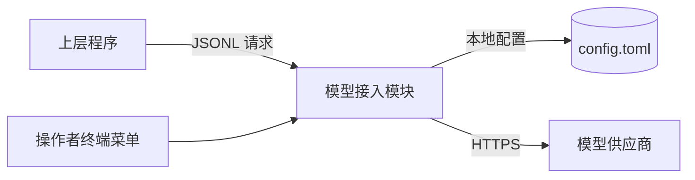
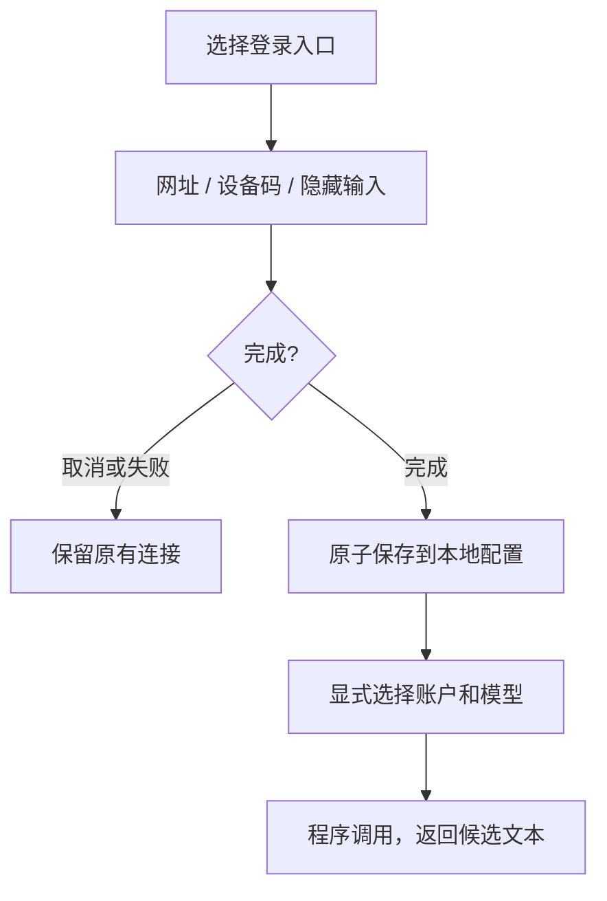

# 模型接入模块式样书

版本：3.2.0

对应设计书：[05_模型接入模块设计书](05_模型接入模块设计书.md)。需求编号 S5，验收编号 T5。

## 1 定位

模型接入模块（P5）为上层程序提供大语言模型的文本生成：

- 管理模型账户的登录、凭据刷新和退出；
- 列出每个账户可用的模型；
- 接受上层的一次生成请求，返回完整的候选文本，或返回脱敏的失败原因。

P5 与应用实例（P3）和 Web 管理台（P4）平级，可以独立启动。它没有文件读写、命令执行、交易、后台代理或自主工具调用的能力，也不访问 P1/P2 的内部实现或数据库。

**输出只是候选文本**：P5 不授予任何事实、事件、评分或交易资格。上层使用 P5 的输出时，资格由上层按自己的式样授予（例如 P3 的新闻研判）。

## 2 通道与账户

### S5-001 通道

P5 有两套通道：

| 通道 | 说明 |
|---|---|
| 多供应商通道 | 采用固定版本的上游登录注册表，覆盖其中全部登录方式（OAuth、设备码、浏览器会话、API Key、本地模型），包括 ChatGPT/Codex、Claude、Antigravity 等供应商 |
| 兼容通道 | 一个兼容 OpenAI Responses 的 API Key 通道和一个 ChatGPT 账户通道；另外可以交接给已安装的官方命令行程序（Claude、Antigravity）自行登录 |

- **登录入口随版本登记**：入口随锁定的上游版本登记，不用几个占位按钮代替。登录入口的别名与它实际保存到的供应商之间的对应关系可见。
- **工具凭据**：搜索等工具类凭据可以登录和退出，但明确标出用途，不能冒充文本模型。

### S5-008 账户与模型

- **显式选择**：每次调用都显式指定供应商、本地账户句柄和模型。P5 不自动切换账户、供应商、订阅或付费 API。
- **多个连接**：同一供应商可以有多个连接。本地句柄只用于选择，不显示邮箱、供应商账户编号或令牌。
- **目录注明来源**：模型目录注明来自供应商的实时发现、缓存还是上游内置目录。内置或缓存的目录不能说成账户授权已验证。
- **最终以调用为准**：对提供账户限定目录的通道，发现失败不能据此说账户可用；模型的最终可用性由实际调用的结果确认。
- **没有文本能力**：没有文本模型能力的凭据明确说明原因。

## 3 登录、刷新与退出

### S5-002 兼容通道的登录

- ChatGPT 账户通道使用供应商的动态客户端注册与授权码流程，检查身份、计划权限，退出时请求远端撤销。
- 官方命令行程序的登录由该程序自己完成；P5 只启动它，不读取它保存的凭据，也不把它们转成 API Key。

### S5-009 多供应商通道的登录

- **完整登录过程**：使用对应供应商的完整登录过程。操作者可以打开认证网址、回填设备码或授权码、输入隐藏的 API Key，或使用单独的浏览器会话。
- **不代填、不导入**：P5 不代填密码，不扫描或导入其他程序已保存的凭据。
- **可取消**：登录可以取消、超时或失败；未完成的新登录不能删除原有的有效连接。
- **只在操作者终端显示**：授权步骤和说明只显示在操作者的终端。远程终端可以看到并复制网址和回填说明。
- **浏览器会话**：需要能显示浏览器的桌面环境；缺少时明确提示，不会静默卡住。
- **保存才算成功**：保存成功才显示“连接已保存”，也不自动发送模型测试。
- **刷新**：凭据重启后可以继续使用，并按供应商协议刷新。同一个令牌同时只允许一次刷新；持久化失败后停止后续调用。
- **退出**：必须选择账户并确认，只删除该账户的本地凭据和缓存。没有远端撤销确认时，明确显示“本地已删除，远端撤销未确认”。不删除其他账户或兼容通道的凭据。

## 4 操作者菜单

### S5-006 交互式终端菜单

- **组件**：复用上游的供应商选择器、登录对话和模型选择组件。支持方向键、输入搜索、Enter、Esc、Ctrl+C，适应窄屏和窗口缩放。
- **主菜单**：
  - 登录 / 添加连接
  - 选择账户与模型（只选择，不发送请求）
  - 显式模型调用测试
  - 查看本地预算与连接状态
  - 设置推理边界
  - 退出一个连接
  - 兼容通道菜单
- **当前选择可见**：显示已选的供应商、账户句柄、模型和目录来源。选择本身不改变后台使用的模型，也不发送请求。
- **测试调用**：需要再次确认会占用额度。输入和完整结果只显示在操作者终端。
- **机器接口与菜单分开**：非终端环境拒绝打开菜单；机器接口的输出不混入颜色、菜单、认证网址或调试日志。
- **退出恢复**：正常退出、异常、中断和输入结束时，都恢复终端并释放配置锁。
- **缺少运行环境**：缺少运行时或浏览器时，给出可以照做的准备说明。

## 5 调用与预算

### S5-003 文本调用

- **请求内容**：上层通过公开接口提交唯一的请求编号、供应商、账户句柄、模型和输入文本。系统提示词由 P5 从本地提示词文件读取。
- **只返回明确成功的完整结果**：只有供应商明确以正常结束的完整纯文本才算成功，同时返回有限的数值用量；多供应商通道还返回本次所用提示词的哈希。
- **失败分别处理**：拒绝回答、工具调用、空结果、不完整、断流、超时和其他失败分别给出错误码。中间片段不能作为成功结果。
- **不自动重试**：超时、断流或终态不明时返回失败，不自动重试、不换账户、不换模型。可能已经送达的失败标为“送达未知”。
- **限流暂停**：多供应商通道的限流和 ChatGPT 通道的计划额度拒绝，会让该账户（通道）在当前进程中暂停后续生成。
- **错误脱敏**：不输出供应商的原始错误、身份或秘密。

### S5-004 本地预算

- **开关与边界**：生成有独立的总开关；单次超时、输入字节、输出字节和单行字节上限都必须明确配置为正数。登录和查看本地状态不要求打开生成开关。
- **次数默认不限**：每个账户的本地调用次数默认不设上限。次数上限为 0 时，不能因本地次数或缺少预算窗口而拒绝调用。只有操作者主动设置正数上限时，才按预算窗口限制，并且必须给出正数窗口。
- **先记录再发送**：每次生成前先持久记录这次尝试；失败不退还。
- **近期去重**：同一预算窗口内重复的请求编号不再发送。不限次数时只保留有界的最近请求编号，历史请求的业务幂等由调用者负责。
- **时钟回退**：系统时钟回退时拒绝调用。
- **与供应商额度无关**：本地统计不代表供应商的剩余额度。菜单明确显示“无限制”和“供应商剩余额度未知”。

## 6 本地配置

### S5-005 本地配置与隔离

- **一个本地配置**：P5 管理的全部配置、凭据和状态都保存在被 Git 忽略的 `config/config.toml` 中，不另建凭据库。提示词保存在本地的提示词文件中；仓库只提供空模板。
- **一个写进程**：同一份配置同时只允许一个进程使用；外部修改造成冲突时拒绝写入，不覆盖。
- **不泄漏**：状态、错误、文档、测试报告和日志中不含凭据、认证参数、提示词以及请求和响应正文。授权网址只显示给正在登录的操作者，不进入机器输出或日志。
- **运行时目录在本地**：模型目录缓存和临时浏览器配置只放在被忽略的本地运行目录中，路径上不允许符号链接。
- **环境隔离**：运行上游登录与推理代码的进程只继承必要的环境变量，不继承其他程序的供应商路由、认证覆盖或已有账户；交给官方程序的环境同样按白名单传递。

## 7 验收

| 编号 | 场景 | 应达到的效果 | 覆盖 |
|---|---|---|---|
| T5-01 | 兼容通道的请求协议 | 严格校验字段；未知字段、非法编号、缺少模型或输入被拒 | S5-001、S5-003 |
| T5-02 | ChatGPT 账户登录、刷新与退出 | 身份、计划权限、刷新时间和撤销语义正确；取消或超时不改变原有登录 | S5-002 |
| T5-03 | 官方命令行程序交接 | 只启动登记版本的原生程序；不读取其凭据；环境变量按白名单传递 | S5-002、S5-005 |
| T5-04 | 多供应商登录入口 | 与上游注册表一致，别名可见；重点入口可搜索并完成授权回调；工具凭据分类正确 | S5-001、S5-009 |
| T5-05 | 终端菜单 | 搜索、取消、隐藏输入、模型选择、窄屏和退出恢复正常 | S5-006 |
| T5-06 | 凭据持久化 | 重启后可用；并发刷新只发生一次；失败保留原连接；账户隔离；退出只删本账户；外部修改造成冲突时拒绝写入 | S5-005、S5-009 |
| T5-07 | 生成的成功与失败 | 只有明确正常结束的完整文本成功；拒绝、工具调用、空文本、不完整、断流、超时分别报错；不重试 | S5-003 |
| T5-08 | 输出与包络上限 | 超过输出字节、单行字节或流总量时失败并标为送达未知 | S5-003、S5-004 |
| T5-09 | 本地预算 | 默认 0 可连续调用；重启后近期重复编号被拒；正数上限到达后拒绝且不发送；有上限而无正数窗口时提示配置错误；不限次数时历史编号有界 | S5-004 |
| T5-10 | 限流与计划额度 | 多供应商通道的限流和 ChatGPT 的计划额度使当前进程暂停该账户；其他账户不受影响 | S5-003 |
| T5-11 | 机器接口 | 独立的 JSONL 进程；严格输入；标准输出只含协议响应；超长行拒绝 | S5-003、S5-006 |
| T5-12 | 隐私 | 输出、错误和日志中没有凭据、认证参数、提示词或正文 | S5-005 |
| T5-13 | 真实账户 | 操作者登录真实账户后，确认目录来源并完成一次获授权的非交易调用；未执行时状态为 `ACCOUNT_VALIDATION_PENDING` | S5-008 |

本地机制的验收不等于真实订阅资格、全部供应商现场可用或上层功能完成。真实账户的登录由操作者完成。
