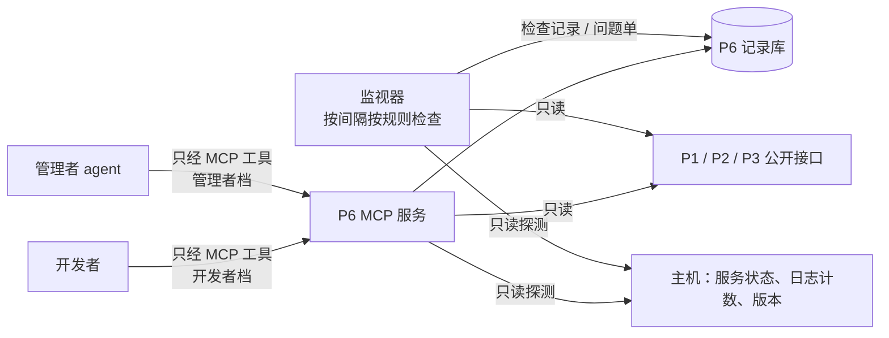
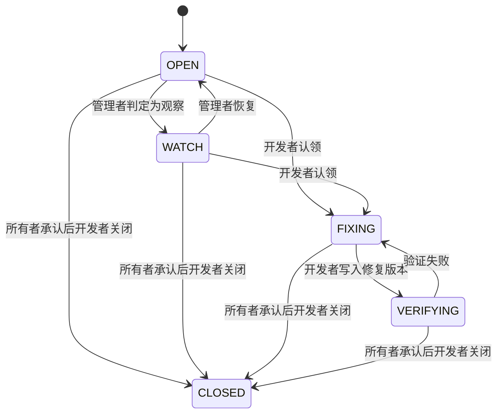

# 运维代理式样书

版本：4.1.1

对应设计书：[06_运维代理设计书](06_运维代理设计书.md)。需求编号 S6，验收编号 T6。

## 1 定位

运维代理（P6）让一个长期运行的管理者 agent 承担系统的日常值班：监控、诊断、登记问题、向所有者报告。它把散落在脚本、日志和手写文档里的运维知识变成**有编号的规则**和**结构化记录**，并通过 MCP 工具，以统一、可查询的方式把系统状态交给 agent。

P6 属于运维层，只读取交易层（P1）、策略层（P2）和应用层（P3）公开的接口，不导入它们的内部实现，也不直连它们的数据库。P6 有自己的记录库。关闭 P6 不影响交易保护、框架周期和实例运行；P6 也不是交易所的应急通道。

### S6-001 三种角色

| 角色 | 是谁 | 职责 | 不做 |
|---|---|---|---|
| 所有者 | 系统的使用者 | 做决定：参数、实例、资金、实盘、高风险操作、问题单是否关闭 | 不亲手执行任何操作，一律在对话中交给 agent |
| 管理者 | 长期运行的 agent，所有者可以随时与它对话 | 观察；开问题单、补证据、验证修复；写巡检报告；按所有者原话记录决定 | 改代码；读密钥；关闭问题单 |
| 开发者 | 开发用的编程助手会话 | 观察；认领问题单、写修复版本；改代码、出版本、部署（按仓库流程）；所有者在对话中承认后关闭问题单 | 不负责日常值班 |

- **所有者只做决定，执行全部由 agent 完成**：运行中的事与管理者商定，代码与问题单的事与开发者商定。
- **管理者与开发者只经 MCP 工具接触 P6**：工具没有提供的事，经 P6 做不了。
- **问题单是管理者与开发者之间的唯一接口**（S6-005）：管理者开单，开发者修复并在单上写版本，管理者验证；关闭需要所有者的承认，由开发者执行。

### S6-002 工具等级

每个 MCP 工具登记一个等级：

| 等级 | 内容 | 规则 |
|---|---|---|
| 观察 | 实例、状态、批次与成交、研判与准确率、检查记录、规则、问题单、报告、决定、剔除段（S6-007） | 随时可调，不改变任何状态 |
| 记录 | 问题单的开立、追加、状态推进；巡检报告；所有者决定；剔除段（S6-005、S6-006） | 只改变 P6 自己的记录；每次调用都留审计 |

P6 不提供改变下层状态或主机状态的工具，也不提供读取密钥、令牌的工具。

## 2 监视器

### S6-003 规则与检查

- **常驻**：监视器是常驻进程，按固定间隔检查每个登记实例和主机，不调用模型。
- **只认登记的规则**：每条规则有编号（`R-<序号>`）、名称、适用对象、判定条件、等级（`ANOMALY` / `WARN`）、开单严重度、良性例外和处置建议。例外必须写成规则条件的一部分（例如“服务启动后 180 秒内的读取失败”“一次性定时服务”），不能靠 agent 的记忆。
- **规则随代码发布**：规则定义在 P6 代码里，改规则走代码变更，并升规则版本；每条检查记录带上所用的规则版本。
- **检查记录**：每次检查得出一组命中。与同一实例上一条记录规则版本相同、命中相同、间隔不长的连续检查合并成一个区间，记录次数和最近一次的证据；命中一变就另起一条。
- **证据脱敏**：证据只含状态、编号、时间、计数和数值，不含令牌、连接串、密钥、提示词或新闻正文。

### S6-004 主机探测

- 监视器读取登记服务的运行状态、上一次检查以来日志中结构化告警的计数、各服务程序的版本与 main 是否一致、主机温度和负载。
- 主机探测只读；只执行登记的固定命令，参数不经命令行解释器拼接。
- 部署重启期间的日志（服务被停止和重新启动时打印的内容）不计入告警。

## 3 问题单与记录

### S6-005 问题单

- **字段**：编号、标题、严重程度（高 / 中 / 低）、状态、来源（规则来源键或管理者）、涉及实例、首次和最近出现时间、出现次数、修复版本、是否已验证、全部历史记录。
- **状态**：

- **关闭**：只能由开发者执行，并且必须附上所有者在对话中的原话。管理者的验证记在单上，但不能关闭。
- **自动开单与合并**：规则命中 `ANOMALY` 时，没有同来源的未关闭问题单就新开一张，有就更新最近出现时间；间隔较长后再次命中算一次新的出现。关闭后再命中开新单。
- **严重程度**：让实例不能正常运行的命中（服务停止、交易运行异常、对账异常、保护单不符、决策停滞、租约过期、风险锁）开单时为高。

### S6-006 其他结构化记录

| 记录 | 内容 | 谁写 |
|---|---|---|
| 巡检报告 | 一次巡检的结论：发现了什么、处理了什么、涉及哪些问题单 | 管理者或开发者 |
| 所有者决定 | 时间、所有者原话、决定内容、涉及的实例或问题单 | 管理者或开发者 |
| 剔除段 | 实例（或全部实例）、起止时间、原因、问题单编号；比较实验结果和准确率时排除 | 管理者或开发者 |
| 工具审计 | 每次记录类工具调用：档案、工具、参数摘要、时间、结果 | P6 |

- 记录只追加或按状态推进，不删除。
- 记录不含凭据、令牌、连接串或下层状态原文。

## 4 观察

### S6-007 观察内容

观察工具以实例为单位回答下列问题：

- **实例**：有哪些实例，各自的测试目的、登记设置，以及与多数实例不同的设置。
- **现在的状态**：交易运行状态、账户、执行器租约、标记价、持仓与保护单、最新决策与研判、服务状态与版本、应用层的批次与研判链，以及按登记规则判出的命中。
- **过去发生了什么**：批次（开仓到平仓）及其盈亏和 R、成交、决策历史、研判、注入等动作。
- **研判准确率**：
  - 每条有方向的研判，按研判时刻的价格与之后若干个登记时长（默认 4、24、48 小时）以及研判自带时长的价格比较，价格朝研判方向变化即为命中；
  - 按时长、方向、信心档位分别统计命中率与样本数；观望研判单独计数，并给出其间价格变化的平均幅度；
  - 可以剔除登记的剔除段；
  - 价格取交易层的公开 K 线；缺价格的研判不计入分母，时长未结束的研判不计入。
- **运维**：检查记录、规则、问题单及其历史、巡检报告、所有者决定、剔除段。

- 观察工具返回结构化数据，字段名稳定。
- 读取失败时如实列出不可用的来源和原因，不用旧数据冒充当前状态。

## 5 MCP 服务与档案

### S6-008 档案

MCP 服务按启动时指定的档案提供工具：

| 档案 | 观察 | 问题单 | 其他记录 |
|---|---|---|---|
| `manager` | 全部 | 开单、追加、`OPEN↔WATCH`、验证失败退回、记录验证 | 巡检报告、所有者决定、剔除段 |
| `developer` | 全部 | 追加、认领、写修复版本、带所有者原话关闭 | 巡检报告、所有者决定、剔除段 |

- 档案以外的工具不出现在工具列表中，调用时被拒绝。
- 工具参数严格校验，未知字段被拒绝；错误只返回代码。

## 6 本地配置与秘密

### S6-009 本地配置

- 实例登记（各层标识、接口地址、只读令牌所在的本地文件、服务名）、主机探测的参数和记录库的连接都放在被 Git 忽略的本地配置中，不进入仓库。
- 令牌和连接串文件必须只有所有者可以读取；内容只在进程内使用，不出现在工具结果、记录、日志或错误中。
- P6 只使用只读令牌。

## 7 验收

| 编号 | 场景 | 应达到的效果 | 覆盖 |
|---|---|---|---|
| T6-01 | 工具等级与档案 | 每个工具登记等级；档案以外的工具不在列表中且调用被拒；参数中的未知字段被拒 | S6-002、S6-008 |
| T6-02 | 规则判定 | 每个条件给出登记的等级；良性例外不报；规则完整登记了条件、例外和处置 | S6-003 |
| T6-03 | 检查记录合并 | 连续无命中或命中相同的检查合并为区间；命中变化时另起记录；记录带规则版本 | S6-003 |
| T6-04 | 自动开单与合并 | 同来源 `ANOMALY` 只开一张单；间隔较长的再次命中计为新出现；关闭后再出现开新单 | S6-005 |
| T6-05 | 问题单状态 | 只允许登记的转移；修复版本只能由开发者写；关闭只能由开发者带所有者原话执行 | S6-005 |
| T6-06 | 研判准确率 | 命中按方向与价格变化计算；观望单独计数；缺价格的研判不进分母；未到期的不计入；剔除段生效 | S6-007 |
| T6-07 | 脱敏 | 工具结果、记录、日志和错误中没有令牌、连接串、密钥、提示词或正文 | S6-003、S6-009 |
| T6-08 | 读取失败 | 下层不可用时列出不可用的来源，不返回旧数据冒充当前 | S6-007 |
| T6-09 | 主机探测 | 只执行登记的固定命令；参数不经命令行解释器；部署重启期间的日志不计入告警 | S6-004 |
