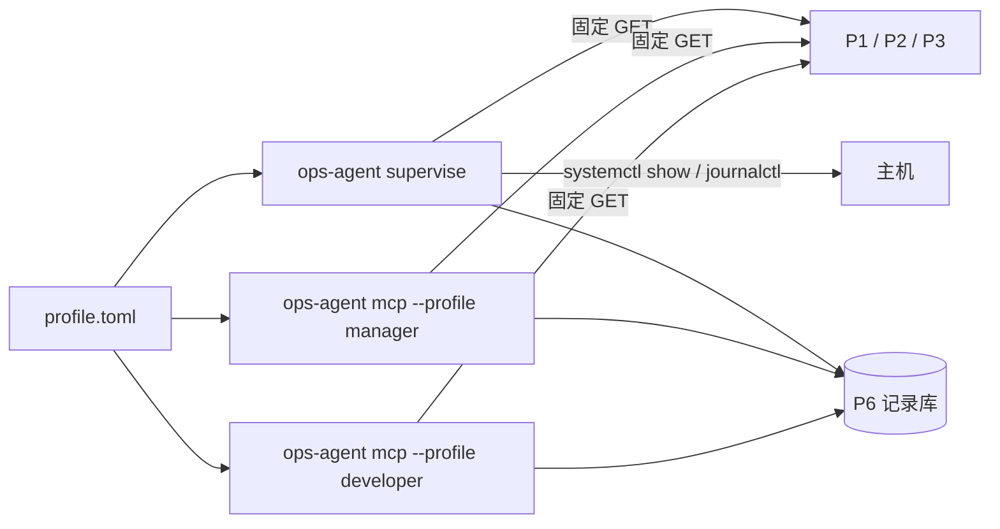

# 运维代理设计书

版本：4.1.0

对应式样书：[06_运维代理式样书](06_运维代理式样书.md)。本书说明 `src/factorforge/operations/agent` 的实现。

## 1 结构

### 1.1 包

| 包 | 职责 |
|---|---|
| `domain` | 一次检查读到的快照（`Snapshot`、`HostSnapshot`）、登记规则（`Rules`、`Evaluate`、`EvaluateHost`）、问题单状态与转移（`Move`）、研判准确率（`Scorecard`、`CandlePrices`、`Excluder`）、记录类型 |
| `ports` | `Lower`（下层公开读取）、`Host`（主机只读探测）、`Store`（记录库） |
| `application` | 快照采集（`Collector`）、监视器（`Supervisor`）、观察查询（`Observer`）、按档案改变记录（`Records`） |
| `adapters` | 下层固定 GET（`LowerHTTP`）、主机探测（`HostProbe`） |
| `adapters/postgres` | 记录库（`Store`）与迁移 |
| `api/mcp` | MCP 服务（`Server`）与工具登记（`Tools`） |
| `config` | 本地配置的读取与校验（`Load`） |
| `entrypoints/ops-agent` | 进程入口 |

P6 只经 HTTP 读取 P1/P2/P3 的公开接口，不导入它们的包，也不连接它们的数据库。

### 1.2 进程

`ops-agent` 有三个子命令，都要 `--config <profile.toml>`：

- `supervise`：常驻；每 `interval_seconds` 做一次检查（`Supervisor.Run`），每次在标准输出打一行 JSON 摘要（时间、`ANOMALY` 与 `WARN` 数、新开问题单编号、失败代码），不含证据。
- `sweep`：只做一次检查并打印结果，用于部署后核对。
- `mcp --profile manager|developer`：在标准输入输出上提供 MCP 服务，由 agent 的客户端以子进程启动。

启动失败时只输出 `OPS_AGENT_START_FAILED <代码>` 并退出，不打印配置内容。

## 2 本地配置（`config.Load`）

配置是被 Git 忽略的 TOML 文件，严格解码，未知字段拒绝（`PROFILE_INVALID`）。

**顶层字段**：

- `schema_version`：必须为 1。
- `database_url_file`：记录库连接串所在的文件。
- `schema`：记录库的模式名（小写字母开头，只含小写字母、数字和下划线，最长 41 个字符）。
- `interval_seconds`：检查间隔，10～3600 秒。
- `timeout_seconds`：单次下层读取和单条主机命令的超时，1～300 秒。
- `max_response_bytes`：单次下层响应的上限，至少 1024 字节。
- `scorecard_horizons`：准确率的比较时长（小时，1～336），缺省为 4、24、48。

**`[host]`**：

- `systemctl`、`journalctl`：两个程序的绝对路径，必填。
- `repository`：仓库目录，用于读取 main 的版本；为空时不判 R-013。
- `thermal`：温度文件的通配路径（每个文件是千分之一摄氏度）；为空时不判 R-101。
- `revision_skip`：正则表达式；可执行文件路径匹配时不读它的版本（运维工具、代理等不由仓库构建的程序）。

**`instances`**（`[[instances]]` 表数组，至少一个）：

- `instance_id`、`object_id`、`environment`（`SIM` / `LIVE`）、`account_id`、`run_id`、`venue`、`instrument_id`：实例在各层的标识。`instance_id` 不能重复，也不能是 `host`。
- `units`：这个实例的 systemd 用户服务名。
- `trading`、`strategy`、`application`（即 `[instances.trading]` 等三个子表）：三层的接口地址 `url` 与只读令牌文件 `token_file`。

**私有文件（`readPrivate`）**：连接串文件和令牌文件必须是普通文件（不跟随符号链接）、组和其他用户没有任何权限、不超过 1 MiB，否则 `PRIVATE_FILE_REQUIRED`。读入后只保存在进程内存。

**地址**：`https` 任意主机；`http` 只允许本机回环地址。不走系统代理，不跟随重定向。

## 3 下层读取（`LowerHTTP`）

只发 `Routes` 表里的 GET，路径参数由绑定填入，查询参数只接受表里登记的键：

| 名称 | 路径 | 可用查询 |
|---|---|---|
| `trading.run` | `/api/v2/trading/runs/{run_id}` | — |
| `trading.account`、`trading.alerts`、`trading.health`、`trading.points`、`trading.positions`、`trading.protections`、`trading.fills` | `/api/v2/trading/` 下对应视图（`trading.health` 为 `operational-health`） | — |
| `trading.candles` | `/api/v2/trading/market/candles` | `interval`、`start`、`end` |
| `strategy.object`、`strategy.policy`、`strategy.batches` | `/api/v2/strategy/objects/{object_id}` 及其下 | — |
| `strategy.decisions` | `…/decisions` | `limit` |
| `strategy.history` | `…/decision-history` | `from`、`to`、`cursor`、`limit` |
| `instance.status` | `/api/v2/instances/{instance_id}/dynamic/status` | — |
| `instance.judgments`、`instance.actions`、`instance.plans` | 同上目录 | `cursor`、`limit`、`from`、`to` |

交易层请求自动带上 `environment`、`account_id`、`run_id`（读取运行本身时不带 `run_id`），K 线另带 `venue`、`instrument_id`。

失败只返回代码：`LOWER_UNAVAILABLE`、`LOWER_SCOPE_REVOKED`（401/403）、`LOWER_NOT_FOUND`、`LOWER_FILTER_INVALID`（400/422）、`LOWER_RATE_LIMITED`、`LOWER_RESPONSE_BUDGET`（超过 `max_response_bytes`）、`LOWER_RESPONSE_INVALID`（不是 JSON）。

## 4 主机探测（`HostProbe`）

- **服务**：对每个登记服务执行 `systemctl --user show <服务> --timestamp=unix --property=ActiveState,SubState,UnitFileState,Type,StateChangeTimestamp,InactiveExitTimestamp,ExecStart`，参数以数组传递，不经命令行解释器。`StateChangeTimestamp` 是进入当前状态的时间（`EnteredAt`），`InactiveExitTimestamp` 是最近一次启动的时间（`StartedAt`）；启动中的服务还没有新的“进入运行”时间，所以不用 `ActiveEnterTimestamp`。服务名必须匹配 `^[A-Za-z0-9_.@-]{1,200}\.(service|timer)$`。子进程的环境只有 `XDG_RUNTIME_DIR` 和 `LANG=C`。
- **版本**：从 `ExecStart` 的 `path=` 取可执行文件，用 Go 的构建信息（`debug/buildinfo`）读 `vcs.revision`；不是 Go 构建的程序没有版本。
- **main**：读仓库 `.git/refs/remotes/origin/main`，没有时在 `.git/packed-refs` 里找 `refs/remotes/origin/main`。
- **日志告警**：有上一次检查时间时，执行 `journalctl --user --unit <服务> --since @<秒> --output cat --no-pager --quiet`，只按行匹配 `"alert":"<代码>"` 计数，不保存正文。
- **主机**：`thermal` 匹配的文件里的最高温度，`/proc/loadavg` 的 1 分钟负载。

## 5 快照与规则

### 5.1 采集（`Collector.Collect`）

并发读取 `trading.run`、`trading.account`、`trading.alerts`、`trading.health`、`trading.points`（取 `MARK`）、`trading.positions`、`trading.protections`（只留未关闭的）、`strategy.decisions`（取周期开始最晚的一条；周期开始取 `cycle_id` 冒号后的时间，解析不了时用 `available_cutoff`）、`instance.judgments`（最新一条），以及主机的服务状态和 main 版本。读取失败的来源以路由名记入 `Unavailable`，对应字段为空。

列表响应可以是裸数组、`{"items": [...]}` 或 `{"data": [...]}`。风险锁、运行健康问题可以是字符串数组或带 `code` / `kind` 的对象数组。

### 5.2 规则（`Rules`）

`RulesVersion` 当前为 `2`；任何规则的条件、等级或例外变化都要升它。规则按编号顺序判定，命中写成 `Hit{Rule, Level, Instance, Subject, Summary, Evidence}`；`Rule/Instance/Subject` 是问题单的来源键。

| 编号 | 名称 | 等级 | 开单严重度 | 判定要点 |
|---|---|---|---|---|
| R-001 | 下层读取失败 | WARN | 中 | `Unavailable` 的每个来源；所属层的服务启动（`StartedAt`）不满 `RestartGrace`（180 秒）时不报 |
| R-002 | 服务未运行 | ANOMALY | 高 | 不是 `active/running`；`Type=oneshot`、`disabled`+`inactive` 不判；`activating`/`reloading` 进入该状态（`EnteredAt`）未满 180 秒不报；读不到状态也报 |
| R-003 | 交易运行不是 NORMAL | ANOMALY | 高 | `state ≠ NORMAL` 或 `reasons` 非空 |
| R-004 | 账户风险锁 | ANOMALY | 高 | `risk_state ≠ NORMAL` 或有锁 |
| R-005 | 交易层新告警 | ANOMALY | 中 | 告警时间晚于上一次检查（首次检查取最近 15 分钟），按代码计数，代码为 `Subject` |
| R-006 | 交易层运行健康问题 | ANOMALY | 中 | `issues` 非空 |
| R-007 | 标记价过期 | ANOMALY | 中 | 缺失或超过 `MarkStaleAfter`（5 分钟）；`trading.points` 读取失败时不判 |
| R-008 | 持仓对账或过渡异常 | ANOMALY | 高 | `reconciliation_state ≠ NORMAL`，或 `transition_state` 不是 `STABLE` / `CLOSED` |
| R-009 | 保护单与持仓不符 | ANOMALY | 高 | 持仓非零时 `STRATEGY` 与 `INSURANCE` 各恰好一张，`ACTIVE_VERIFIED`、覆盖数量等于持仓绝对值、方向一致、触发价未越过标记价；空仓时没有未关闭保护单；持仓或保护单读取失败时不判 |
| R-010 | 策略决策停滞 | ANOMALY | 高 | 最新周期超过 `DecisionStaleAfter`（15 分钟） |
| R-011 | 研判停滞 | WARN | 中 | 最新研判超过 `JudgmentStaleAfter`（70 分钟） |
| R-012 | 最新研判失败 | WARN | 中 | 最新研判 `ok=false` |
| R-013 | 程序不是最新 main | WARN | 中 | 有版本的服务与 main 不一致（前缀相同即视为一致） |
| R-014 | 服务日志告警 | WARN | 低 | 上一次检查之后的告警计数；服务启动时间晚于“上一次检查减 180 秒”的不计 |
| R-015 | 执行器租约过期 | ANOMALY | 高 | `lease_epoch > 0` 且 `lease_until` 已过 |
| R-101 | 主机过热 | WARN | 低 | 最高温度超过 `HotTemperatureC`（90°C） |

每条规则另有自然语言的条件、例外和处置建议，`list_rules` 原样返回。

## 6 监视器（`Supervisor.Sweep`）

1. 每个实例并发：取该实例上一次检查的时间（`LastSweep`），采集快照，用 `Evaluate` 判定。
2. 主机：探测后用 `EvaluateHost` 判定，实例名记为 `host`。
3. 写检查记录（`RecordCheck`），再对每条 `ANOMALY` 调 `Occur`：没有同来源的未关闭问题单就新开一张（严重度取规则登记值，标题为“规则编号 实例：摘要”），有就更新最近出现时间。
4. 一个实例的记录库失败不影响其他实例，失败代码进入结果的 `Failures`。

## 7 记录库（`adapters/postgres`）

### 7.1 迁移

`Open` 连接后，在一个事务里先取 `pg_advisory_xact_lock(hashtext('factorforge-ops-agent:<schema>'))`，再执行 `migrations/*.sql`（把 `__SCHEMA__` 换成模式名）。迁移全部是 `IF NOT EXISTS`，监视器和每个 MCP 进程都可以安全地重复执行。

### 7.2 表

| 表 | 内容 |
|---|---|
| `check_record` | 实例、起止时间、合并次数 `sweeps`、`rules_version`、命中键 `hit_key`、命中 `hits` |
| `issue` | 问题单；编号 `I-<四位序号>` 取自 `issue_seq` |
| `issue_entry` | 问题单记录：时间、操作者、种类（`OCCURRENCE` / `EVIDENCE` / `NOTE` / `STATE` / `FIX` / `VERIFY`）、状态变化、正文、所有者原话、证据 |
| `report` | 巡检报告 |
| `owner_decision` | 所有者决定 |
| `exclusion` | 剔除段；编号 `X-<四位序号>` |
| `tool_audit` | 改变记录的工具调用：档案、工具、参数摘要（最长 300 字）、结果代码 |

### 7.3 合并与出现

- **检查记录合并**：命中键是全部命中“等级:来源键”排序后的拼接，无命中为空串。新检查与该实例最新一条记录的规则版本相同、命中键相同、间隔不超过 `MergeGap`（30 分钟）时，只把终止时间推到本次、`sweeps` 加一、命中换成本次的；否则新起一条。所以无命中的连续检查和命中相同的连续检查都合成区间，命中一变就分段。
- **出现次数**：同一张单上，距上次出现超过 `MergeGap` 的命中算一次新出现，追加一条 `OCCURRENCE` 记录；间隔内的连续命中只更新最近出现时间。
- **状态推进**：`Append` 在行锁下核对问题单的当前状态仍等于调用者读到的状态，不等时返回 `ISSUE_CHANGED`。`STATE` 和 `FIX` 记录同时改状态（`FIX` 另写修复版本）；回到 `FIXING` 时清除已验证标记；`VERIFY` 只设已验证标记。

## 8 问题单的操作（`Records`）

| 操作 | 档案 | 规则 |
|---|---|---|
| `OpenIssue` | 管理者 | 标题、说明必填（最长 4000 字），严重度为 `HIGH` / `MEDIUM` / `LOW`；来源记为 `manager` |
| `Note` | 两者 | 已关闭的单不能追加；带证据时种类为 `EVIDENCE` |
| `Move` | 两者 | 按 `domain.transitions`：管理者 `OPEN↔WATCH`、`VERIFYING→FIXING`；开发者 `OPEN/WATCH→FIXING`、`FIXING→VERIFYING`、`VERIFYING→FIXING`、任意未关闭状态 `→CLOSED`。理由必填；关闭必须带所有者原话（`OWNER_WORDS_REQUIRED`） |
| `Fixed` | 开发者 | 写修复版本并转入 `VERIFYING` |
| `Verify` | 管理者 | 只对 `VERIFYING` 的单；记验证依据并设已验证 |
| `Report`、`Decision`、`Segment` | 两者 | 巡检报告、所有者决定、剔除段；剔除段的实例可以是 `*`（全部实例） |

每个操作无论成败都写一条 `tool_audit`。

## 9 观察（`Observer`）

- **`List`**：读每个实例的 `instance.status`，取 `data.settings`（其中 `purpose` 为测试目的）。把设置展开成“点分键 → 值”，对每个键求多数值（超过半数的实例取同一值才算有多数），列出与多数不同的实例和值。
- **`Status`**：现读一次快照并用规则判定（不写检查记录），另附 `instance.status` 里的 `batch`、`next_entry`、`price_state`、`entry_gate`、`baseline`、`chain`、`last_judgment_id`、`equity_peak`。
- **`Raw`**：其余观察工具直接转发一条登记路由的读取。

### 9.1 研判准确率（`Observer.Scorecard`）

1. 区间 `[from, to)` 不超过 120 天。研判从 `instance.judgments` 读取（新的在前，按 `cursor` 翻页，每页 500 条，最多 200 页，遇到早于 `from` 的即停），只取 `ok=true` 的，按编号去重。
2. 价格取 `trading.candles` 的 5 分钟 K 线，从 `from` 前 1 小时到 `to` 加最长比较时长（不超过现在），每次请求 10 天。
3. `CandlePrices`：某时刻的价格是收盘时间不晚于它的最后一根 K 线的收盘价，且这根 K 线的收盘时间离该时刻不超过 15 分钟；否则视为缺价格。
4. `Scorecard`：对每个登记时长和 `OWN`（各研判自带的 `horizon_hours`）：
   - 剔除段内的研判计入 `excluded`；
   - 终点晚于现在的计入 `pending`；
   - 缺起点或终点价格、方向或时长缺失的计入 `undetermined`；
   - `FLAT` 计入 `flat`，并累计价格变化的绝对百分比，给出平均值；
   - `LONG` 涨、`SHORT` 跌为命中（价格不变算未命中），计入总数、按方向和按信心档位的分组。
   命中率保留三位小数。

## 10 MCP 服务（`api/mcp`）

- **传输**：标准输入输出上每行一条 JSON-RPC 2.0 消息，单行上限 4 MiB，逐条处理。
- **方法**：`initialize`（协议版本 `2025-06-18`，只声明工具能力）、`ping`、`tools/list`、`tools/call`。没有 `id` 的消息视为通知，不回复。
- **档案**：`NewServer` 只保留登记了该档案的工具；不在档案里的工具调用返回工具错误 `TOOL_NOT_IN_PROFILE`。
- **参数**：严格解码，未知字段返回 `ARGUMENTS_INVALID`；时间一律为 RFC3339。
- **结果**：JSON 文本，同时放在 `structuredContent`；超过 `MaxResultBytes`（256 KiB）返回 `RESULT_TOO_LARGE`。错误只返回代码。
- **列表的截取**：转发类工具（`list_batches`、`decision_history`、`list_judgments`、`list_actions`、`list_fills`）按时间字段降序，最多保留 `limit` 条（各工具有缺省值和上限），并标出是否截断。`decision_history` 缺起止时间时取最近 6 小时。

| 工具 | 等级 | 档案 |
|---|---|---|
| `list_instances`、`instance_status`、`list_batches`、`decision_history`、`list_judgments`、`list_actions`、`list_fills`、`judgment_scorecard`、`list_rules`、`list_checks`、`list_issues`、`get_issue`、`list_reports`、`list_owner_decisions`、`list_exclusions` | 观察 | 两者 |
| `open_issue`、`verify_issue` | 记录 | 管理者 |
| `set_issue_fixed` | 记录 | 开发者 |
| `add_issue_note`、`move_issue`、`write_report`、`record_owner_decision`、`add_exclusion` | 记录 | 两者 |

## 11 验证

| 验收 | 测试 |
|---|---|
| T6-01 | `tests/operations/agent/store_mcp_test.go` `TestMCPProfilesAndTools` |
| T6-02 | `rules_test.go` 全部 |
| T6-03、T6-04、T6-05 | `store_mcp_test.go` `TestStoreChecksAndIssues`、`issues_test.go` |
| T6-06 | `scorecard_test.go` |
| T6-07、T6-08 | `TestMCPProfilesAndTools`（错误只含代码、读取失败的来源列为不可用） |
| T6-09 | `HostProbe` 只以参数数组调用登记程序；部署重启期间的日志不计入告警见 `TestRulesConditionsAndExceptions` |

记录库测试使用临时的原生 PostgreSQL（`FACTORFORGE_TEST_PG_BIN`）。
