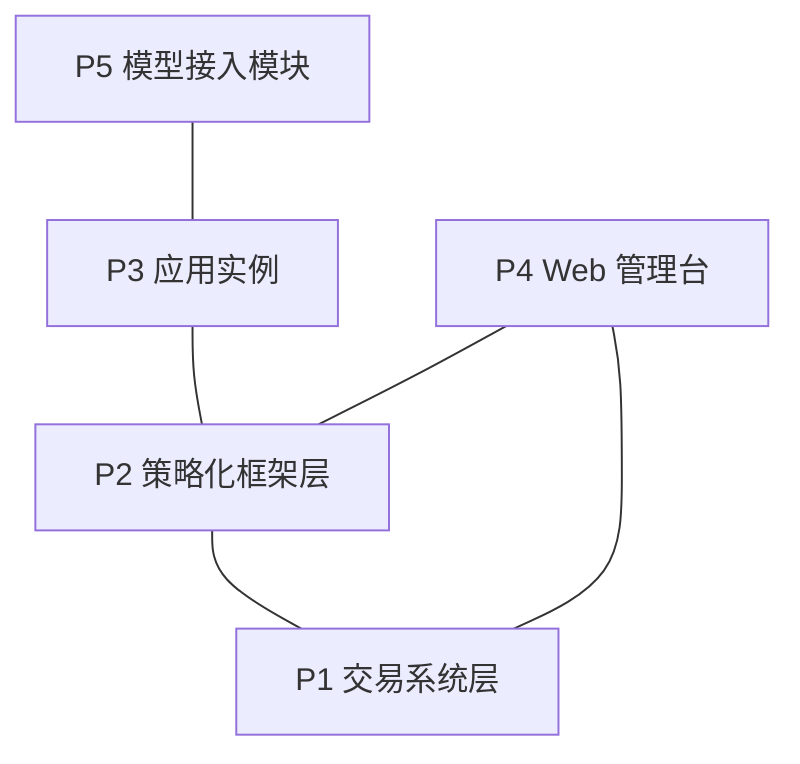

# Factorforge 文档

版本：2.21.2

这里是当前版本的式样书和设计书。版本号与根目录的 `VERSION` 一致；历史版本的文档在对应的 Git 标签中。

## 各层文档

| 层 | 内容 | 式样书 | 设计书 |
|---|---|---|---|
| P1 交易系统层 | 行情、订单、保护、账务与恢复 | [式样书](01_交易系统层式样书.md) | [设计书](01_交易系统层设计书.md) |
| P2 策略化框架层 | 事件准入、情绪账本、目标仓位、案例与参数学习 | [式样书](02_策略化框架层式样书.md) | [设计书](02_策略化框架层设计书.md) |
| P3 应用实例 | 一个交易对象的新闻研判、止损管理与事件分析 | [式样书](03_SOXLUSDT应用实例式样书.md) | [设计书](03_SOXLUSDT应用实例设计书.md) |
| P4 Web 管理台 | 只读的观察与追溯界面 | [式样书](04_Web管理台式样书.md) | [设计书](04_Web管理台设计书.md) |
| P5 模型接入模块 | 模型账户登录与文本生成 | [式样书](05_模型接入模块式样书.md) | [设计书](05_模型接入模块设计书.md) |

各层只通过公开接口协作。P1 和 P2 可以不依赖上层独立运行；P3、P4、P5 同属应用层，彼此平级。

## 式样书与设计书

- **式样书**写原理和验收：系统应该做什么、为什么、边界在哪里，以及用什么场景验收。需求编号为 `S<层>-<序号>`，验收编号为 `T<层>-<序号>`。
- **设计书**写实现逻辑：代码结构、数据、接口、算法和测试。配置字段在描述用到它的逻辑时说明，字段名与代码完全一致；示例中的数值只示意格式。

两本书都只描述当前版本，不记录开发过程、实验或运行记录。

## 版本

版本号为 `主.次.修订`，规则见 [CONTRIBUTING](../CONTRIBUTING.md)。每次发布登记在 [releases.json](releases.json)。
