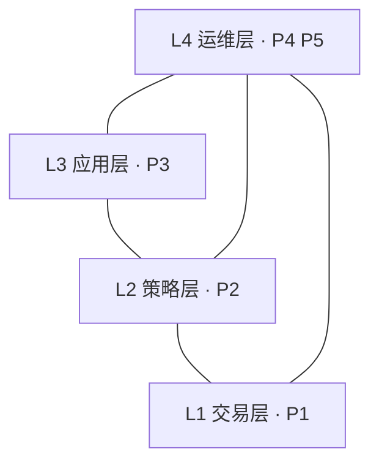

# Factorforge 文档

版本：3.1.0

这里是当前版本的式样书和设计书。版本号与根目录的 `VERSION` 一致；历史版本的文档在对应的 Git 标签中。

## 层、模块与式样

层是抽象的依赖层级；模块是有自己目录和入口的可构建单元，属于一层；式样是一份式样书加一本设计书，属于一层，覆盖一个或多个模块。一层可以有多个模块和多份式样。三者的对应关系登记在机器可读的 [layers.json](layers.json)。

| 层 | 式样 | 模块 | 内容 | 式样书 | 设计书 |
|---|---|---|---|---|---|
| L1 交易层 | S1 交易系统 | P1 | 行情、订单、保护、账务与恢复 | [式样书](01_交易系统式样书.md) | [设计书](01_交易系统设计书.md) |
| L2 策略层 | S2 策略化框架 | P2 | 事件准入、情绪账本、目标仓位、案例与参数学习 | [式样书](02_策略化框架式样书.md) | [设计书](02_策略化框架设计书.md) |
| L3 应用层 | S3 SOXLUSDT 应用 | P3 | 一个交易对象的新闻研判、止损与仓位管理、预排日程 | [式样书](03_SOXLUSDT应用实例式样书.md) | [设计书](03_SOXLUSDT应用实例设计书.md) |
| L4 运维层 | S4 Web 管理台 | P4 | 只读的观察与追溯界面 | [式样书](04_Web管理台式样书.md) | [设计书](04_Web管理台设计书.md) |
| L4 运维层 | S5 模型接入 | P5 | 模型账户登录与文本生成 | [式样书](05_模型接入模块式样书.md) | [设计书](05_模型接入模块设计书.md) |

依赖规则：

- 下层不依赖上层；一个模块只导入其他模块公开的包（`api/dto` 等），不导入内部实现。
- 运维层读取交易层、策略层和应用层公开的只读接口。
- 运维层的服务型模块（P5）可以被下层以进程协议调用（协议登记在 `contracts/`），其代码不能被导入。

## 式样书与设计书

- **式样书**写原理和验收：系统应该做什么、为什么、边界在哪里，以及用什么场景验收。需求编号为 `S<式样>-<序号>`，验收编号为 `T<式样>-<序号>`，式样编号见上表。
- **设计书**写实现逻辑：代码结构、数据、接口、算法和测试。配置字段在描述用到它的逻辑时说明，字段名与代码完全一致；示例中的数值只示意格式。

两本书都只描述当前版本，不记录开发过程、实验或运行记录。

## 版本

版本号为 `主.次.修订`，规则见 [CONTRIBUTING](../CONTRIBUTING.md)。每次发布登记在 [releases.json](releases.json)。
